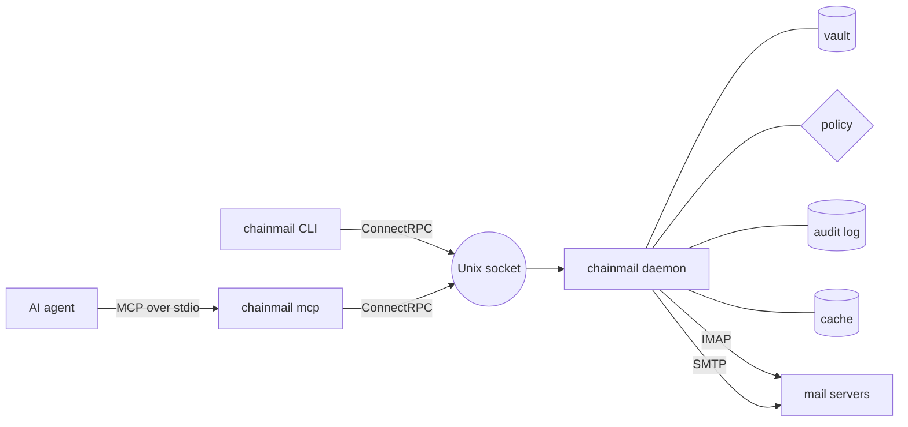

<p align="center">
  <picture>
    <source media="(prefers-color-scheme: dark)" srcset="docs/img/wordmark-dark.svg" />
    
  </picture>
</p>

<p align="center">
  <a href="https://github.com/yaklabco/chainmail/releases/latest"></a>
  <a href="https://github.com/yaklabco/chainmail/actions/workflows/ci.yml"></a>
  <a href="LICENSE"></a>
  <a href="https://chainmail.sh"></a>
</p>

**chainmail** is email for AI agents, behind a policy daemon.

## Why

- The daemon owns every password and token, in an age-encrypted vault, and no call ever returns one.
- A send to anyone off the allowlist is saved as a draft for you to review, never sent.
- Nearly every call is recorded in an append-only audit log.
- Agents reach the daemon over MCP, behind the same policy and audit log as the CLI.



## Install

```sh
brew install yaklabco/tap/chainmail
chainmail version
```

Homebrew installs the binary, its shell completions and its man page. It does not start the daemon; `chainmail bootstrap` does. Release archives, Nix and building from source are on the [install page](https://chainmail.sh/docs/getting-started/install).

## Set up

`chainmail bootstrap` sets up a production daemon that runs as its own user, with one account. Run it as yourself, not as root. It asks for sudo once.

```sh
chainmail bootstrap you@example.com
```

Bootstrap finds the provider from the address. It supports Gmail, Google Workspace, iCloud and Hostinger. `--provider` names one when the address does not show it. Bootstrap prints its plan, asks for the account's app password, and asks you to confirm. A Google Workspace account needs `--oauth-client-id`, and bootstrap asks for the OAuth client secret instead. Bootstrap then creates the `chainmail` user (`_chainmail` on macOS) and the `chainmail-clients` group. It installs the binary, the config, the vault key and the service. It starts the daemon, stores the password and tests the login. `--dry-run` prints the plan and changes nothing. A rerun adds another account or repairs the install.

When bootstrap makes a new vault key, it asks whether to back it up. The default is no backup. The key then stays on this machine, and only the daemon's user can read it. If the key is lost, nothing can read the stored passwords, but no mail is lost. [If the vault key is lost](#if-the-vault-key-is-lost) says how to recover. The other choice shows the key once on the terminal, for you to save in a password manager. Anything that can see the terminal at that moment sees the key too, including an agent watching the session. `--key-backup none` or `--key-backup show` answers the question in advance.

Bootstrap adds you to `chainmail-clients`. Log out and back in, or run `newgrp chainmail-clients`, before you use chainmail. The account is named after the address's local part, `you` here, unless `--name` picks another:

```sh
chainmail accounts list
chainmail folders --account you
chainmail search is:unread in:inbox
```

On macOS, bootstrap also writes your `cli.toml` so commands find the daemon's socket. Bootstrap supports Linux with systemd, NixOS and macOS. [On NixOS](#on-nixos) it works differently.

An agent that can run sudo without a password can get around all of this. Run agents from an account that cannot.

The [quick start](https://chainmail.sh/docs/getting-started/quick-start) goes on to Google accounts, sends and the policy, watching and items.

### On NixOS

On NixOS, the [NixOS module](https://chainmail.sh/docs/operations/deploy#nixos) runs chainmail, and bootstrap writes the files that configure it. Bootstrap never edits your NixOS configuration and never rebuilds. It never starts or restarts the daemon either.

```sh
chainmail bootstrap you@example.com --nix-dir ./chainmail-nixos
```

Bootstrap writes three files into `--nix-dir`, which is `./chainmail-nixos` by default. `chainmail.nix` turns on the module and adds you to `chainmail-clients`. `chainmail-you.nix` holds the account. `chainmail-vault-key.cred` is the vault key, sealed with `systemd-creds` so that only this machine can open it. None of the files holds a secret in the clear, so you can commit them.

Import the files from your NixOS configuration and add the chainmail flake input. Bootstrap prints the lines to add. Rebuild the way you normally do. Then run bootstrap again with the same address. It stores the password through the daemon and tests the login.

A second account works the same way. Bootstrap writes only that account's file, `chainmail-<name>.nix`, and needs no sudo for it. Import the file, rebuild, and run bootstrap again.

### If the vault key is lost

Bootstrap does not make a new key while the old vault is still there, because a new key could never open it. The error says `the vault /var/lib/chainmail/vault.age exists but the vault key /etc/chainmail/vault-key does not`.

If you saved the key, put it back. Paste it into a file called `vault-key`, install that file as the daemon's key with mode 0400, and delete the copy. Then run bootstrap again to check the install and start the daemon:

```sh
sudo install -o chainmail -g chainmail -m 0400 vault-key /etc/chainmail/vault-key
rm vault-key
chainmail bootstrap you@example.com
```

On macOS, use `-o _chainmail -g chainmail-clients` instead.

Without a saved key, the stored passwords and logins cannot be recovered. Move the old vault aside, then run bootstrap again:

```sh
sudo mv /var/lib/chainmail/vault.age /var/lib/chainmail/vault.age.lost
chainmail bootstrap you@example.com
```

Bootstrap makes a new key and asks for that account's password again. Run it once more for each other account, with the same address and options as before, to enter its password again. For an OAuth account, bootstrap asks for the OAuth client secret again and logs in through the browser. Without a terminal it cannot log in, and it tells you to run `chainmail auth login <name>`.

On NixOS, the key is the sealed credential `chainmail-vault-key.cred` in your NixOS configuration, and bootstrap does not make a new one while the module is installed. A reinstall loses the host key that sealed it, so the credential no longer opens. If you saved the key, put it in a file called `vault-key` in the directory that holds the old credential, and seal it again on this machine. The new credential replaces the old one only after it decrypts to a valid age identity, and the saved copy is deleted only after that. Then commit the new file and rebuild:

```sh
sudo nix shell nixpkgs#age -c bash -euo pipefail -c '
  systemd-creds encrypt --name=vault-key vault-key chainmail-vault-key.cred.new
  systemd-creds decrypt --name=vault-key chainmail-vault-key.cred.new - | age-keygen -y >/dev/null
  mv chainmail-vault-key.cred.new chainmail-vault-key.cred' && rm vault-key
```

Without a saved key, stop the daemon, move the old vault aside, and seal a new key in place of the old credential. Run the commands below in the directory that holds the old credential. One root shell makes the new key with `age-keygen` and pipes it straight into `systemd-creds`. The key never passes through a process of yours and is never shown. The new credential replaces the old one only after it decrypts to a valid age identity. Commit the new file and rebuild, which starts the daemon again. Then run bootstrap once for each account to enter its password again:

```sh
sudo systemctl stop chainmail
sudo mv /var/lib/chainmail/vault.age /var/lib/chainmail/vault.age.lost
sudo nix shell nixpkgs#age -c bash -euo pipefail -c '
  age-keygen 2>/dev/null | systemd-creds encrypt --name=vault-key - chainmail-vault-key.cred.new
  systemd-creds decrypt --name=vault-key chainmail-vault-key.cred.new - | age-keygen -y >/dev/null
  mv chainmail-vault-key.cred.new chainmail-vault-key.cred'
```

### Developing chainmail

`chainmail daemon --dev` runs a daemon as your own user, for work on chainmail itself:

> dev mode: this daemon runs as you, so any program running as you, including agents, can read the vault key and every stored password. Use it only to develop chainmail, never with real accounts.

```sh
chainmail daemon --dev --config ./config.toml --state-dir ./state \
    --vault-key-file ./vault-key --socket ./state/chainmail.sock
```

The [developer guide](https://chainmail.sh/docs/developers/architecture) covers building and testing.

## Features

- [Reading and search](https://chainmail.sh/docs/guide/reading-and-searching): `folders`, `search`, `get`, `thread` and `attachment` across every account, with Gmail-style operators. Reading never marks mail read.
- [Sending and drafts](https://chainmail.sh/docs/guide/sending): `send`, `send-raw`, `reply`, `forward` and `draft`, with Markdown bodies, attachments, dry runs and idempotency keys.
- [Organizing](https://chainmail.sh/docs/guide/organizing): move, copy, archive, trash, flags, Gmail labels and folders, with refs piped in from a search.
- [The send policy](https://chainmail.sh/docs/concepts/policy): sends off the allowlist are held as drafts, and `expunge` and `folder delete` are refused unless the config allows them.
- [The audit log](https://chainmail.sh/docs/guide/audit-log): an append-only table in `state.db`, read with `chainmail audit`, that never holds message content or secrets.
- [MCP](https://chainmail.sh/docs/agents/setup): `chainmail mcp` serves the tools to an AI agent over stdio.
- [Watching and events](https://chainmail.sh/docs/guide/watching): IMAP IDLE and polling feed a durable event log, and a named group resumes where it stopped.
- [The local cache](https://chainmail.sh/docs/concepts/cache): `cache.db`, indexed with SQLite FTS5, answers searches and reads when it is complete and fresh.
- [Work items](https://chainmail.sh/docs/guide/items): a tree of items from objectives down to tasks, with mail threads linked to them and events when they come due.
- [Rules](https://chainmail.sh/docs/guide/rules): rules in `state.db` label, file, forward and archive mail as it arrives, on a schedule or on demand. They match with the search language against the cache, and each action is audited.
- [Calendars](https://chainmail.sh/docs/guide/calendars): `calendars`, `agenda`, `event`, `invites`, `invite`, `rsvp` and `freebusy` read calendars and answer invites on Google accounts and CalDAV servers. `event create`, `event edit` and `event cancel` change events under the send policy.
- [NixOS module](https://chainmail.sh/docs/operations/deploy): runs the daemon as its own system user, with the vault key passed as an encrypted systemd credential.

## Calendars

chainmail reads and answers calendars on Google accounts through the Google Calendar API, and on CalDAV servers such as Mailwright. The daemon syncs them into `calendar.db`, next to `cache.db`, every 5 minutes by default. Ten MCP tools give agents the same calls, such as `agenda`, `rsvp` and `create_event`.

- Each account's `[accounts.<name>.calendar]` table sets `store` to `google`, `caldav` or `none`. A Google account that logs in with OAuth2 defaults to `google`, and every other account defaults to `none`.
- The cache finds invites in the new mail of every watched account. On an account with store `none`, `chainmail rsvp` answers them with an iCalendar REPLY email to the organizer.
- A Google account with store `google` asks for three calendar scopes. A token from before calendars lacks them, so mail keeps working and calendar calls fail with `AUTH_REQUIRED` until you run `chainmail auth login <account>`.
- A Mailwright account uses the `custom` provider with `auth = "oauth2"` and an OAuth client that has an `issuer`, such as a Keycloak realm. Its calendar table sets `store = "caldav"` and the server's `url`.
- The send policy checks every answer and every change that notifies anyone else. A held answer through the calendar changes nothing, and a held answer by email is saved to Drafts. A new event with an attendee off the allowlist becomes a draft event that invites no one, and you send its invitations from your calendar app.
- `chainmail watch --kind invite,event_changed,event_cancelled,invite_reply` reports new invites and changes to your events.

## Documentation

The manual is at [chainmail.sh](https://chainmail.sh).

- [Getting started](https://chainmail.sh/docs/getting-started/install): install, a first daemon, accounts and connecting an agent.
- [User guide](https://chainmail.sh/docs/guide/reading-and-searching): reading, sending, organizing, items, rules, calendars, watching, the audit log and CLI settings.
- [Agents](https://chainmail.sh/docs/agents/setup): setting up an MCP client and working with mail as an agent.
- [Operations](https://chainmail.sh/docs/operations/deploy): deploying, health checks, auth, upgrades, backups and troubleshooting.
- [Reference](https://chainmail.sh/docs/reference/configuration): configuration, commands, MCP tools and exit codes.
- [Developer guide](https://chainmail.sh/docs/developers/architecture): architecture, building, testing, the API and releasing.

## Status

chainmail is in active development. Releases are published on [GitHub](https://github.com/yaklabco/chainmail/releases) and in the [yaklabco/homebrew-tap](https://github.com/yaklabco/homebrew-tap) tap, and the [changelog](https://chainmail.sh/docs/reference/changelog) lists what each one changed.

## License

chainmail is released under the MIT license. See [LICENSE](LICENSE).
