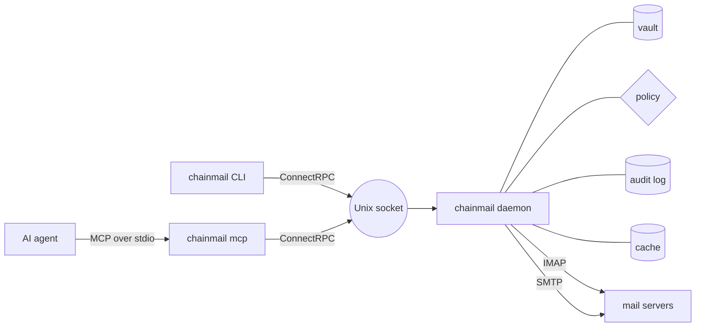

<p align="center">
  <picture>
    <source media="(prefers-color-scheme: dark)" srcset="docs/img/wordmark-dark.svg" />
    
  </picture>
</p>

<p align="center">
  <a href="https://github.com/yaklabco/chainmail/releases/latest"></a>
  <a href="https://github.com/yaklabco/chainmail/actions/workflows/ci.yml"></a>
  <a href="LICENSE"></a>
  <a href="https://chainmail.sh"></a>
</p>

**chainmail** is email for AI agents, behind a policy daemon.

## Why

- The daemon owns every password and token, in an age-encrypted vault, and no call ever returns one.
- A send to anyone off the allowlist is saved as a draft for you to review, never sent.
- Nearly every call is recorded in an append-only audit log.
- Agents reach the daemon over MCP, behind the same policy and audit log as the CLI.



## Install

```sh
brew install yaklabco/tap/chainmail
chainmail version
```

Homebrew installs the binary, its shell completions and its man page. It does not start the daemon. Release archives, Nix and building from source are on the [install page](https://chainmail.sh/docs/getting-started/install).

## A first look

This runs a development daemon as your own user, with one Hostinger account. The vault key comes from `age-keygen`, part of [age](https://age-encryption.org). Make the directories and the key:

```sh
mkdir -p ~/.config/chainmail-dev ~/.local/state/chainmail-dev
age-keygen -o ~/.config/chainmail-dev/vault-key
```

Save the config as `~/.config/chainmail-dev/config.toml`:

```toml
[accounts.site]
provider = "hostinger"
address = "me@example.com"
```

Start the daemon in a terminal of its own:

```sh
chainmail daemon --dev --config ~/.config/chainmail-dev/config.toml \
    --state-dir ~/.local/state/chainmail-dev \
    --vault-key-file ~/.config/chainmail-dev/vault-key \
    --socket ~/.local/state/chainmail-dev/chainmail.sock
```

In a second terminal, store the mailbox password, check the login, then list folders and search. Each client command names the same socket:

```sh
chainmail secret set accounts/site --socket ~/.local/state/chainmail-dev/chainmail.sock
chainmail accounts test site --socket ~/.local/state/chainmail-dev/chainmail.sock
chainmail folders --account site --socket ~/.local/state/chainmail-dev/chainmail.sock
chainmail search is:unread in:inbox --socket ~/.local/state/chainmail-dev/chainmail.sock
```

The [quick start](https://chainmail.sh/docs/getting-started/quick-start) goes on to a settings file for the socket, Google accounts, sends and the policy, watching and items.

## Features

- [Reading and search](https://chainmail.sh/docs/guide/reading-and-searching): `folders`, `search`, `get`, `thread` and `attachment` across every account, with Gmail-style operators. Reading never marks mail read.
- [Sending and drafts](https://chainmail.sh/docs/guide/sending): `send`, `send-raw`, `reply`, `forward` and `draft`, with Markdown bodies, attachments, dry runs and idempotency keys.
- [Organizing](https://chainmail.sh/docs/guide/organizing): move, copy, archive, trash, flags, Gmail labels and folders, with refs piped in from a search.
- [The send policy](https://chainmail.sh/docs/concepts/policy): sends off the allowlist are held as drafts, and `expunge` and `folder delete` are refused unless the config allows them.
- [The audit log](https://chainmail.sh/docs/guide/audit-log): an append-only table in `state.db`, read with `chainmail audit`, that never holds message content or secrets.
- [MCP](https://chainmail.sh/docs/agents/setup): `chainmail mcp` serves the tools to an AI agent over stdio.
- [Watching and events](https://chainmail.sh/docs/guide/watching): IMAP IDLE and polling feed a durable event log, and a named group resumes where it stopped.
- [The local cache](https://chainmail.sh/docs/concepts/cache): `cache.db`, indexed with SQLite FTS5, answers searches and reads when it is complete and fresh.
- [Work items](https://chainmail.sh/docs/guide/items): a tree of items from objectives down to tasks, with mail threads linked to them and events when they come due.
- [Rules](https://chainmail.sh/docs/guide/rules): rules in `state.db` label, file, forward and archive mail as it arrives, on a schedule or on demand. They match with the search language against the cache, and each action is audited.
- [NixOS module](https://chainmail.sh/docs/operations/deploy): runs the daemon as its own system user, with the vault key passed as an encrypted systemd credential.

## Documentation

The manual is at [chainmail.sh](https://chainmail.sh).

- [Getting started](https://chainmail.sh/docs/getting-started/install): install, a first daemon, accounts and connecting an agent.
- [User guide](https://chainmail.sh/docs/guide/reading-and-searching): reading, sending, organizing, items, rules, watching, the audit log and CLI settings.
- [Agents](https://chainmail.sh/docs/agents/setup): setting up an MCP client and working with mail as an agent.
- [Operations](https://chainmail.sh/docs/operations/deploy): deploying, health checks, auth, upgrades, backups and troubleshooting.
- [Reference](https://chainmail.sh/docs/reference/configuration): configuration, commands, MCP tools and exit codes.
- [Developer guide](https://chainmail.sh/docs/developers/architecture): architecture, building, testing, the API and releasing.

## Status

chainmail is in active development. Releases are published on [GitHub](https://github.com/yaklabco/chainmail/releases) and in the [yaklabco/homebrew-tap](https://github.com/yaklabco/homebrew-tap) tap, and the [changelog](https://chainmail.sh/docs/reference/changelog) lists what each one changed.

## License

chainmail is released under the MIT license. See [LICENSE](LICENSE).
