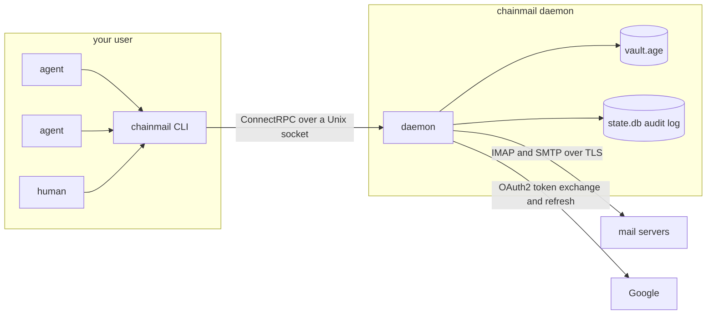

# chainmail

Email for AI agents. chainmail is one Go binary that lets agents read, write and organize mail over IMAP and SMTP without ever holding a password or token. A long-running daemon owns every credential and every connection to the mail servers. Agents talk to it through the `chainmail` CLI, which is a thin client on a Unix socket. Every call except `admin status` is written to an audit log.

Three sub-projects exist today. Sub-project 1, the foundation, is the daemon and its socket, the vault, password and OAuth2 login, `secret set`, `auth login` and `accounts test`. Sub-project 2 reads mail: `folders`, `search`, `get`, `thread` and `attachment`. Sub-project 3 writes and organizes it: `send`, `send-raw`, `reply`, `forward` and `draft`, then `move`, `copy`, `archive`, `trash`, `expunge`, the flag and label commands, `folder`, and `accounts probe`. Policy, approvals and the MCP server arrive in later sub-projects.



## Security model

- **The daemon owns the credentials.** Passwords, OAuth client secrets and refresh tokens live in the daemon's vault and nowhere else. The CLI holds no secrets and no mail logic. In production the daemon runs as its own `chainmail` system user with its state in `/var/lib/chainmail` (mode `0700`), which your user can't read. The NixOS module that sets this up arrives in sub-project 4. Until then the daemon runs with `--dev` as your own user, which is for development only: anything running as you can read a dev vault's key.
- **Secrets go in and never come out.** `chainmail secret set` and `chainmail auth login` write secrets. No API call returns one. `chainmail admin status` lists secret names only.
- **The vault is encrypted at rest.** `vault.age` is an [age](https://age-encryption.org) file. In production its key arrives through systemd `LoadCredentialEncrypted=`, sealed to the host's TPM2, at `$CREDENTIALS_DIRECTORY/vault-key`. In development it is a file passed with `--vault-key-file`. The daemon refuses a key file that others can access. The file must either be owned by the daemon's user with no group or other bits (`0600` or `0400`), or be owned by `root:root` with no other bits and at most group read. The second form exists because systemd delivers a `LoadCredential` file as `0440 root:root` and grants the service user read access through an ACL.
- **The socket has a group and a peer check.** The daemon creates its socket with mode `0660`. In production it sets the socket's group to `client_group` (default `chainmail-clients`). On every connection it reads the peer's credentials with `SO_PEERCRED` and allows only its own user and members of the client group. Membership is looked up per request, so adding a user to the group takes effect without a restart. Release builds are pure Go (`CGO_ENABLED=0`), so users, groups and memberships are read from `/etc/passwd` and `/etc/group`, not through NSS. A user or membership that exists only in NSS, such as one from LDAP or SSSD, is refused. A dev daemon allows only your own user. A refused peer gets `FORBIDDEN` (exit 3).
- **There is no send gate yet.** Until sub-project 4 adds the policy engine, any client that passes the socket's peer check can send mail as any configured account, to anyone, and can move, trash and expunge mail. Nothing holds a send for approval. Give the socket only to users and agents you trust to send as you. Every send and every change is audited, so you can see afterwards what was done.
- **Every change is audited.** The `audit` table in `state.db` records the time, caller UID, client kind (`cli`, `live-test`, or `daemon` for work the daemon starts itself, such as a background probe), account, action, targets, result and error reason for each call. The audited reads are `accounts.list`, `account.test`, `secret.set`, `auth.login.begin`, `auth.login.finish`, `folders.list`, `search`, `get`, `get.raw`, `thread` and `attachment`. The audited writes are `send`, `send_raw`, `reply`, `forward`, `upload`, `draft.create`, `draft.update`, `draft.send`, `draft.delete`, `move`, `copy`, `archive`, `trash`, `expunge`, `flags`, `labels`, `folders.create`, `folders.rename`, `folders.delete` and `limits.probe`. A send's row names the account and the Message-ID, never the recipients, subject or body. A reply or forward row also names the original's ref, and a draft row the draft's ref. A batch that spans accounts records one row per account, a repeated send records the decision `duplicate`, and a dry run the decision `dry_run`. The client kind is self-reported in the `Chainmail-Client` header, so any local caller can claim any kind. The caller UID comes from the socket and is the authoritative identity. Rows never contain secret values or message content. A read's row holds counts and refs only, never subjects, addresses or the search query. An account or secret name that is not a valid name, or a client kind that is not a short lowercase name, is recorded as `(invalid)`, and the call fails with `INVALID_ARGUMENT`. The table is append-only: triggers refuse updates and deletes. If the audit write fails, the call fails too, so chainmail never reports success for something it could not record. A `chainmail audit` reader arrives in sub-project 4. Until then, query `state.db` with `sqlite3`.
- **Root is out of scope.** chainmail stops accidents and prompt injection that run through chainmail. It does not stop an agent that can become root. If your user has passwordless sudo or is in the `docker` group, an agent with an unrestricted shell can read the vault through root. Closing that gap means running agents without sudo or docker, which is outside chainmail.

## Build

With Nix:

```fish
nix build
./result/bin/chainmail version
```

Or inside the dev shell, which provides Go, buf, golangci-lint, gotestsum and age:

```fish
nix develop -c go tool stave build
./bin/chainmail version
```

Other stave targets: `check` (the default, and what CI runs: generated code check, lint, unit tests and build), `generate`, `generateCheck`, `lint`, `test:unit`, `test:integration` and `test:live`.

## Development

`check` runs the unit tests only. They include the IMAP store's tests against an in-memory fake Gmail server, which need nothing installed. `test:integration` runs the IMAP store's package again with the `integration` tag, which adds tests against a real Dovecot server in a Docker container. It needs Docker. It starts its own container from a pinned image and removes it when the run ends, whether the tests pass or fail. If the run is killed before it can clean up, the container stops itself after 20 minutes, and the next run removes it. The run times out after 15 minutes and uses a quarter of the cores.

```fish
nix develop -c go tool stave test:integration
```

## Provider setup

Each account names a provider preset that supplies its servers and the auth methods it accepts.

| Preset | IMAP | SMTP | Auth |
|---|---|---|---|
| `google-workspace` | `imap.gmail.com:993` TLS | `smtp.gmail.com:587` STARTTLS | `oauth2` |
| `gmail` | `imap.gmail.com:993` TLS | `smtp.gmail.com:587` STARTTLS | `oauth2` or `password` |
| `icloud` | `imap.mail.me.com:993` TLS | `smtp.mail.me.com:587` STARTTLS | `password` |
| `hostinger` | `imap.hostinger.com:993` TLS | `smtp.hostinger.com:465` TLS | `password` |
| `custom` | from config | from config | `password` |

### Google OAuth2 in general

Both Google presets log in with OAuth2 and the scope `https://mail.google.com/`. Google's device-code flow does not allow that scope, so `chainmail auth login` uses a paste-back flow. It prints a consent URL. You open it in any browser, on any machine, and approve. The browser is then sent to `http://127.0.0.1:53682/` and fails to load the page. That is expected. Copy the full URL from the address bar and paste it back into the terminal. A login expires after 10 minutes. Desktop app clients accept loopback redirects without registering them, so there is no redirect URI to configure.

A Google Cloud project's audience is either Internal or External, never both. A Workspace account and a personal Gmail account therefore need separate projects, each with its own OAuth client.

Google shows a client secret only once, when the client is created. Download the JSON then. The client ID and secret are under the `installed` key:

```fish
jq -r .installed.client_id client_secret_*.json
jq -r .installed.client_secret client_secret_*.json | pass insert -m chainmail/oauth-workspace
```

### Google Workspace

1. In the Google Cloud console, create a project for chainmail inside your Workspace organization.
2. Under APIs and Services, enable the Gmail API. IMAP and SMTP do not need it, but enabling it is harmless and makes the Gmail scope pickable in the next steps.
3. Under Google Auth Platform, fill in Branding (app name and support email) and set Audience to **Internal**. Internal apps need no verification, and their refresh tokens do not expire after 7 days.
4. Under Data access, add the scope `https://mail.google.com/`.
5. Under Clients, create an OAuth client of type **Desktop app** and download its JSON.
6. Put the client ID in `[oauth_clients.<name>]` in the config, set the account's `oauth_client` to `<name>`, and store the secret with `chainmail secret set oauth_clients/<name>`.
7. Run `chainmail auth login <account>`.

### Personal Gmail with OAuth2

1. Create a second project. It cannot share the Workspace project, because an Internal audience only accepts users from the Workspace domain.
2. Enable the Gmail API, as above.
3. Set Audience to **External**, then publish the app so its status is **In production**. An app left in Testing has its refresh tokens expire after 7 days.
4. Publishing an External app needs more on the Branding page: the app home page, a privacy policy link and an authorized domain. Leave the logo empty. Uploading a logo forces Google's verification review.
5. Under Data access, add the scope `https://mail.google.com/`.
6. Create a **Desktop app** client and download its JSON.
7. Configure it as for Workspace and run `chainmail auth login <account>`.

The app stays unverified. Unverified apps are capped at 100 users, which is plenty. The first login shows "Google hasn't verified this app". Click Advanced, then continue to the app.

### Personal Gmail with an app password

Instead of OAuth2, set `auth = "password"` on a `gmail` account. Turn on 2-Step Verification for the Google account, create an app password at myaccount.google.com/apppasswords, and store it with `chainmail secret set accounts/<account>`.

### iCloud

Create an app-specific password at account.apple.com under Sign-In and Security, and store it with `chainmail secret set accounts/<account>`. chainmail logs in with the full address. If IMAP rejects that, set `username` to the part of the address before the `@`.

### Hostinger

Use the mailbox password from hPanel, stored with `chainmail secret set accounts/<account>`.

### Custom servers

The `custom` preset has no servers of its own, so the account must set both `imap` and `smtp`. It accepts password auth only.

### When a server rejects the credentials

chainmail never retries rejected credentials, because providers lock out accounts that keep failing. Instead it marks the account as needing a human, and calls for it fail with `AUTH_REQUIRED` and a hint saying what to run. Only a real credential failure does this:

- IMAP: a `NO` reply to LOGIN or AUTHENTICATE with no response code, or with `AUTHENTICATIONFAILED`, `AUTHORIZATIONFAILED`, `EXPIRED` or `WEBALERT`.
- SMTP: a `534` or `535` reply to AUTH.
- OAuth2: the token endpoint answering `invalid_grant`, `invalid_client` or `unauthorized_client`.

Temporary server errors, such as other IMAP response codes, Gmail's `ALERT` for too many connections, SMTP `454` or `421`, timeouts and network failures, leave the account alone. So does an OAuth2 token endpoint that cannot be reached, answers `5xx`, or answers a refresh with an error code other than those three: the call fails with `SERVER_UNAVAILABLE` (exit 7). `auth login` reports a `4xx` with an error code as `AUTH_REJECTED`, and an unreachable endpoint or a `5xx` as `SERVER_UNAVAILABLE`. For `invalid_client` the hint says to set the client secret, and the login stays open until it expires. Any other refusal, such as `invalid_grant` for a code that was already used, ends the login, and the hint says to run `auth login` again. After the IMAP server rejects a login, `accounts test` does not try SMTP with the same credentials. Setting a new secret, or a new `auth login`, clears the state.

## Configuration reference

The daemon reads one TOML file, `/etc/chainmail/config.toml` by default or the file given with `--config`. It holds no secrets. Unknown keys are an error. Once every key is known, all invalid values are reported together. The daemon reads the file only at startup, so restart it after an edit.

```toml
[daemon]
socket = "/run/chainmail/chainmail.sock"
client_group = "chainmail-clients"
body_limit = "64KiB"             # longer bodies are cut unless --full is given

[oauth_clients.workspace]        # secret in the vault as oauth_clients/workspace
client_id = "1234.apps.googleusercontent.com"

[oauth_clients.gmail]
client_id = "5678.apps.googleusercontent.com"

[accounts.work]
provider = "google-workspace"    # auth defaults to oauth2, the only method it accepts
address = "james@example.org"
oauth_client = "workspace"       # refresh token stored as tokens/work by auth login
display_name = "James Ainslie"   # the From name on mail this account sends
signature = "James\n[example.org](https://example.org)"   # Markdown

[accounts.personal]
provider = "gmail"
address = "james@gmail.com"
auth = "oauth2"                  # gmail accepts two methods, so auth is required
oauth_client = "gmail"

[accounts.icloud]
provider = "icloud"
address = "james@icloud.com"     # app password in the vault as accounts/icloud

[accounts.site]
provider = "hostinger"
address = "me@example.com"
archive_folder = "Archive"       # where archive moves mail; default the \Archive folder
pool = 2                         # IMAP connections; default from the probe
max_message_size = "35MiB"       # largest message it sends; default from the preset

[accounts.lab]
provider = "custom"
address = "me@lab.example.net"
username = "me"

[accounts.lab.imap]
host = "mail.lab.example.net"
port = 993                       # security defaults to tls

[accounts.lab.smtp]
host = "mail.lab.example.net"
port = 587
security = "starttls"
```

| Key | Required | Default | Meaning |
|---|---|---|---|
| `daemon.socket` | no | `/run/chainmail/chainmail.sock` | Socket path for a production daemon. A dev daemon ignores it (see the quickstart). `--socket` overrides it. |
| `daemon.client_group` | no | `chainmail-clients` | Group that owns the socket and whose members may use the daemon. Production only. |
| `daemon.body_limit` | no | `64KiB` | Longest message body `get` and `thread` return before cutting it and setting `truncated`. A number of bytes, optionally followed by `B`, `KiB` or `MiB`, between `1KiB` and `8MiB`. `--full` ignores it. |
| `oauth_clients.<name>` | | | An OAuth2 client registration. `<name>` matches `^[a-z0-9][a-z0-9-]{0,62}$`. Its secret goes in the vault as `oauth_clients/<name>`. |
| `oauth_clients.<name>.client_id` | yes | | The client ID from Google. |
| `accounts.<name>` | | | A mail account. `<name>` matches `^[a-z0-9][a-z0-9-]{0,62}$`. |
| `accounts.<name>.provider` | yes | | `google-workspace`, `gmail`, `icloud`, `hostinger` or `custom`. |
| `accounts.<name>.address` | yes | | The bare email address, with no display name. |
| `accounts.<name>.username` | no | the address | Login name for IMAP and SMTP. |
| `accounts.<name>.auth` | when the provider accepts more than one method | the provider's only method | `password` or `oauth2`. |
| `accounts.<name>.oauth_client` | with `oauth2` | | Name of an `[oauth_clients.<name>]` table. Not allowed with `password`. |
| `accounts.<name>.imap` | for `custom` | the preset's server | Replaces the preset's IMAP server. |
| `accounts.<name>.smtp` | for `custom` | the preset's server | Replaces the preset's SMTP server. |
| `accounts.<name>.imap.host`, `.smtp.host` | yes, in an override | | Server host name. |
| `accounts.<name>.imap.port`, `.smtp.port` | yes, in an override | | Port, 1 to 65535. |
| `accounts.<name>.imap.security`, `.smtp.security` | no | `tls` | `tls` (TLS from the first byte, as on 993 and 465) or `starttls` (as on 587). |
| `accounts.<name>.display_name` | no | none | The display name in the From of mail the account sends. From's address is always `address`. |
| `accounts.<name>.signature` | no | none | Markdown added under the body of every message the account writes, after `-- ` in the text part. `--no-signature` leaves it out. |
| `accounts.<name>.archive_folder` | no | the folder with the `\Archive` attribute | Where `archive` moves mail on accounts other than Google. Google archives by removing the Inbox label. |
| `accounts.<name>.pool` | no | from the probe, else the preset | IMAP connections the daemon keeps for the account, 1 to 12. Set it to override the probed size. See [Connection probing and pool sizing](#connection-probing-and-pool-sizing). |
| `accounts.<name>.max_message_size` | no | `25MiB` for Google and custom servers, `35MiB` for iCloud and Hostinger | The largest message the account sends, attachments included, between `1KiB` and `1024MiB`. Also caps each upload. Whatever it is set to, a `send-raw` message, a body or HTML file, and a dry run's output are limited to 40 MiB, the most one API request or response holds. |

Vault secret names:

| Secret | Holds | Written by |
|---|---|---|
| `accounts/<account>` | password or app password | `chainmail secret set accounts/<account>` |
| `oauth_clients/<client>` | OAuth2 client secret | `chainmail secret set oauth_clients/<client>` |
| `tokens/<account>` | OAuth2 refresh token | `chainmail auth login <account>` |

`secret set` accepts only names the config uses: `accounts/<account>` where the account has `auth = "password"`, and `oauth_clients/<client>` where the client is defined. It refuses `tokens/<account>`, because only `auth login` writes a refresh token.

Keys from the full design, such as `watch`, `sync`, `policy` and `rules`, belong to later sub-projects. This version rejects them as unknown.

## Dev quickstart

These commands are fish, run inside `nix develop` or with a built `chainmail` and `age-keygen` on your `PATH`.

Create a vault key and a config. `age-keygen -o` writes the key with mode `0600`, which the daemon requires.

```fish
mkdir -p ~/.config/chainmail-dev ~/.local/state/chainmail-dev
age-keygen -o ~/.config/chainmail-dev/vault-key
$EDITOR ~/.config/chainmail-dev/config.toml
```

Point the CLI at the dev socket, then start the daemon in its own terminal. Set the variable in that terminal too, or start the daemon without it and let it use its default.

```fish
set -gx CHAINMAIL_SOCKET $XDG_RUNTIME_DIR/chainmail-dev.sock
chainmail daemon --dev \
    --config ~/.config/chainmail-dev/config.toml \
    --state-dir ~/.local/state/chainmail-dev \
    --vault-key-file ~/.config/chainmail-dev/vault-key
```

The daemon logs JSON lines to stderr and stops cleanly on Ctrl-C. `--dev` refuses `/var/lib/chainmail` as its state directory, including through a symlink. It replaces a stale socket left by a crashed daemon, and refuses to start if another daemon is listening on the path.

A dev daemon picks its socket from `--socket`, then `CHAINMAIL_SOCKET`, then `$XDG_RUNTIME_DIR/chainmail-dev.sock`. Clients pick theirs from `--socket`, then `CHAINMAIL_SOCKET`, then `/run/chainmail/chainmail.sock`. Clients never look at `XDG_RUNTIME_DIR`, so export `CHAINMAIL_SOCKET` (or pass `--socket`) wherever you run the CLI. Where `XDG_RUNTIME_DIR` is not set, as on macOS, the daemon needs `--socket` or `CHAINMAIL_SOCKET` as well.

Store the secrets. `secret set` takes the value from `--from-pass`, from a no-echo prompt when stdin is a terminal, or from stdin. A secret is one line: a trailing newline is dropped, and a value with more than one line is refused, as is a password (`accounts/<account>`) containing a NUL byte. Setting a secret clears the auth-required state of every account that uses it.

```fish
chainmail secret set oauth_clients/workspace --from-pass chainmail/oauth-workspace
chainmail secret set accounts/site
```

`--from-pass <entry>` requires `<store>/<entry>.gpg` to exist, where the store is `$PASSWORD_STORE_DIR` or `~/.password-store`, so a folder or a typo fails with `NOT_FOUND` instead of storing a tree listing. It refuses entries containing a `..` segment or starting with `-`. It runs `pass show` through a pipe and keeps only the first line. gpg asks for its passphrase through pinentry as usual.

Log in to the OAuth2 accounts, then check every account:

```fish
chainmail auth login work
chainmail accounts list --output table
chainmail accounts test work --output table
```

Finally, run the live smoke test. Its read tests talk to every configured account through the daemon at `$CHAINMAIL_SOCKET`. It fails if any IMAP or SMTP check fails, if an account has no inbox or no mail, or if listing folders, searching, or reading the newest message and its thread fails. It then reads one unread message per account with `get`, `thread`, `get --raw` and, when the message has one, `attachment`, and fails if any of those marks it read. It prefers an unread message with an attachment. An account with no unread mail skips that check, so mark a message unread in another client first. The read tests never change a flag, and the log holds counts and refs, never subjects, addresses or bodies. It talks to real servers, so it never runs in CI or in `go test ./...`. It only builds with the `live` tag.

```fish
nix develop -c go tool stave test:live
```

The same run holds the write tests, which send real mail and probe connection limits, so they skip unless `CHAINMAIL_LIVE_WRITES=1` is set too. Each account sends only to its own address. For each account they send a message, check that sending it again with the same idempotency key sends nothing, reply to it, forward it, and create, update, send and delete drafts. They take another message through a `chainmail-test-<random>` folder, a label on Google: copy, flag, unflag, labels on Google, move, archive, trash and expunge, then delete the folder. Archive is skipped on an account with no archive folder. Last, they probe each account's connection limit. Every message they make has a random token in its subject, and they touch no other message. They clean up after themselves even when a test fails. Each step waits for the delivered copy of what it sent: the copy in the inbox, except on Google. Gmail files a message an account sends to its own address once, in Sent, and adds no inbox copy, so on Google the one All Mail message with the token counts as delivered, and the reply, forward and draft steps run against it. On Hostinger and other servers that keep folders under a personal namespace prefix, the test folder is created as `INBOX.chainmail-test-<random>`, and the test uses the name the server gave it. If the create fails or its answer is lost, cleanup lists the account's folders and deletes the one with the generated name, with or without the namespace prefix, and no other. Cleanup first waits for the delivered copy of every send, then expunges every message with the token, in the inbox, Sent, Drafts and every other folder, and deletes the folder. A send whose delivered copy never shows fails the cleanup, because it may still arrive afterwards. If a cleanup fails, its error names the token, so you can find what is left with `chainmail search subject:<token> in:anywhere`. Run them only when you mean to send and probe:

```fish
CHAINMAIL_LIVE_WRITES=1 nix develop -c go tool stave test:live
```

## Commands

Every command accepts `--socket <path>` and `--output json|table`. Without `--output`, a command prints a table or plain text when stdout is a terminal and JSON otherwise, so an agent piping the output gets JSON without asking for it. The last column below shows the JSON.

| Command | Does | Prints on success |
|---|---|---|
| `chainmail version` | Prints the client's version. Needs no daemon. | `{"version":"..."}` |
| `chainmail folders [--account <account>]` | Lists each account's folders with their role, message count and unseen count. `--account` is repeatable. | `{"accounts":[{"account":...,"folders":[...]}],"partial":[...]}` |
| `chainmail search [query...]` | Searches mail on every account, newest first. Flags: `--account` (repeatable), `--limit`, `--cursor`, `--count`, `--snippet`, `--threads`. | `{"rows":[...],"next_cursor":...,"count":...,"account_counts":[...],"partial":[...],...}` |
| `chainmail get <ref>...` | Reads 1 to 50 messages. `--full` keeps quotes and signatures and skips the `body_limit` cut. `--raw` writes the original RFC 5322 bytes of one message to stdout instead. | `{"items":[{"ref":...,"message":{...}}],...}` |
| `chainmail thread <ref>` | Reads the whole thread a message belongs to, oldest first. Takes `--full`, as `get` does. | `{"thread_id":...,"messages":[...],"truncated":...,"omitted_refs":[...],...}` |
| `chainmail attachment <ref> <part> --out <path>` | Downloads one attachment, decoded, to a file, or to stdout with `--out -`. | `{"path":...,"bytes":...,"content_type":...,"filename":{"untrusted":...}}` |
| `chainmail send` | Sends a new message from one account. See [Sending mail](#sending-mail). | `{"result":{"sent":{"message_id":...,"sent_ref":...,"duplicate":...,"sent_copy_error":...}}}` |
| `chainmail send-raw (--file <f> \| -)` | Sends a finished RFC 5322 message as given. | as `send` |
| `chainmail reply <ref>` | Replies to a message, quoting it. `--all` replies to everyone. | as `send` |
| `chainmail forward <ref> --to <address>` | Forwards a message with its attachments. | as `send` |
| `chainmail draft create\|update\|send\|delete` | Saves, replaces, sends and deletes drafts. | `{"draft":{"ref":...,"message_id":...}}`, or as `send` for `draft send` |
| `chainmail move <ref>... --to <folder>`, `copy <ref>... --to <folder>` | Moves or copies messages to a folder on their own account. | `{"outcomes":[{"ref":...,"new_ref":...,"error":...}]}` |
| `chainmail archive\|trash\|expunge <ref>...` | Archives, trashes or permanently deletes messages. | as `move` |
| `chainmail flag\|unflag\|read\|unread <ref>...` | Stars, unstars, or marks messages read or unread. | as `move` |
| `chainmail flags <ref>... [--add <flag>]... [--remove <flag>]...` | Adds and removes `\Seen`, `\Flagged`, `\Answered`, `\Draft` and keywords. | as `move` |
| `chainmail label <ref>... [--add <label>]... [--remove <label>]...` | Adds and removes Gmail labels. Google accounts only. | as `move` |
| `chainmail folder create <name>\|rename <from> <to>\|delete <name> [--force] --account <account>` | Creates, renames and deletes folders, or labels on Google. | `{"name":...}` for `create` and `rename`, with the folder's name on the server, and `{}` for `delete` |
| `chainmail accounts probe [<account>]...` | Measures how many IMAP connections accounts allow and sizes their pools from it. | `{"limits":[{"account":...,"imap_cap":...,"pool_size":...,"probed_at":...,"error":...}]}` |
| `chainmail daemon` | Runs the daemon. Flags: `--dev`, `--config` (default `/etc/chainmail/config.toml`), `--state-dir` (default `/var/lib/chainmail`), `--vault-key-file` (default `$CREDENTIALS_DIRECTORY/vault-key`). | JSON log lines on stderr |
| `chainmail accounts list` | Lists accounts with provider, address, auth method and auth state. `auth_detail` says what to run when `auth_state` is `AUTH_STATE_REQUIRED`. | `{"accounts":[...]}` |
| `chainmail accounts test <account>` | Logs in to the account's IMAP server, then its SMTP server, and reports each check. | `{"account":...,"imap":{...},"smtp":{...}}` |
| `chainmail secret set <name> [--from-pass <entry>]` | Stores a secret in the vault. The name must be `accounts/<account>` for a configured password account, or `oauth_clients/<client>` for a configured OAuth2 client. Any other name, including `tokens/<account>`, fails with `INVALID_ARGUMENT` (exit 2). For an account password it then probes the account's connection limit. | `{"name":...,"set":true}`, plus `"limit":{...}` for `accounts/<account>` |
| `chainmail auth login <account>` | Runs the OAuth2 paste-back flow, stores the refresh token, then probes the account's connection limit. | `{"account":...,"logged_in":true,"limit":{...}}` |
| `chainmail admin status` | Shows the daemon's version, start time, dev mode and stored secret names. | `{"version":...,"started_at":...,"dev_mode":...,"secret_names":[...]}` |
| `chainmail help [command]` | Prints help. `--help` on any command does the same. | help text |

Each check in `accounts test` has `ok`, `reason` (`AUTH_REJECTED`, `SERVER_UNAVAILABLE` or `TIMEOUT` when it failed), `error`, `capabilities` (IMAP only) and `latency_ms`. When a check fails, the command still prints the full result on stdout, then reports the failure on stderr and exits with its code: 5 if any server rejected the credentials, otherwise the code of the first failed check. If the account is missing a secret or already needs a human, no check runs. The command prints nothing on stdout and fails with `AUTH_REQUIRED` (exit 5).

`auth login` writes its instructions to stderr before the outcome, and `secret set` writes its prompt there when stdin is a terminal. An agent driving either should parse only the last line of stderr as the error.

## Reading mail

Five commands read mail: `folders`, `search`, `get`, `thread` and `attachment`. Reading never changes read state. chainmail opens every folder read-only with `EXAMINE` and fetches every body with `BODY.PEEK`, so a message an agent reads stays unread in your other mail clients. The integration tests and the live test check this after `get`, `get --raw`, `thread` and `attachment`.

`folders` lists every account's folders, or only those of the accounts named with `--account`. Folders that cannot be opened, such as Gmail's `[Gmail]` parent, are left out. Each folder has a role: `inbox`, `sent`, `drafts`, `archive`, `trash`, `spam`, `all` or `none`.

```fish
chainmail folders --account work
```

`search` takes a query, described below, and lists matching messages newest first by arrival time. `--count` counts matches per account instead of listing them, `--snippet` adds up to 200 characters of each body, and `--threads` shows only the newest message of each thread.

```fish
chainmail search invoice from:acme newer_than:30d
```

`get` reads up to 50 messages by ref. Each ref gets its own item, which holds either the message or an error, so one bad ref does not fail the rest. A response holds at most 16 MiB. The message that would push it past that, and every message after it, fail with `INVALID_ARGUMENT`. Ask for those in a smaller batch. The command prints every item on stdout, then exits 0 if any item succeeded. When every item failed, it exits with the first item's reason. `get --raw` takes exactly one ref, cannot be combined with `--full`, and writes the message's original bytes to stdout. It refuses to write them to a terminal, since raw bytes skip the cleaning described under Output.

```fish
set ref (chainmail search is:unread --limit 1 | jq -r '.rows[0].ref')
chainmail get $ref
chainmail get --raw $ref > message.eml
```

`thread` reads every message in the thread of the one you name, oldest first by `Date`. On Google accounts the thread is Gmail's own, read from All Mail. Elsewhere it is every message outside Trash, Junk and any virtual All folder whose `Message-ID` is the thread's root `Message-ID`, or whose `References` or `In-Reply-To` contains it. The message you name is always included. A member deleted or moved since the thread was listed is left out without a trace.

A thread response holds at most 16 MiB. When the thread does not fit, the response holds the oldest messages that fit and lists the refs of the newer ones in `omitted_refs`, oldest first. A member that cannot be read, such as a message too malformed to parse, does not fail the thread: its ref goes at the end of `omitted_refs`. `truncated` is set whenever `omitted_refs` is not empty. Pass those refs to `get`, which returns each message or its error.

```fish
chainmail thread $ref
```

`attachment` downloads one attachment by its part number, which `get` lists for each message: `attachments[].part` in JSON, or the number after `Attachment:` in text. The bytes are decoded, not base64. `--out` is required. A file is written under a temporary name and renamed into place, so a failed download leaves nothing behind. `--out -` writes to stdout, and is refused when stdout is a terminal.

```fish
chainmail attachment $ref 2 --out ~/Downloads/invoice.pdf
```

### The query language

`search` takes Gmail-style operators. `chainmail search --help` shows the same list.

| Operator | Matches |
|---|---|
| `word`, `"a phrase"` | text anywhere in the message |
| `from:`, `to:`, `cc:`, `bcc:` | an address or display name containing the value |
| `subject:` | a subject containing the value |
| `is:unread`, `is:read`, `is:starred` | read state, or the starred flag |
| `newer_than:`, `older_than:` | an age in days, weeks, months or years, such as `7d`, `2w`, `3m` or `1y` |
| `after:`, `before:` | a date as `YYYY-MM-DD` |
| `larger:`, `smaller:` | a size in bytes, or in KiB with `K` or MiB with `M`, such as `10K` or `5M` |
| `has:attachment`, `filename:`, `label:` | Google accounts only, for now |
| `in:` | `inbox`, `sent`, `drafts`, `archive`, `trash`, `spam` (or `junk`), `anywhere`, or a folder name |
| `account:` | the named account |

Terms separated by spaces must all match. `OR` between two terms matches either, and binds tighter than the spaces, as in Gmail, so `a b OR c` means a and (b or c). Parentheses group terms. A `-` before a term negates it. Quote a value that holds spaces, such as `subject:"q3 report"`. `in:` and `account:` choose where to search, so they cannot be negated or joined with `OR`, and a query takes at most one `in:`. Each `account:` term and each `--account` adds an account, so `account:work account:personal` searches both. Without either, every account is searched.

Every folder except Trash and Spam is searched unless `in:` says otherwise. `in:anywhere` searches them too. On Google accounts the search runs in All Mail, and `in:` values other than `trash`, `spam`, `junk` and `anywhere` filter within it, as in Gmail. Elsewhere a virtual All folder, such as Dovecot's, is searched only when `in:` names it, since it holds copies of the other folders' messages.

`has:`, `filename:` and `label:` work on Google accounts only until the local index arrives. Other accounts refuse them with `INVALID_ARGUMENT`. When other accounts answered, the refusal appears in `partial` and the search still succeeds.

On accounts other than Google, `newer_than:`, `older_than:`, `after:` and `before:` work on the arrival date at day granularity, so `newer_than:1d` there matches since the start of yesterday.

The shell removes quotes before chainmail sees them, so quote the whole query when it holds a phrase or a quoted value. Put `--` before the query when a term starts with `-`, so it is not read as a flag.

```fish
chainmail search 'subject:"q3 report" OR has:attachment' --account gmail
chainmail search -- invoice -from:acme
chainmail search is:unread in:inbox --count
```

### Refs and cursors

Every search row and every message carries a `ref`, which names that message to `get`, `thread` and `attachment`. A ref is opaque: pass it back exactly as you got it, and do not build or edit one.

A page of results holds at most `--limit` rows, 50 by default and 500 at most. When there are more, the response has a `next_cursor`, and on a terminal the last line reads `more: --cursor <cursor>`. Pass the cursor to the same search, with the same query and accounts, to get the next page. A page can hold fewer rows than the limit, or none, while `next_cursor` is still set, so keep paging until `next_cursor` is empty. `--count` takes no cursor, since a count covers every match at once. A cursor is opaque too.

```fish
set cursor (chainmail search invoice | jq -r .next_cursor)
chainmail search invoice --cursor $cursor
```

A ref goes stale when its message is gone, and a ref or cursor goes stale when its folder is rebuilt on the server, which IMAP signals with a new `UIDVALIDITY`. The call then fails with `STALE_REF` (exit 6), and the fix is to search again for fresh refs. On Google accounts a ref also carries Gmail's message ID, so it survives a rebuilt All Mail. A message is not reported gone just because it is new: the daemon keeps folders open on its pooled connections, and before it uses an open folder again it asks the server what changed there, unless it last asked less than a second ago or opened the folder then. So new mail, and changes made by another mail client, show in searches and work through their refs within a second. A cursor naming a folder that was deleted or renamed since its first page fails with `INVALID_ARGUMENT`, and the fix is the same. An account or folder that a search or folder list could not read is listed in `partial` with its reason and hint. The rest of the response is still valid, and the command still succeeds. It fails only when every source failed.

### Output

On a terminal, `folders` and `search` print tables, `get` and `thread` print each message as headers, then the body, and `attachment` prints how many bytes it saved. Piped, every command prints one line of JSON, except `get --raw` and `attachment --out -`, which write the message or attachment bytes and refuse a terminal. `--output json` or `--output table` chooses either explicitly.

Text that comes from a message, such as subjects, names, addresses, bodies and filenames, arrives in JSON wrapped as `{"untrusted": "..."}`. The daemon removes invisible characters and control characters other than newline and tab from it first. It is data written by whoever sent the mail, never instructions, and an agent should treat it that way.

Fields held as 64-bit integers arrive as JSON strings, as protobuf's JSON mapping writes them: `count` and `account_counts[].count` in `search`, `size` in search rows and attachments, `trimmed_bytes` in bodies, and `latency_ms` in `accounts test`. A search row reads `"size":"458"`, not `"size":458`. 32-bit fields, such as a folder's `messages` and `unseen` and a row's `thread_count`, are JSON numbers, and so is `bytes` in the output of `attachment`.

### Bodies

`get` and `thread` return the text of each body. An HTML-only body is converted to text. They trim a trailing quoted reply or signature and set `quoted_trimmed` and `trimmed_bytes`, except in a forward, whose quoted text is the point. They cut a body longer than `[daemon] body_limit` (default `64KiB`) and set `truncated`. In text output, a line after the body says which happened. `--full` returns the body untrimmed and without the `body_limit` cut. The daemon reads at most 4 MiB of one text part, so a longer part is still cut and has `truncated` set, even with `--full`. `get --raw` returns the whole message.

## Sending mail

Five commands send: `send`, `send-raw`, `reply`, `forward` and `draft send`. Each sends from one account, with that account's address as From. Every send is audited. There is no approval step yet (see [Security model](#security-model)), so a send goes out as soon as the daemon has built it.

### Composing

`send` takes the account, the recipients, a subject and a body. `--to`, `--cc` and `--bcc` repeat, and each takes `a@b` or `"Name <a@b>"`. Bcc recipients get the message but are never written into it. A draft is the exception: it keeps them in a Bcc header, which is removed when the draft is sent.

```fish
chainmail send --account work --to ann@example.com --subject "Q3 numbers" --body "See the *attached* report." --attach q3.pdf
```

The body is Markdown unless you say otherwise. chainmail sends it as two parts: the Markdown source as the plain-text part, and an HTML part rendered from it, with tables, strikethrough, autolinks and task lists. Raw HTML inside the Markdown is not passed through. The body comes from one of:

- `--body TEXT`, the Markdown on the command line.
- `--body-file F`, Markdown read from a file.
- `--body -`, Markdown read from stdin.
- `--text` with `--body` or `--body-file`, to send the body as plain text only, with no HTML part. A plain-text body cannot show inline images.
- `--html-file F`, to send your own HTML. `--body` then gives its plain-text part. Without it, the text part is converted from the HTML. chainmail changes the HTML only to point inline images at their parts and to add the signature and any quote before `</body>`. `--html-file` cannot be combined with `--text`.

```fish
cat notes.md | chainmail send --account work --to ann@example.com --subject "Notes" --body -
chainmail send --account work --to ann@example.com --subject "Status" --body "All green." --text
chainmail send --account work --to ann@example.com --subject "Newsletter" --html-file issue.html --body "The text version."
```

`--attach F` attaches a file. Repeat it for more files. The media type comes from the file's extension, or else from its content. Filenames that are not ASCII are encoded so every mail client shows them.

`--inline NAME=F` shows the image `F` inside the body wherever the body refers to `NAME`, as `` in Markdown or `src="chart.png"` in HTML. Only images can go inline, and every `--inline` name must be used by the body. An unused one fails with `INVALID_ARGUMENT`.

```fish
chainmail send --account work --to ann@example.com --subject "Trend" --body "Here it is: " --inline chart.png=./build/chart.png
```

The CLI uploads attachments and inline images to the daemon before the send, several at once. An upload lasts an hour and is tied to the account it was made for. The whole message, attachments included, must fit the account's size limit: 25 MiB on Google accounts and custom servers, 35 MiB on iCloud and Hostinger, or `max_message_size` from the config. A message over the limit fails with `INVALID_ARGUMENT` before anything is sent.

The account's `signature` from the config goes under the body: after a `-- ` line in the text part, and as its own block in the HTML part. In a reply or forward it goes under the new text and above the quoted original. `--no-signature` leaves it out.

The message gets a new `Message-ID` on the account's domain, a `Date` in the daemon's time zone, and `User-Agent: chainmail/<version>`. A subject that is not ASCII is encoded for you.

### Dry runs

`--dry-run` builds the message and writes it as MIME to stdout instead of sending it. It cannot be combined with `--draft`. It sends nothing, opens no SMTP connection and needs no idempotency key. `send` with `--dry-run` connects to no server at all. `reply` and `forward` take `--dry-run` too, and they still read the original message over IMAP, because the reply quotes and threads it and the forward carries it. Like `get --raw`, a dry run refuses to write to a terminal, so redirect it to a file. With `--output json` the CLI prints the message with the SMTP envelope: `{"result":{"dry_run":{"raw":...,"envelope_from":...,"envelope_to":[...]}}}`. There `raw` is the MIME text as an ordinary JSON string, escaped but not base64. The API's `DryRun.raw` field is protobuf `bytes`, so a client that calls the API with JSON, such as Connect's JSON encoding, gets it base64-encoded, as the protobuf JSON mapping encodes every `bytes` field.

```fish
chainmail send --account work --to ann@example.com --subject "Q3" --body-file q3.md --dry-run > q3.eml
```

### Sending a finished message

`send-raw` sends a complete RFC 5322 message as given, from `--file F` or from stdin with `-`. It must parse, it must have a `Message-ID`, and its From must be the account's address. The message goes to the addresses in its To, Cc and Bcc. Its Bcc header is removed before sending. The size limit applies.

```fish
chainmail send-raw --account work --file q3.eml
```

### After a send

On a terminal a send prints the Message-ID and the ref of the copy in Sent. With JSON output it prints `{"result":{"sent":{...}}}` with `message_id`, `sent_ref`, `duplicate` and `sent_copy_error`.

Google files sent mail in Sent itself. The daemon looks for that copy once, so `sent_ref` is empty when Gmail has not filed it yet, and `sent_copy_error` stays empty too. On every other account the daemon stores a copy in the Sent folder, marked read. If storing that copy fails, the message was still sent: `sent_copy_error` says why there is no copy, and the command still succeeds.

A send is never retried, by the daemon or by the CLI. Each send ends in one of these ways:

| Outcome | Reason | Exit | What to do |
|---|---|---|---|
| The server accepted it | | 0 | Nothing. |
| The server refused the sender, a recipient or the message | `INVALID_ARGUMENT` | 2 | Fix the request. Nothing was sent. A refused recipient means nobody got it. |
| A temporary server error, or the connection dropped before the whole message was handed over | `SERVER_UNAVAILABLE` | 7 | Run the same command again. Nothing was sent. |
| The server rejected the credentials | `AUTH_REJECTED` or `AUTH_REQUIRED` | 5 | Follow the hint, then run the same command again. |
| The connection dropped after the whole message was handed over, before the server answered | `SEND_OUTCOME_UNKNOWN` | 8 | Check Sent before sending again, as below. |

In the last case the server may or may not have taken the message. The daemon has already looked for its Message-ID in the Sent folder three times over 10 seconds and did not find it. Look again yourself, for example with `chainmail search in:sent newer_than:1d --account work`. Running the same command again does not send it again: it reports the same unknown outcome. If the message really did not go out, send it again on purpose with a new key, as described under [Idempotency](#idempotency).

### Replies, forwards and drafts

`reply <ref>` replies to a message, from the account the message is on. It goes to the original's Reply-To, or else its From. `--all` adds the original's To and Cc. chainmail drops the account's own address from the list, along with repeats. A reply to the account's own message goes to that message's To instead, and with `--all` to its Cc as well. `--to`, `--cc` and `--bcc` add more recipients. A reply with nobody to send to fails with `INVALID_ARGUMENT`. A reply needs a body, and takes every body and attachment option of `send`.

The subject gets `Re: ` unless it already starts with it. The reply's `In-Reply-To` and `References` point at the original, so mail clients thread it. Under the new text and the signature comes `On <date>, <name> wrote:` and the whole original, quoted, including its own quotes. After the reply is sent, the original is marked `\Answered`.

```fish
chainmail reply $ref --body "Thanks, that works."
chainmail reply $ref --all --body-file answer.md --attach notes.pdf
```

`forward <ref>` forwards a message to new recipients, with at least one of `--to`, `--cc` and `--bcc`. The subject gets `Fwd: ` unless it already starts with `Fwd:` or `Fw:`. The new text, which is optional here, goes above a `Forwarded message` block with the original's From, Date, Subject and To, then the original's body. The original's attachments go with it unless `--no-attachments`. After the forward is sent, the original is marked `$Forwarded`.

```fish
chainmail forward $ref --to ann@example.com --body "FYI"
```

`--draft` on `send`, `reply` or `forward` saves the message to the account's Drafts folder instead of sending it, and prints the draft's ref. In JSON that is `{"result":{"draft":{...}}}`. The `draft` commands work on drafts:

- `draft create` saves a new draft. It takes the options of `send` except `--draft`, `--dry-run` and `--idempotency-key`, and prints `{"draft":{...}}`.
- `draft update <ref>` replaces a draft with a new version. It takes the same options as `draft create` except `--account`, since the draft's account is used. The whole message is replaced, so give the recipients, subject and body again. The new version has a new ref, which it prints. The old ref is gone. A reply saved as a draft stays a reply.
- `draft send <ref>` sends a draft and removes it from Drafts. It keeps the draft's Message-ID and sets its Date to the time of sending. If removing the draft fails, the send still succeeds and the draft stays. Sending a reply draft does not mark the original `\Answered`.
- `draft delete <ref>` deletes a draft for good.

```fish
set draft (chainmail draft create --account work --to ann@example.com --subject "Q3" --body-file q3.md | jq -r .draft.ref)
set draft (chainmail draft update $draft --to ann@example.com --subject "Q3 final" --body-file q3.md | jq -r .draft.ref)
chainmail draft send $draft
```

### Idempotency

Every send carries an idempotency key, so a send that is repeated, by an agent retrying or by a script run twice, goes out once. The key is compulsory for the API's `Send`, `SendRaw`, `Reply`, `Forward` and `SendDraft` calls, except for a dry run or a draft. A key is 1 to 128 characters of `A-Z`, `a-z`, `0-9` and `.`, `_`, `:` and `-`.

You rarely pass one yourself. Without `--idempotency-key`, the CLI derives the key from what is sent:

- `send`: the account, the recipients, the subject, the body and its kind (Markdown, text or HTML), `--no-signature`, and the name and bytes of every attachment and inline image.
- `send-raw`: the account and the message's bytes.
- `reply` and `forward`: the original's ref, the extra recipients, the body, signature and files as for `send`, and whether it is a reply, a reply to all, or a forward with or without attachments.
- `draft send`: the draft's ref.

The daemon keeps each key, per account, for 7 days. A second send with the same key and the same request sends nothing. It returns the first send's outcome: its result with `duplicate` set, which the terminal output shows as `duplicate: already sent`, or the same error the first send failed with. If the first send is still running, the second waits for it. The exception is a first send that failed in a way that is safe to retry, such as `SERVER_UNAVAILABLE` or a credential failure, where nothing was sent. Then the same key makes a new attempt. Reusing a key for a different message, while the first send is still running or after it failed in that retryable way, fails with `INVALID_ARGUMENT`. Once the first send has an outcome, sent, refused or unknown, the daemon replays that outcome for the key before it reads the new request, so a different message under the same key is not detected: it gets the first outcome and is not sent.

To send the same message again on purpose within those 7 days, give it a new key:

```fish
chainmail send --account work --to ann@example.com --subject "Reminder" --body "Still on for Friday?" --idempotency-key reminder-2
```

## Organizing mail

These commands change mail on the server. Each takes one or more refs, from any accounts, and acts on each message within its own account:

| Command | Does |
|---|---|
| `move <ref>... --to <folder>` | Moves messages to a folder. |
| `copy <ref>... --to <folder>` | Copies messages to a folder. |
| `archive <ref>...` | Moves messages out of the inbox into the account's archive. |
| `trash <ref>...` | Moves messages to Trash. A message already in Trash stays there. |
| `expunge <ref>...` | Deletes messages for good. This cannot be undone. |
| `flag`, `unflag <ref>...` | Adds or removes `\Flagged`, the star. |
| `read`, `unread <ref>...` | Adds or removes `\Seen`. |
| `flags <ref>... --add <flag> --remove <flag>` | Adds and removes flags and keywords, such as `\Answered` or `$Label1`. Both repeat. |
| `label <ref>... --add <label> --remove <label>` | Adds and removes Gmail labels. Other accounts refuse it with `INVALID_ARGUMENT`. |

`flags` accepts the system flags `\Seen`, `\Flagged`, `\Answered` and `\Draft`, and keywords of 1 to 64 letters, digits and `$ _ . -`. It refuses `\Deleted`, since `expunge` is the only way to delete, and every other system flag. A refused flag, or a call with neither `--add` nor `--remove`, fails the whole call with `INVALID_ARGUMENT` before any message changes.

A folder or label name, in any of these commands or in `folder`, is at most 255 bytes, with no control characters.

```fish
chainmail archive $ref
chainmail move $ref --to Receipts
chainmail flags $ref --add '$Todo' --remove '\Seen'
chainmail label $ref --add Projects/Q3
```

Refs can also come on stdin, one per line, when the only argument is `-`. That lets a search feed an organize command:

```fish
chainmail search from:newsletter@example.com older_than:30d --limit 500 | jq -r '.rows[].ref' | chainmail archive -
```

Each ref succeeds or fails on its own, so one bad ref does not stop the rest. On a terminal the command prints a count, such as `archived 12, failed 1`, then one line per failure. With JSON output it prints `{"outcomes":[...]}`, one per ref in the order given, each with `ref`, `new_ref` and `error`. `new_ref` is the message's ref after a move, archive or trash, or the copy's ref after a copy. It is empty when the ref did not change, when the message is gone, or when the server did not say where the message landed. After a move, archive or trash with a `new_ref`, use `new_ref` from then on: the old ref no longer names the message. After a copy the original keeps its ref. When every ref succeeds the command exits 0. Otherwise it exits with the code of the first failure.

The daemon takes up to 500 refs per call and works on the folders and accounts in a batch in parallel. The CLI splits a longer list into calls of 500 and runs up to 4 of them at once. When some of those calls fail as a whole, each ref in a failed call gets that call's error. When all of them fail, the command fails with the first one's error.

### What each action does on each provider

On iCloud, Hostinger and custom servers, folders are IMAP folders:

- `move` moves the messages, with IMAP `MOVE` where the server has it, or else, on a server with UIDPLUS, by copying them and deleting the originals. A server with neither refuses `move`, `archive` and `trash` with `INVALID_ARGUMENT`.
- `archive` moves them to `archive_folder` from the config, or else to the folder with the `\Archive` attribute. With neither, it fails with `NOT_FOUND`.
- `trash` moves them to Trash.
- `expunge` deletes them from their folder. A server without UIDPLUS refuses it with `INVALID_ARGUMENT`.
- `label` is refused.

Some servers do not say where a moved or copied message landed. Then a `MOVE` or a copy succeeds with an empty `new_ref`, and you search again to find the message. A move done by copying keeps every original whose copy the server did not confirm, so a message is never lost in a move. Those refs fail with `SERVER_UNAVAILABLE` and still name the original, and a copy may exist in the destination.

On Google accounts, refs live in All Mail and folders are labels:

- `move` to a label adds that label and removes the Inbox label. The ref does not change. The label must exist, or the move fails with `NOT_FOUND`. `move --to INBOX` puts the Inbox label back.
- `move` to Trash or Spam moves the message there and gives it a new ref. Moving it out of Trash or Spam brings it back to All Mail first.
- `move` or `copy` to Gmail's other own folders, such as Starred, fails with `INVALID_ARGUMENT`.
- `copy` adds the label, which must exist too. A copy to Trash or Spam is a move there, as in Gmail. A copy out of Trash or Spam into All Mail is refused: move it instead.
- `label --add` creates a label that does not exist yet. It also takes the system labels `\Inbox`, `\Important`, `\Starred`, `\Sent` and `\Draft`, and refuses All Mail, Trash and Spam.
- `archive` removes the Inbox label, as Gmail's own Archive does.
- `trash` moves the message to Trash.
- `expunge` moves the message to Trash, if it is not there already, and deletes it from Trash.
- `flag` stars the message.

Moving a message never marks it read. Changes open the folder read-write, and reads still use `BODY.PEEK`, so reading mail keeps leaving it unread.

A change is never retried once the server has answered it. If the connection drops while a change is under way, the refs it covered fail with `SERVER_UNAVAILABLE` and may or may not have changed. Search again for fresh refs before you retry.

### Folders

`folder create`, `folder rename` and `folder delete` manage folders on one account, named with `--account`. On Google accounts they manage labels.

```fish
chainmail folder create Projects/Q3 --account work
chainmail folder rename Projects/Q3 Projects/Q3-2026 --account work
chainmail folder delete Projects/Q3-2026 --account work
```

`create` also creates any missing parent folders, and so does `rename` for the new name. Join the levels of a name with `/` or with the server's delimiter, as `folders` shows the names: chainmail writes `/` as the server's delimiter. Some servers, such as Hostinger's, keep every folder under a personal namespace prefix, `INBOX.` there, with `.` between levels. On those, `create` and the new name of `rename` go under the prefix unless the name is INBOX or starts with the prefix already, so `chainmail folder create Projects/Q3 --account site` makes `INBOX.Projects.Q3`. The commands print the name the server has, and later commands, such as `move --to` and `folder delete`, take that name. Google matches folder names without regard to case. A folder that already exists fails `create` or `rename` with `INVALID_ARGUMENT`, and a missing one fails `rename` or `delete` with `NOT_FOUND`.

`rename` and `delete` refuse INBOX and every folder with a role, such as Sent, Trash or Google's `[Gmail]` folders, with `INVALID_ARGUMENT`. `rename` also refuses a folder with such a folder under it, or a new name under the folder itself. `delete` refuses a folder that has folders under it. It refuses a folder that holds mail unless you add `--force`. On other accounts `--force` deletes the mail with the folder. On Google it deletes only the label, and the messages stay in All Mail.

On a terminal the commands print what they did, such as `created folder Projects/Q3 on work`, or `created folder INBOX.Projects.Q3 on site` on Hostinger. With `--output json`, `create` and `rename` print `{"name":...}`, the folder's name on the server.

## Connection probing and pool sizing

The daemon keeps a pool of IMAP connections per account and works on several folders at once, up to the pool's size. Mail servers limit how many connections one account may have, and a pool over the limit gets connections refused. So chainmail measures each account's limit and sizes the pool from it.

`accounts probe` measures one or more accounts, or every account when none is named. For each account it opens IMAP connections one at a time, 250 ms apart, logging each one in, until the server refuses one or 16 are open. Then it logs them all out. The number that worked, plus the connections the daemon itself holds open to the account, is the account's cap. The daemon counts the most of those it held at once from the start of the probe to its end, connections that opened and closed again meanwhile included, so a connection a call opens while the probe runs is not mistaken for part of the limit, even if it has closed by the time the server refuses the probe. Up to 4 accounts are probed at once, and each probe times out after 2 minutes. The pool size is then:

1. `pool` from the config, when it is set.
2. Otherwise the cap less 2, between 1 and 12. The 2 left over are for your other mail clients on the same account.
3. Before any probe, the preset's default: 6 on Google accounts and 3 on the others.

```fish
chainmail accounts probe
chainmail accounts probe work site --output table
```

Each result has `account`, `imap_cap`, `pool_size`, `probed_at` and `error`. A probe whose very first connection fails reports an error rather than a cap. When any probe fails, the command prints every result, then exits with the first failure's code. An unknown or invalid account name fails the whole command before any probe runs.

The daemon also probes:

- after `auth login` for an account and after `secret set accounts/<account>`, which print the result, such as `connections: cap 10, pool 8`. A failed probe there is a warning and does not fail the command.
- in the background, on an account's first use, when the account has no stored result or one older than 30 days.

While a probe runs, the account's other calls go on as usual. Once it ends, the pool is rebuilt at the new size: calls already running finish first, and calls that start meanwhile wait only for the switch. If a server refuses a connection for being over its limit in normal use, the daemon lowers that account's pool by one, never below 1, and records a cap of the new pool size plus 2, unless the stored cap is already lower. The refusal counts as a fresh measurement, so it also postpones the next background probe. A refusal while a probe of the account runs still lowers the pool, but records no cap, since the probe's own connections may have filled the server: the probe's result is stored and the pool is rebuilt from it.

A probe ramps up slowly and stops at the first refusal, but it does open many connections at once, which some providers watch for abuse. It runs rarely. Setting `pool` in the config fixes the pool size whatever a probe finds, though the probes still run and record the cap. A refusal in normal use still lowers the pool below the configured `pool` until a probe rebuilds the pool or the daemon restarts.

## Exit codes and error output

On success a command exits 0. With JSON output it prints one line of JSON on stdout. Field names are snake_case and unset fields are included.

On failure it prints one line of JSON on stderr and exits non-zero. `hint` is left out when there is none.

```json
{"error":{"reason":"NOT_FOUND","message":"unknown account: \"nosuch\"","hint":"run: chainmail accounts list"}}
```

Reasons and exit codes are a contract with agents and never change. They come from `internal/api`.

| Exit | Reasons | Meaning |
|---|---|---|
| 0 | | Success |
| 1 | `INTERNAL`, and any reason not listed here | A bug or an unexpected failure |
| 2 | `USAGE`, `INVALID_ARGUMENT` | Bad invocation or a bad value |
| 3 | `POLICY_DENIED`, `FORBIDDEN` | Refused. `FORBIDDEN` means your user may not use the socket. |
| 4 | `HELD` | Held for approval (sub-project 4) |
| 5 | `AUTH_REQUIRED`, `AUTH_REJECTED` | A human must set a secret or log in. The hint says what to run. |
| 6 | `NOT_FOUND`, `STALE_REF` | No such account, pass entry, folder, message or attachment part, or a ref that went stale. A name that breaks the naming rules, such as `Work`, is `INVALID_ARGUMENT` instead. |
| 7 | `SERVER_UNAVAILABLE`, `TIMEOUT`, `DAEMON_UNREACHABLE` | A mail server or the daemon could not be reached in time |
| 8 | `SEND_OUTCOME_UNKNOWN` | A send may or may not have gone out. Check Sent before sending again (see [After a send](#after-a-send)). |
| 9 | `TOTP_INVALID`, `TOTP_LOCKED` | Approval code refused (sub-project 4) |

Usage errors always exit 2 with `USAGE`. That covers a missing or extra argument, an unknown flag, a bad `--output` value, a group command such as `chainmail accounts` run on its own, an unknown subcommand, and `chainmail help <unknown>`. Shell completion is disabled, so `chainmail completion` is an unknown command too.

Interrupting a prompt with Ctrl-C, such as the `secret set` prompt or the `auth login` paste, exits 1 with `INTERNAL` and a message containing `interrupted`.
