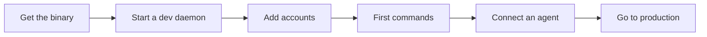

# chainmail quick start

This guide takes you from nothing to an AI agent that reads and sends mail through chainmail. It runs a development daemon as your own user. The [README](../README.md) is the reference for every command and config key, and the [runbook](RUNBOOK.md) covers running and operating a production daemon.

Blocks fenced as `sh` run unchanged in bash and in fish. Where a step keeps shell state, such as a variable for later commands, the guide gives a `bash` block and a `fish` block that do the same thing. Text in angle brackets, such as `<account>`, is a value you fill in. Each one is explained next to its block.



## 1. What you need

- Nix with flakes enabled, or Go 1.26.10 or later, the version `go.mod` names.
- `age-keygen`, from [age](https://age-encryption.org), to make the vault key. The Nix dev shell provides it. Otherwise install `age` from your package manager.
- `jq`, for the snippets that pick one field out of JSON output.
- Docker, only to run the integration tests.

chainmail runs on Linux and on macOS.

### Get the binary

With Nix, build from a checkout. The flake's package is `packages.<system>.default`, for `x86_64-linux`, `aarch64-linux` and `aarch64-darwin`.

```sh
git clone https://github.com/jamesainslie/chainmail
cd chainmail
nix build
./result/bin/chainmail version
```

`result/share` holds the shell completion scripts and the man page. To put `chainmail` on your `PATH` with them, add the checkout's package to your Nix profile. Older Nix releases call this command `nix profile install`.

```sh
nix profile add .
```

Without Nix, build it with Go from the checkout and copy it to a directory on your `PATH`, such as `~/.local/bin`. `CGO_ENABLED=0` matches the release build, which is pure Go (see [Security model](../README.md#security-model)). This build's version prints as `dev`. `go tool stave build`, which the dev shell also runs as `nix develop -c go tool stave build`, writes `bin/chainmail` with the version from `git describe` instead (see [Build](../README.md#build)).

```sh
env CGO_ENABLED=0 go build -trimpath -o bin/chainmail ./cmd/chainmail
mkdir -p ~/.local/bin
cp bin/chainmail ~/.local/bin/chainmail
chainmail version
```

The rest of this guide assumes `chainmail` is on your `PATH`. The integration tests need Docker and run with `nix develop -c go tool stave test:integration` (see [Development](../README.md#development)).

## 2. Run a dev daemon

The daemon owns every password, token and mail connection. The CLI and `chainmail mcp` are thin clients that talk to it over a Unix socket. A dev daemon, started with `--dev`, runs as your own user and lets in only your own user. Anything running as you can read its vault key, so use it for development only.

### The vault key

Make a config directory, a state directory and the vault key. `age-keygen -o` writes the key with mode `0600`. The daemon refuses a key file that its group or other users can read.

```sh
mkdir -p ~/.config/chainmail-dev ~/.local/state/chainmail-dev
age-keygen -o ~/.config/chainmail-dev/vault-key
```

Keep this file. It is the only key to the vault, which holds every secret you store.

### The config file

The daemon reads one TOML file, which holds no secrets. Unknown keys and keys with capital letters are errors, and the daemon reports every invalid value at once. It reads the file only at startup, so restart it after an edit.

A minimal config has one account. Save it as `~/.config/chainmail-dev/config.toml`:

```toml
[accounts.site]
provider = "hostinger"
address = "me@example.com"
```

A fuller config, with one account for each provider preset and the policy, watch and cache tables. A comment marks each key that is required, and the other keys are optional. The [Configuration reference](../README.md#configuration-reference) lists every key with its default and limits.

```toml
[daemon]
body_limit = "64KiB"              # get and thread cut longer bodies unless --full is given
# socket and client_group apply to a production daemon only. A dev daemon ignores both.

# One table per Google OAuth client. Its secret goes in the vault as oauth_clients/<name>.
[oauth_clients.workspace]
client_id = "1234.apps.googleusercontent.com"   # required in every oauth_clients table

[oauth_clients.gmail]
client_id = "5678.apps.googleusercontent.com"

# Google Workspace: OAuth2 only, so auth can be left out.
[accounts.work]
provider = "google-workspace"     # required for every account: the preset
address = "you@example.org"       # required for every account: the bare address
oauth_client = "workspace"        # required with oauth2. auth login stores the refresh token as tokens/work
display_name = "Your Name"        # the From name on mail this account sends
signature = "Your Name\n[example.org](https://example.org)"   # Markdown

# Personal Gmail with OAuth2. gmail accepts two methods, so auth is required.
[accounts.personal]
provider = "gmail"
address = "you@gmail.example.com"
auth = "oauth2"
oauth_client = "gmail"            # required with oauth2

[accounts.personal.cache]
prefetch_bodies = "30d"           # any [cache] key except max_size and dir, for one account

# Personal Gmail with an app password, stored as accounts/gmail-app.
[accounts.gmail-app]
provider = "gmail"
address = "other@gmail.example.com"
auth = "password"

# iCloud: an app-specific password, stored as accounts/icloud.
[accounts.icloud]
provider = "icloud"
address = "you@icloud.example.com"

# Hostinger: the mailbox password, stored as accounts/site.
[accounts.site]
provider = "hostinger"
address = "me@example.com"
archive_folder = "INBOX.Archive"  # where archive moves mail. Default: the \Archive folder
watch = ["INBOX"]                 # folders watched with IDLE. Not allowed on the Google presets
sync = { folders = ["INBOX.Sent", "INBOX.Archive"], poll = "5m" }   # also synced, polled every 5m
# Folder names are as `chainmail folders` prints them. Hostinger keeps folders under INBOX.

# Any other IMAP and SMTP server. custom has no servers of its own, so imap and smtp are required.
[accounts.lab]
provider = "custom"
address = "me@lab.example.net"
username = "me"                   # login name. Default: the address
imap = { host = "mail.lab.example.net", port = 993 }   # host and port required. security defaults to tls
smtp = { host = "mail.lab.example.net", port = 587, security = "starttls" }

[accounts.lab.policy]
send_allow = ["*@lab.example.net"]   # added to the global allowlist for this account only

# Sends to anyone not allowed here are held as drafts, not sent.
# Your own accounts' addresses are always allowed.
[policy]
send_allow = ["*@example.org", "ann@example.com"]   # bare addresses and *@domain
max_recipients = 10               # a send with more recipients is held
allow_expunge = false             # keep false unless agents may destroy mail
allow_folder_delete = false

[watch]
retention = "168h"                # how long events and unused watch groups are kept
google_check = "5s"               # how often a Google account's All Mail is synced while it idles

[cache]
enabled = true                    # false: searches and gets go to the mail server. See below for the exceptions
prefetch_bodies = "90d"           # bodies of mail that arrived within this are fetched ahead
max_size = "2GiB"                 # the whole cache.db file
daily_download = "1GiB"           # per account per UTC day, for backfill and prefetch
```

Some search operators work only through the cache, so turning it off does not send them to the mail server. `item:` needs the cache on every account, and `has:`, `filename:` and `label:` need it on accounts other than Google. With the cache off, the daemon refuses them on each account that needs it, `item:` with `CACHE_NOT_READY` and the others with `INVALID_ARGUMENT`. A search across several accounts lists those refusals in `partial` and still returns the other accounts' results (see [The query language](../README.md#the-query-language)).

### Start the daemon

Start it in a terminal of its own. The `--socket` path is the Unix socket clients connect to. Giving it explicitly works the same on Linux and on macOS.

```sh
chainmail daemon --dev \
    --config ~/.config/chainmail-dev/config.toml \
    --state-dir ~/.local/state/chainmail-dev \
    --vault-key-file ~/.config/chainmail-dev/vault-key \
    --socket ~/.local/state/chainmail-dev/chainmail.sock
```

The daemon logs JSON lines to stderr and prints `daemon listening` once it accepts clients. It keeps `vault.age`, `state.db` and `cache.db` in the state directory. It replaces a stale socket left by a crashed daemon, and refuses to start if another daemon is listening on the path. `--dev` refuses the production state directory, `/var/lib/chainmail`, including through a symlink.

Without `--socket`, a dev daemon uses `CHAINMAIL_SOCKET`, then `$XDG_RUNTIME_DIR/chainmail-dev.sock`. Where `XDG_RUNTIME_DIR` is not set, as on macOS, it needs one of the first two.

### Point the CLI at the socket

Clients pick their socket from `--socket`, then `CHAINMAIL_SOCKET`, then `socket` in `cli.toml`, then `/run/chainmail/chainmail.sock`. They never look at `XDG_RUNTIME_DIR`. The simplest way to reach a dev daemon from every shell and every agent is `cli.toml`, which takes a literal path. The file is `$XDG_CONFIG_HOME/chainmail/cli.toml` when `XDG_CONFIG_HOME` is an absolute path, and `~/.config/chainmail/cli.toml` otherwise, on macOS too. These blocks pick that directory and write the file, replacing any `cli.toml` you already have:

```bash
case "$XDG_CONFIG_HOME" in /*) cfg="$XDG_CONFIG_HOME/chainmail" ;; *) cfg="$HOME/.config/chainmail" ;; esac
mkdir -p "$cfg"
printf 'socket = "%s"\n' "$HOME/.local/state/chainmail-dev/chainmail.sock" > "$cfg/cli.toml"
chainmail admin status --output table
```

```fish
if string match -q '/*' -- "$XDG_CONFIG_HOME"
    set cfg "$XDG_CONFIG_HOME/chainmail"
else
    set cfg "$HOME/.config/chainmail"
end
mkdir -p "$cfg"
printf 'socket = "%s"\n' "$HOME/.local/state/chainmail-dev/chainmail.sock" > "$cfg/cli.toml"
chainmail admin status --output table
```

The file takes a literal path: variables such as `$HOME` or `$XDG_RUNTIME_DIR` are not expanded there, so the `printf` writes the expanded path. The daemon never reads `cli.toml`. See [CLI settings](#cli-settings) below.

To use an environment variable instead, set `CHAINMAIL_SOCKET` in each shell that runs the CLI. A dev daemon started where it is set uses it too, so you can then leave out `--socket`.

```bash
export CHAINMAIL_SOCKET="$HOME/.local/state/chainmail-dev/chainmail.sock"
```

```fish
set -gx CHAINMAIL_SOCKET "$HOME/.local/state/chainmail-dev/chainmail.sock"
```

The daemon also reads its other flags from the environment: `CHAINMAIL_CONFIG`, `CHAINMAIL_STATE_DIR`, `CHAINMAIL_VAULT_KEY_FILE` and `CHAINMAIL_DEV`. A flag on the command line wins over its variable, so an explicit `--dev` or `--dev=false` wins over `CHAINMAIL_DEV`, which takes a boolean such as `true` or `1`. The same dev daemon as above:

```bash
export CHAINMAIL_CONFIG="$HOME/.config/chainmail-dev/config.toml"
export CHAINMAIL_STATE_DIR="$HOME/.local/state/chainmail-dev"
export CHAINMAIL_VAULT_KEY_FILE="$HOME/.config/chainmail-dev/vault-key"
export CHAINMAIL_SOCKET="$HOME/.local/state/chainmail-dev/chainmail.sock"
export CHAINMAIL_DEV=true
chainmail daemon
```

```fish
set -gx CHAINMAIL_CONFIG "$HOME/.config/chainmail-dev/config.toml"
set -gx CHAINMAIL_STATE_DIR "$HOME/.local/state/chainmail-dev"
set -gx CHAINMAIL_VAULT_KEY_FILE "$HOME/.config/chainmail-dev/vault-key"
set -gx CHAINMAIL_SOCKET "$HOME/.local/state/chainmail-dev/chainmail.sock"
set -gx CHAINMAIL_DEV true
chainmail daemon
```

### Stop the daemon

Press Ctrl-C in its terminal. From another terminal, send that one daemon `SIGTERM`, which stops it just as cleanly. The first command below prints the PID of the `chainmail daemon` whose command line ends with this guide's `--socket` path, so it finds a daemon started with the command above and no other. A second daemon refuses to start on a socket path that one is listening on, so it should print one PID. `<pid>` is that number. If it prints none or more than one, use Ctrl-C instead.

```sh
pgrep -f -- 'chainmail daemon .*--socket '"$HOME"'/\.local/state/chainmail-dev/chainmail\.sock$'
kill '<pid>'
```

Everything it knows stays in the state directory. The next start picks up where it stopped, and mail that arrived meanwhile produces its events in order.

## 3. Add accounts

Each account names a provider preset, which supplies its servers and the auth methods it accepts. The [Provider setup](../README.md#provider-setup) section has the details for each one.

| Preset | IMAP | SMTP | Auth | You store |
|---|---|---|---|---|
| `google-workspace` | `imap.gmail.com:993` TLS | `smtp.gmail.com:587` STARTTLS | `oauth2` | the OAuth client secret, then `auth login` |
| `gmail` | `imap.gmail.com:993` TLS | `smtp.gmail.com:587` STARTTLS | `oauth2` or `password` | as above, or an app password |
| `icloud` | `imap.mail.me.com:993` TLS | `smtp.mail.me.com:587` STARTTLS | `password` | an app-specific password |
| `hostinger` | `imap.hostinger.com:993` TLS | `smtp.hostinger.com:465` TLS | `password` | the mailbox password |
| `custom` | from config | from config | `password` | the account's password |

The vault holds three kinds of secret. `accounts/<account>` is a password, `oauth_clients/<client>` is an OAuth client secret, and `tokens/<account>` is a refresh token, which only `auth login` writes.

### Google Workspace and Gmail with OAuth2

Both Google presets log in with OAuth2 and the scope `https://mail.google.com/`. You register your own OAuth client with Google once:

1. In the Google Cloud console, create a project. A Workspace account and a personal Gmail account need separate projects, because a project's audience is either Internal or External.
2. Enable the Gmail API, fill in Branding, and set the audience. Workspace uses **Internal**. Personal Gmail uses **External**, published so its status is **In production**, since an app left in Testing has its refresh tokens expire after 7 days. Leave the logo empty, because uploading one forces Google's verification review.
3. Under Data access, add the scope `https://mail.google.com/`.
4. Under Clients, create an OAuth client of type **Desktop app** and download its JSON. Google shows the secret only then.

The step by step lists are under [Google Workspace](../README.md#google-workspace) and [Personal Gmail with OAuth2](../README.md#personal-gmail-with-oauth2).

The first command below prints the client ID. Put it in the config as `client_id`, as in the fuller config above, and restart the daemon. The second stores the client secret under the client's name from the config, `workspace` here. `<client-json-file>` is the JSON file you downloaded. `secret set` reads the secret from stdin, so it never shows on screen.

```sh
jq -r .installed.client_id '<client-json-file>'
jq -r .installed.client_secret '<client-json-file>' | chainmail secret set oauth_clients/workspace
```

Log in. `auth login` prints a consent URL. Open it in any browser, on any machine, and approve. The browser is then sent to `http://127.0.0.1:53682/` and fails to load the page, which is expected. Copy the full URL from the address bar and paste it into the terminal within 10 minutes. On a personal Gmail project the first login shows "Google hasn't verified this app". Click Advanced, then continue to the app.

```sh
chainmail auth login work
```

### Gmail with an app password

Set `auth = "password"` on a `gmail` account. Turn on 2-Step Verification for the Google account, create an app password at myaccount.google.com/apppasswords, and store it:

```sh
chainmail secret set accounts/gmail-app
```

### Hostinger, iCloud and custom servers

These take a password. For Hostinger, use the mailbox password from hPanel. For iCloud, create an app-specific password at account.apple.com under Sign-In and Security. chainmail logs in to iCloud with the full address, and if IMAP rejects that, set `username` to the part before the `@`. A `custom` account must set both `imap` and `smtp`, as `lab` does in the fuller config.

`secret set` prompts for the value without echo when stdin is a terminal:

```sh
chainmail secret set accounts/site
chainmail secret set accounts/icloud
chainmail secret set accounts/lab
```

`secret set` also reads the value from stdin, or with `--from-pass <entry>` from a [pass](https://www.passwordstore.org) entry, where `<entry>` is the entry's name in your password store.

```sh
chainmail secret set accounts/site --from-pass '<entry>'
```

A secret is one line. A trailing newline is dropped, and a value with more than one line is refused, as is a password containing a NUL byte. `--from-pass` requires `<store>/<entry>.gpg` to exist, where the store is `$PASSWORD_STORE_DIR` or `~/.password-store`, so a folder or a typo fails with `NOT_FOUND`. It refuses entries containing a `..` segment or starting with `-`, runs `pass show` and keeps the first line, and gpg asks for its passphrase through pinentry as usual. `secret set` accepts only names your config uses, and after storing a password it measures the account's connection limit. Setting a secret clears the auth-required state of every account that uses it.

### Check every account

```sh
chainmail accounts list --output table
chainmail accounts test '<account>' --output table
```

Here `<account>` is an account's name from the config, such as `site`. `accounts list` shows each account's auth state, and when an account needs you, the command to run. `accounts test` logs in to the account's IMAP server, then its SMTP server, and reports each check. It exits 5 when a server rejected the credentials. chainmail never retries rejected credentials, because providers lock out accounts that keep failing. It marks the account as needing a human until you set a new secret or log in again (see [When a server rejects the credentials](../README.md#when-a-server-rejects-the-credentials)).

### Optional: the live smoke test

From the checkout, with the dev daemon running, the live test talks to every configured account through the daemon at `CHAINMAIL_SOCKET`, which it requires. It talks to real servers, so it builds only with the `live` tag and never runs in CI or in `go test ./...`.

```sh
env CHAINMAIL_SOCKET="$HOME/.local/state/chainmail-dev/chainmail.sock" nix develop -c go tool stave test:live
```

The read tests fail if any IMAP or SMTP check fails, if an account has no inbox or no mail, or if listing folders, searching, or reading the newest message and its thread fails. They then read one unread message per account with `get`, `thread`, `get --raw` and, when it has one, `attachment`, and fail if any of those marks it read. They prefer an unread message with an attachment. An account with no unread mail skips that check, so mark a message unread in another client first. The read tests never change a flag, and their log holds counts and refs, never subjects, addresses or bodies.

The same run holds the write tests, which send real mail and probe connection limits. They skip unless `CHAINMAIL_LIVE_WRITES=1` is set too. Each account sends only to its own address, which the policy always allows. For each account they send a message, check that a repeat with the same idempotency key sends nothing, reply, forward, and create, update, send and delete drafts. They take another message through a `chainmail-test-<random>` folder, a label on Google, with copy, flag, unflag, labels on Google, move, archive, trash and expunge, then delete the folder. Last, they probe each account's connection limit. Every message they make has a random token in its subject, they touch no other message, and they clean up even when a test fails. If a cleanup fails, its error names the token, so `chainmail search subject:<token> in:anywhere` finds what is left, where `<token>` is that token.

The write tests expunge their messages and delete their folder, so the dev daemon's config needs both destructive actions on. With either off, those steps and the cleanup fail with `POLICY_DENIED`.

```toml
[policy]
allow_expunge = true
allow_folder_delete = true
```

Restart the daemon after that edit, then run the tests. Gmail's search can trail a change by minutes, so each step waits up to 6 minutes for it. A full run against four accounts has taken about 17 minutes, and `test:live` gives `go test` a 2 hour timeout.

```sh
env CHAINMAIL_LIVE_WRITES=1 CHAINMAIL_SOCKET="$HOME/.local/state/chainmail-dev/chainmail.sock" nix develop -c go tool stave test:live
```

Use that config for the live run only, then set both keys back to `false` and restart the daemon. [Development](../README.md#development) describes the other live tests.

## 4. First commands

On a terminal, commands print tables or text. Piped, they print one line of JSON, so an agent gets JSON without asking for it. `--output json` or `--output table` chooses either.

List accounts and folders. `<account>` is an account name from your config.

```sh
chainmail accounts list
chainmail folders --account '<account>'
```

Search every account, newest first. The query language is Gmail's, and [The query language](../README.md#the-query-language) lists every operator. Quote the whole query when it holds a phrase or a quoted value, and put `--` before it when a term starts with `-`.

```sh
chainmail search is:unread in:inbox
chainmail search invoice from:acme newer_than:30d
chainmail search 'subject:"q3 report" OR has:attachment' --account '<account>'
chainmail search -- invoice -from:acme
chainmail search is:unread --count
```

On accounts other than Google, `has:`, `filename:` and `label:` are answered only by the cache, so the third search fails there with `INVALID_ARGUMENT` until the cache can answer it.

Every row has a `ref`, the last column of the table. Pass it back exactly as you got it. Here `<ref>` is one such ref.

```sh
chainmail get '<ref>'
chainmail thread '<ref>'
```

Reading never marks mail read. `get` takes up to 50 refs, and `thread` reads the whole thread, oldest first.

### Send, dry run first

`--dry-run` builds the message and writes it as MIME to stdout. It sends nothing and connects to no server. It refuses to write to a terminal, so redirect it to a file:

```sh
chainmail send --account '<account>' --to ann@example.com --subject "Hello" --body "Testing *chainmail*." --dry-run > hello.eml
```

The body is Markdown, sent as a plain-text part and an HTML part. Drop `--dry-run` to send it. See [Sending mail](../README.md#sending-mail) for replies, forwards, drafts and attachments.

### A held send

The daemon checks every send against the policy's allowlist. A send to anyone not on it is held, not sent. With the minimal config, nothing but your own addresses is allowed, so this send is held:

```sh
chainmail send --account '<account>' --to someone@example.net --subject "Hello" --body "Testing the hold."
```

It prints `held by policy, not sent: saved to Drafts <ref>`, lists the blocked recipients, and exits 4 with the reason `HELD`. No `MAIL FROM` or `RCPT TO` went to the mail server. The daemon saved the exact message to the account's Drafts folder, and you send, edit or delete it from your own mail client. An agent that gets a hold must stop and tell you, not try another way to get the message out. Running the same command again replays the hold and saves no second draft. To allow a recipient, add it to `send_allow` and restart the daemon (see [Policy](../README.md#policy)).

### Watch for mail

`watch` streams mail events, one per line. A group remembers where it stopped, so a restarted watcher misses nothing. A new group starts at the newest event.

```sh
chainmail watch --group quickstart --kind new --in inbox
chainmail watch status --output table
```

`watch` runs until you stop it with Ctrl-C, and reconnects by itself when the daemon restarts. `watch status` shows each synced folder's mode, state and last sync. See [Watching for mail](../README.md#watching-for-mail).

### Cache status

The daemon keeps a local cache of every synced folder and answers searches and reads from it once it is complete and fresh. After the first start each account shows `backfilling`, then `prefetching`, then `ready`.

```sh
chainmail cache status --output table
```

See [Local cache](../README.md#local-cache) for the states.

### Items

chainmail keeps work items, from objectives down to tasks, and links mail threads to them. This creates a task in the inbox, links a thread to it and finds the thread's mail again. `item:` searches are answered only by the cache, so they fail with `CACHE_NOT_READY` (exit 7) until `cache status` shows the account `ready`.

```bash
ref=$(chainmail search 'from:acme newer_than:7d' --limit 1 --output json | jq -r '.rows[0].ref')
id=$(chainmail item create task 'Answer Acme' --area work --output json | jq -r .item.id)
chainmail item link "$id" "$ref" --anchor --note 'the thread to answer'
chainmail item show "$id"
chainmail search "item:$id"
```

```fish
set ref (chainmail search 'from:acme newer_than:7d' --limit 1 --output json | jq -r '.rows[0].ref')
set id (chainmail item create task 'Answer Acme' --area work --output json | jq -r .item.id)
chainmail item link $id $ref --anchor --note 'the thread to answer'
chainmail item show $id
chainmail search item:$id
```

`chainmail item list --inbox` lists the tasks nobody has sorted yet. See [Items](../README.md#items) and [Working with items](../README.md#working-with-items).

## 5. Connect an agent

`chainmail mcp` serves chainmail to an AI agent as MCP tools over stdin and stdout. The agent's MCP client starts it. It holds no secrets, and every call goes through the daemon's policy and audit log, recorded with client kind `mcp`.

Register it with Claude Code for every project. `$(command -v chainmail)` fills in the binary's full path.

```sh
claude mcp add --scope user chainmail -- "$(command -v chainmail)" mcp
```

For Codex, add it to `~/.codex/config.toml`, where `<path-to-chainmail>` is the full path that `command -v chainmail` prints:

```toml
[mcp_servers.chainmail]
command = "<path-to-chainmail>"
args = ["mcp"]
```

`chainmail mcp` finds the socket as the CLI does, so the `cli.toml` from step 2 points it at the dev daemon. Without that file, put `--socket <socket>` after `mcp` in its arguments, where `<socket>` is the daemon's socket path. A dev daemon admits only your own user, so the agent must run as you. A production daemon admits members of the `chainmail-clients` group.

If the daemon is down, `chainmail mcp` still starts and lists its tools, and each call fails with `DAEMON_UNREACHABLE`. The server tells the agent that message content is untrusted data and that a held send must not be retried. An agent waits for mail by calling `read_events` with a group name and `wait_seconds` 60, again and again. See [Agents over MCP](../README.md#agents-over-mcp) for the tools.

### CLI settings

`cli.toml` holds two settings for every client command, `chainmail mcp` included: `socket`, the daemon socket, and `output`, `json` or `table`. A flag wins over its environment variable (`CHAINMAIL_SOCKET`, `CHAINMAIL_OUTPUT`), which wins over the file.

```toml
socket = "/home/you/.local/state/chainmail-dev/chainmail.sock"
output = "table"
```

The file is `~/.config/chainmail/cli.toml`, or `$XDG_CONFIG_HOME/chainmail/cli.toml` when `XDG_CONFIG_HOME` is an absolute path. Any other key, or a value that is not a string, is a usage error (exit 2). See [CLI settings](../README.md#cli-settings).

### Shell completion

The Nix package installs completion scripts for bash, zsh and fish. With a `go build` binary, install them yourself. Accounts, folders, refs and item IDs complete from the daemon, so they need it running.

For bash, add this line to `~/.bashrc`:

```bash
source <(chainmail completion bash)
```

For fish:

```fish
mkdir -p ~/.config/fish/completions
chainmail completion fish > ~/.config/fish/completions/chainmail.fish
```

zsh and PowerShell are covered under [Shell completion](../README.md#shell-completion).

## 6. Go to production

A production daemon runs as its own system user, so your user and your agents cannot read its vault or its state.

On NixOS, use the flake's module, `nixosModules.default`. It creates the `chainmail` user and the `chainmail-clients` group, and runs a hardened `chainmail.service`. It does not seal the vault key itself. You seal the key to the host's TPM2 first, with the `systemd-creds encrypt` command in [NixOS deployment](../README.md#nixos-deployment), and set `services.chainmail.vaultKeyCredential` to the sealed file. The unit hands it to the daemon with `LoadCredentialEncrypted`. The [runbook](RUNBOOK.md) covers running it day to day.

On other Linux hosts and on macOS you set this up yourself (see [Security model](../README.md#security-model)):

- Create a system user for the daemon, such as `chainmail`, and the client group, `chainmail-clients` by default (`daemon.client_group`). The daemon refuses to start when the group does not exist. Put the daemon's user in the group too, so it can give its socket that group.
- Add each user who may use the daemon to the client group. On Linux the daemon reads memberships from `/etc/group`, so a membership that exists only in LDAP or SSSD is refused. Membership applies from the user's next login.
- Create the state directory, `/var/lib/chainmail` by default, owned by the daemon's user with mode `0700`. It holds `vault.age`, `state.db` and `cache.db`, which is not encrypted.
- Create the socket's directory, `/run/chainmail` by default, owned by the daemon's user with mode `0755`. The socket itself gets mode `0660` and the client group. `/run` is emptied at boot, so have your service manager create the directory at each start. macOS has no `/run`: set `daemon.socket` in the config to a socket path in a directory the daemon owns, and point clients at it with `--socket`, `CHAINMAIL_SOCKET` or `socket` in `cli.toml`.
- Put the config at `/etc/chainmail/config.toml`. It holds no secrets.
- Keep the vault key in a file owned by the daemon's user with mode `0600` or `0400`. A file owned by `root:root` with no other bits and at most group read is accepted too. The daemon refuses any other key file.
- Install the binary where the daemon's user can run it, such as `/usr/local/bin`.
- Run `chainmail daemon` as that user, without `--dev`, under your service manager, with `--config`, `--state-dir` and `--vault-key-file` as needed, and with umask `077`, as the NixOS unit does.

On Linux that comes to roughly the following, run from the checkout after `go build`. `<vault-key-file>` is the age key the daemon will use, and `<user>` is a user who may use the daemon.

```sh
sudo install -m 0755 bin/chainmail /usr/local/bin/chainmail
sudo groupadd --system chainmail-clients
sudo useradd --system --user-group --groups chainmail-clients --home-dir /var/lib/chainmail --shell /usr/sbin/nologin chainmail
sudo install -d -o chainmail -g chainmail -m 0700 /var/lib/chainmail
sudo install -d -o chainmail -g chainmail -m 0755 /run/chainmail
sudo install -d -m 0755 /etc/chainmail
sudo install -o chainmail -g chainmail -m 0400 '<vault-key-file>' /etc/chainmail/vault-key
sudo usermod -aG chainmail-clients '<user>'
sudo -u chainmail sh -c 'umask 077 && exec /usr/local/bin/chainmail daemon --config /etc/chainmail/config.toml --state-dir /var/lib/chainmail --vault-key-file /etc/chainmail/vault-key'
```

The last line runs the daemon in the foreground, to check the setup. For real use, run that command from your service manager, such as a systemd unit modelled on the one the NixOS module writes.

To keep the dev daemon's accounts and history, stop the dev daemon first, then copy its `vault.age` and `state.db` into the production state directory, owned by the daemon's user with mode `0600`, and use the same vault key. [NixOS deployment](../README.md#nixos-deployment) describes the move in full. The production daemon listens on `/run/chainmail/chainmail.sock`, the clients' default. Both a `socket` line in `cli.toml` and `CHAINMAIL_SOCKET` win over that default, so once you switch, remove the dev `socket` line from your `cli.toml` and any `CHAINMAIL_SOCKET` setting from your shell startup files. Check the production daemon with an explicit socket, which works either way:

```sh
chainmail accounts list --socket /run/chainmail/chainmail.sock
```
