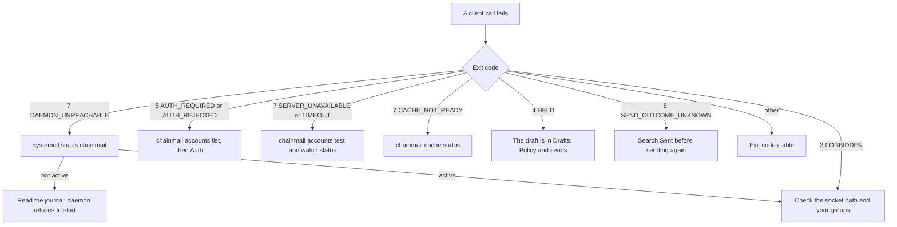

# chainmail operations runbook

This runbook is for whoever keeps a production chainmail daemon running. It covers the daemon that the flake's NixOS module runs as `chainmail.service`, and a daemon you run yourself under plain systemd or launchd. Each entry gives the symptom or goal, the commands to run, what good output looks like, and what to do next.

The [README](../README.md) is the full reference. This runbook links to it rather than repeat it. For a first install, see the [quick start](QUICKSTART.md).

## Conventions

### Layout

The commands assume the layout the NixOS module creates. On another host, substitute your own paths and names.

| What | Where |
|---|---|
| Unit | `chainmail.service`, description `chainmail policy daemon` |
| Daemon user and group | `chainmail:chainmail` |
| Client group | `chainmail-clients`, members may use the socket |
| Config | `/etc/chainmail/config.toml`, mode `0444`, rendered from `services.chainmail.settings` |
| State directory | `/var/lib/chainmail`, mode `0700`: `vault.age`, `state.db`, `cache.db` and `uploads/` |
| Socket | `/run/chainmail/chainmail.sock`, mode `0660`, group `chainmail-clients`, in a `0755` directory |
| Vault key | `$CREDENTIALS_DIRECTORY/vault-key`, from `LoadCredentialEncrypted=vault-key:<vaultKeyCredential>` |

The unit runs `chainmail daemon --config /etc/chainmail/config.toml` with `Restart=on-failure`, `RestartSec=5s` and `UMask=0077`. It restarts whenever the rendered config changes. On a host without the module, copy the `serviceConfig` in [`nix/module.nix`](../nix/module.nix) into your own unit, and pass `--state-dir` and `--vault-key-file` when you do not use the defaults.

### Shells

Every block marked `sh` runs unchanged in bash and in fish 3.4 or later. Blocks marked `bash` or `fish` are for that shell only.

Values you fill in are written as quoted placeholders, such as `'<account>'`. Replace the text between the quotes. The quotes can stay. These are the placeholders this runbook uses:

| Placeholder | Meaning |
|---|---|
| `'<account>'` | An account name from the config, as `chainmail accounts list` shows it |
| `'<client>'` | An `[oauth_clients.<name>]` name from the config |
| `'<folder>'` | A folder name as `chainmail folders` shows it |
| `'<ref>'` | A message ref, such as `cm1:work:Drafts:1793457333:12` |
| `'<group>'` | A watch group name |
| `'<item-id>'` | An item ID, such as `it_admin_work` |
| `'<host>'` | The NixOS configuration name in your host flake |
| `'<backup-dir>'` | A directory only root can read, on the volume you back up |
| `'<label>'` | The label of your own launchd job, on macOS |
| `'<chainmail-checkout>'` | A clone of the chainmail repository |

### sudo and the socket

Use `sudo` only for the service and its files: `systemctl` changes, `journalctl` when your user cannot read the system journal, and anything under `/var/lib/chainmail`. Run the `chainmail` CLI as yourself, never with `sudo`. The daemon allows only its own user and members of `chainmail-clients`, so root gets `FORBIDDEN` unless root is in that group.

The CLI finds the socket from `--socket`, then the `CHAINMAIL_SOCKET` variable, then `socket` in `cli.toml`, then `/run/chainmail/chainmail.sock`. The commands below rely on the default. A `CHAINMAIL_SOCKET`, or a `socket` line in `cli.toml`, left over from development points them at a dev daemon instead (see step 7 of [5.6](#56-move-a-dev-daemons-state-to-production)), so add `--socket /run/chainmail/chainmail.sock` when in doubt. `chainmail admin status` shows `dev mode  false` for the production daemon.

### Logs

The daemon writes one JSON object per line to stderr, which systemd sends to the journal. Each line has `time`, `level` (`INFO`, `WARN` or `ERROR`) and `msg`, plus fields such as `account`, `folder` and `reason`. Log lines name accounts, folders and reason codes, never message content.

A failure that stops the daemon is printed as one line of JSON in the CLI's error form, such as `{"error":{"reason":"INTERNAL","message":"..."}}`, and the process exits non-zero.

## Triage



## 1. Health checks

### 1.1 Is the daemon running

```sh
systemctl status chainmail --no-pager
```

Good output shows `Active: active (running)`, a `Main PID` and the command line `.../bin/chainmail daemon --config /etc/chainmail/config.toml`. The last journal lines under it are JSON from the daemon.

If it shows `activating (auto-restart)` or `failed`, the daemon exits at start. Go to [2.4 The daemon refuses to start](#24-the-daemon-refuses-to-start).

On macOS, with a launchd job you made:

```sh
sudo launchctl print system/'<label>'
```

Look for `state = running`. The daemon's log goes wherever the job's `StandardErrorPath` points.

### 1.2 Read the daemon's log

```sh
sudo journalctl -u chainmail -o cat -n 100 --no-pager
sudo journalctl -u chainmail -o cat --since '1 hour ago' --no-pager | grep -v '"level":"INFO"'
sudo journalctl -u chainmail -o cat -b --no-pager | grep '"msg":"daemon listening"'
```

`-o cat` prints only the JSON, without journald's prefix. The second command shows warnings and errors only. The third shows each start since boot.

A healthy start logs these lines, in this order, within a second or two of `Starting chainmail policy daemon...`:

```
{"time":"...","level":"INFO","msg":"watching accounts","accounts":["work","site"]}
{"time":"...","level":"INFO","msg":"caching accounts","accounts":["work","site"]}
{"time":"...","level":"INFO","msg":"daemon listening","addr":"/run/chainmail/chainmail.sock","dev":false}
```

`cache backfill started` lines for each folder follow on a fresh cache. With the cache off for every account, `the cache is disabled for every account` appears in place of `caching accounts`.

Lines worth acting on:

| Message | Level | Meaning | See |
|---|---|---|---|
| `sends left in progress by an earlier daemon now have an unknown outcome` | WARN | The last daemon died during a send. `count` says how many. | [8.2](#82-send-outcome-unknown-exit-8) |
| `send outcome unknown` | WARN | A send lost its connection after handing the message over. Has `account` and `message_id`. | [8.2](#82-send-outcome-unknown-exit-8) |
| `watching is parked until the account is authenticated` | WARN | An account needs a login or a secret. | [3](#3-auth) |
| `watch connection failed` | WARN | A watched folder's connection failed. `reason` says why. It reconnects by itself. | [6.1](#61-a-folder-stuck-in-reconnecting) |
| `a watched folder does not exist` | WARN | A folder in `watch` is missing on the server. | [6.2](#62-a-folder-in-error) |
| `server refused a watch connection for its connection limit` | WARN | The account is out of IMAP connections. | [9](#9-connection-limits) |
| `server refused a connection; recorded the connection limit` | INFO | The pool shrank by one after a refusal. | [9](#9-connection-limits) |
| `recreating cache.db` | WARN | `reason` is `version`, `corrupt` or `unknown_tables`. The cache rebuilds. | [7.6](#76-corruption) |
| `cache.db could not be opened; searches and reads use the mail servers` | ERROR | The cache is off until a restart opens it. | [7.6](#76-corruption) |
| `the disk holding cache.db is full; searches and reads use the mail servers until a write succeeds, retried hourly` | WARN | Disk full. | [7.7](#77-a-full-disk) |
| `cache.db is over max_size with message headers alone; raise [cache] max_size` | WARN | `over_cap`. | [7.4](#74-over-cap) |
| `audit write failed` | ERROR | Calls fail, because chainmail never reports a call it could not audit. Usually a full disk. | [7.7](#77-a-full-disk) |
| `trimming the event log failed` | ERROR | The event log is not being trimmed. Usually a full disk. | [6.5](#65-event-log-retention) |

### 1.3 The socket

```sh
ls -ld /run/chainmail /run/chainmail/chainmail.sock
id -nG
getent group chainmail-clients
```

Good output:

```
drwxr-xr-x 2 chainmail chainmail          60 Nov  6 08:00 /run/chainmail
srw-rw---- 1 chainmail chainmail-clients   0 Nov  6 08:00 /run/chainmail/chainmail.sock
```

`id -nG` must list `chainmail-clients`, and `getent group chainmail-clients` must name your user. On macOS, use `dseditgroup -o checkmember -m "$USER" chainmail-clients` in place of `getent`.

What the failures look like:

- No socket file: the daemon is down, or its `daemon.socket` is elsewhere. A client prints `DAEMON_UNREACHABLE` (exit 7) with `connect: no such file or directory` and the hint `is the chainmail daemon running? check --socket or CHAINMAIL_SOCKET`.
- `connect: permission denied` with `DAEMON_UNREACHABLE`: your session is not in `chainmail-clients`. Group membership applies to new logins only. Log in again, or on Linux run one command under the group with `sg chainmail-clients -c 'chainmail admin status'`. On NixOS, add the user to `services.chainmail.clientUsers` first.
- `FORBIDDEN` (exit 3) with the hint `your user may not use this daemon socket; join its client group`: the socket accepted the connection, but the daemon's peer check refused you. The daemon reads `/etc/passwd` and `/etc/group` directly, so a user or membership that exists only in LDAP or SSSD is refused. Root is refused too.

### 1.4 Daemon status

```sh
chainmail admin status --socket /run/chainmail/chainmail.sock --output table
```

Good output starts with the daemon's details, then the sync table and the cache table:

```
version   c09c9fd
started   Thu, 05 Nov 2026 08:00 PST
dev mode  false
secrets   accounts/site, oauth_clients/workspace, tokens/work

ACCOUNT  FOLDER            MODE  STATE     CONDSTORE  LAST SYNC         LAST SWEEP        ERROR
site     INBOX             idle  watching  true       2026-11-06 11:40  2026-11-06 11:02  -
work     [Gmail]/All Mail  idle  watching  true       2026-11-06 11:41  2026-11-06 11:05  -

ACCOUNT  CACHE  STATE  BUDGET TODAY         ERROR
site     on     ready  2.5 MiB of 1.0 GiB   -
work     on     ready  60.6 KiB of 1.0 GiB  -
```

Check that `version` is the release you deployed, `dev mode` is `false`, and every secret the config needs is listed: `accounts/<account>` for each password account, `oauth_clients/<client>` for each OAuth client and `tokens/<account>` for each OAuth2 account. The JSON form has `version`, `started_at`, `dev_mode`, `secret_names`, `sync` and `cache`. `admin status` is not audited.

### 1.5 Accounts

```sh
chainmail accounts list --output table
chainmail accounts test '<account>' --output table
```

Good `accounts list` output has `ok` in the `STATE` column for every account. `auth required` there means a human must act, and `DETAIL` says what to run (see [3. Auth](#3-auth)). In JSON the fields are `auth_state` (`AUTH_STATE_OK` or `AUTH_STATE_REQUIRED`) and `auth_detail`. `capabilities` holds the effective `allow_expunge` and `allow_folder_delete` for each account.

To list only the accounts that need a human:

```sh
chainmail accounts list --output json | jq -r '.accounts[] | select(.auth_state == "AUTH_STATE_REQUIRED") | .name + ": " + .auth_detail'
```

`accounts test` logs in to IMAP, then SMTP. Good output:

```
CHECK  OK    REASON  LATENCY  ERROR
imap   true          182ms
smtp   true          240ms
```

A failed check still prints the table, then exits 5 when a server rejected the credentials, otherwise with the first failed check's code. `REASON` is `AUTH_REJECTED`, `SERVER_UNAVAILABLE` or `TIMEOUT`. When the IMAP login is rejected, SMTP is not tried. When the account lacks a secret or already needs a human, no check runs and the command fails with `AUTH_REQUIRED` (exit 5). `accounts test` is audited as `account.test`.

### 1.6 Watching

```sh
chainmail watch status --output table
```

Every folder should be `watching` (mode `idle`) or `polling` (mode `poll`) with `ERROR` shown as `-` and a recent `LAST SYNC`. A polled folder's last sync is at most `sync.poll` old, `5m` by default. The other states are `baselined` (a first sync just ran), `reconnecting`, `auth_required` and `error`. See [6. Watching and events](#6-watching-and-events). `watch status` is not audited.

### 1.7 Cache

```sh
chainmail cache status --output table
```

Good output after the first backfill shows every account `ready`, and a `size` line well under the cap:

```
size  474.5 MiB of 2.0 GiB

ACCOUNT  CACHE  STATE  BUDGET TODAY         ERROR
site     on     ready  2.5 MiB of 1.0 GiB   -
```

A third table lists each folder with `HEADERS`, `BACKFILL`, `BODIES`, `WINDOW`, `FAILED`, `UNREADABLE` and `ATTACH UNKNOWN`. The other states are covered in [7. Cache](#7-cache). `cache status` is not audited.

### 1.8 The audit log

`chainmail audit` lists audit rows, newest first. It is not itself audited.

```sh
chainmail audit --since 1h --output table
chainmail audit --since 24h --action send --output table
chainmail audit --since 168h --account '<account>' --action expunge --output table
chainmail audit --since 24h --limit 1000 --output json
```

| Flag | Default | Meaning |
|---|---|---|
| `--since` | `24h` | How far back, as a Go duration such as `90m` or `168h`. Days are not accepted. |
| `--account` | all | Only this account's rows. An unknown account fails with `INVALID_ARGUMENT`. |
| `--action` | all | One action, such as `send`, `draft.send`, `expunge`, `folders.delete`, `cache.rebuild` or `item.delete`. The README's [Security model](../README.md#security-model) lists every action. |
| `--limit` | `100` | Rows per page, up to 1000. |
| `--before-id` | none | Older rows only. Pass the previous page's `next_before_id`. |

The table's columns are `AT`, `ACTION`, `ACCOUNT`, `DECISION`, `RESULT`, `REASON` and `TARGETS`. The JSON entries also have `id`, `caller_uid` and `client`. `client` is `cli`, `mcp`, `live-test` or `daemon`, as the caller claims it, and `caller_uid` is the authoritative identity from the socket. `next_before_id` is `"0"` on the last page.

Useful decisions: `allowed` (the policy passed a send), `held`, `denied` (a refused `expunge` or `folder delete`), `duplicate` (a replayed send or item create) and `dry_run`. Rows never hold recipients, subjects, bodies, item text or secrets.

To page back:

```sh
chainmail audit --since 168h --before-id '<next_before_id>' --output table
```

## 2. Start, stop and restart

### 2.1 Commands

```sh
sudo systemctl start chainmail
sudo systemctl stop chainmail
sudo systemctl restart chainmail
```

On NixOS you rarely need these: switching to a configuration that changes the package or `services.chainmail.settings` restarts the unit. A config edit on another host needs a restart, since the daemon reads its config only at start.

On macOS, with your own launchd job:

```sh
sudo launchctl kickstart -k system/'<label>'
sudo launchctl bootout system/'<label>'
sudo launchctl bootstrap system /Library/LaunchDaemons/'<label>'.plist
```

### 2.2 What a clean shutdown looks like

On `SIGTERM` (what `systemctl stop` sends) or Ctrl-C, the daemon:

1. cancels every running call at once, together with the watchers and the cache's background work. Running calls are not given time to finish. A call that was waiting on a mail server stops and fails, usually with `TIMEOUT`, and its audit row is still written. The exception is a send that has reached the SMTP step. From there the message goes out in full or not at all, bounded only by the SMTP connection's own timeout.
2. stops accepting connections and removes the socket, so new clients see `DAEMON_UNREACHABLE`. It gives the open connections up to 10 seconds to close, then drops the ones still open.
3. waits for every call's handler to return, with no time limit. A handler can outlive its dropped connection, such as a send in its SMTP step.
4. waits for the watchers to stop. Each ends its IDLE and logs out within 5 seconds. Then it logs out of the mail servers, all accounts in parallel, each within 5 seconds.
5. stops its background loops, then closes `cache.db` and `state.db`, which folds their write-ahead logs back into the files.
6. exits 0 and prints nothing.

If connections were still open after the 10 seconds, steps 3 to 5 still run, but the daemon then prints a `shutting down` error in the CLI's error form and exits non-zero. A send held up in step 3 can make the whole stop take longer than 10 seconds. systemd kills a daemon that is still stopping after the unit's stop timeout, 90 seconds unless your systemd sets another default. A killed daemon leaves a `state.db-wal`, which the next start applies.

After a clean stop, the journal shows only systemd's own lines:

```
systemd[1]: Stopping chainmail policy daemon...
systemd[1]: chainmail.service: Deactivated successfully.
systemd[1]: Stopped chainmail policy daemon.
```

A `logging out of mail servers` warning during the stop only means a server did not answer the logout in time. It loses nothing. After a clean stop, `/var/lib/chainmail` has no `state.db-wal` file.

`chainmail watch` clients reconnect by themselves, from 1 second up to 30 seconds apart, and resume from their group. `chainmail mcp` sessions keep running, and their calls fail with `DAEMON_UNREACHABLE` until the daemon is back.

### 2.3 After a crash

A daemon that was killed leaves its socket behind. The next start replaces a stale socket by itself. Sends that were in flight are settled as unknown, with the warning `sends left in progress by an earlier daemon now have an unknown outcome`. Treat those like [8.2](#82-send-outcome-unknown-exit-8). Watched folders catch up from their checkpoints, so events for mail that arrived while the daemon was down appear after the start.

### 2.4 The daemon refuses to start

`systemctl status chainmail` shows `activating (auto-restart)` and the unit retries every 5 seconds. Read the reason:

```sh
sudo journalctl -u chainmail -o cat -n 20 --no-pager | grep '"error"'
```

Each failure is one line such as `{"error":{"reason":"INTERNAL","message":"..."}}`. Find the message below, fix the cause, then run `sudo systemctl restart chainmail`.

| Message | Cause | Fix |
|---|---|---|
| `client group chainmail-clients: group: unknown group chainmail-clients` | The client group does not exist in `/etc/group`. | Create the group, or set `daemon.client_group` to one that exists. The NixOS module creates it and requires the name `chainmail-clients`. |
| `setting socket group: lchown /run/chainmail/chainmail.sock: operation not permitted` | The daemon's user is not in the client group, so it cannot give the socket that group. | Add the group to the unit's `SupplementaryGroups=`, as the module does. |
| `no vault key: pass --vault-key-file, or run under systemd with LoadCredentialEncrypted=vault-key` | No `--vault-key-file`, and `CREDENTIALS_DIRECTORY` is not set. Reason `USAGE`, exit 2. | Pass `--vault-key-file`, or load the credential in the unit. |
| `vault key: open <path>: no such file or directory` | The key file is missing, or a hand-written unit loads the credential under an ID other than `vault-key`. | Fix `--vault-key-file`, or load the credential as `vault-key`, as the module does. |
| `vault key <path>: mode -rw-r--r-- is too open: others have access` | Others can read the key. | `sudo chmod 0600 <path>`. |
| `vault key <path>: mode -rw-r----- is too open, want 0600 or 0400` | The key is owned by the daemon's user and its group can read it. | `sudo chmod 0600 <path>`. |
| `vault key <path>: owned by uid <n>: key file must be owned by root or the daemon user` | The key belongs to another user. | `sudo chown` it to the daemon's user, mode `0600`. |
| `vault key <path>: owned by root with group <n>: a root-owned key file must have group root` | A root-owned key with another group. | `sudo chown root:root <path>`. |
| `vault key <path>: mode ... is too open: group may only read` | A root-owned key the group can write. | `sudo chmod 0440 <path>` or stricter. |
| `decrypting vault /var/lib/chainmail/vault.age: no identity matched any of the recipients` | The key is not the one that encrypted `vault.age`. | Use the right key. After moving a dev vault, the credential must be sealed from the dev key (see [5.6](#56-move-a-dev-daemons-state-to-production)). |
| `vault /var/lib/chainmail/vault.age has format version <n>, want <m>` | The vault was written by another release. | Run the release that wrote it, or restore a matching `vault.age`. |
| `another daemon is listening on /run/chainmail/chainmail.sock` | Another process answers on the socket. | Find it with `systemctl status chainmail` and stop the extra one. A stale socket from a crash is replaced without this error. |
| `<path> exists and is not a socket` | A regular file or directory sits at the socket path. | Remove it. |
| `cannot tell whether <path> is live: ...` | The daemon cannot connect to the old socket to see whether it is live, often `permission denied`. It refuses to take over a path that might be live. | Check who owns the socket and remove a stale one by hand. |
| `reading config: open /etc/chainmail/config.toml: no such file or directory` | No config file. | Create it, or pass `--config`. |
| `config /etc/chainmail/config.toml: parsing: unknown config key: <keys>` | A misspelt key, or a key from a later sub-project such as `rules`. Every unknown key is listed, such as `policy.send_allowed, rules`. | Fix or remove the key. See the README's [Configuration reference](../README.md#configuration-reference). |
| `config /etc/chainmail/config.toml: parsing: key "Policy": keys must be lower case` | A key or table name with capital letters, such as `[Policy]`. | Write it in lower case. |
| `config /etc/chainmail/config.toml: invalid config: <problem>; <problem>` | Values that fail validation, such as `watch.retention: 1m must be between 1h and 2160h`. Every problem is listed. | Fix each one. |
| `migrating /var/lib/chainmail/state.db: schema version <n> is newer than this binary (<m>)` | An older binary than the one that last ran on this `state.db`, as after a rollback. | See [4.4 Roll back](#44-roll-back). |
| `--dev needs a --state-dir other than /var/lib/chainmail` | A `--dev` daemon pointed at the production state. Reason `USAGE`. | Do not run `--dev` against production state. |

Two failures come from outside chainmail:

- A credential systemd cannot decrypt, such as a `.cred` sealed on another host's TPM, fails the unit before chainmail runs. `systemctl status` shows a credentials failure and the journal has systemd's reason. Seal the key on this host (see [5.3](#53-the-vault-key)).
- On NixOS, a bad module setting stops the build, not the service, with one of the module's assertions: `services.chainmail.vaultKeyCredential must be a Nix path or an absolute path.`, `services.chainmail.settings.daemon.client_group must be "chainmail-clients"; add users with services.chainmail.clientUsers.` or `services.chainmail.settings.daemon.socket must be under /run/chainmail/.`

## 3. Auth

chainmail never retries rejected credentials, because providers lock out accounts that keep failing. It marks the account as needing a human. Calls for it fail with `AUTH_REQUIRED` (exit 5), watching stops for that account, and a `status` event with state `auth_required` carries the command to run. The README's [When a server rejects the credentials](../README.md#when-a-server-rejects-the-credentials) says exactly which server replies count.

### 3.1 An account shows AUTH_STATE_REQUIRED

```sh
chainmail accounts list --output table
chainmail watch status --output table
```

`DETAIL` in `accounts list`, and the hint of any failing call, says what to run:

| Detail | Do |
|---|---|
| `the server rejected the password; run: chainmail secret set accounts/<account>` | [3.3 Rotate a password](#33-rotate-a-password) |
| `the server rejected the access token; run: chainmail auth login <account>` | [3.2 Log in again](#32-log-in-again-with-oauth2) |
| `the refresh token was rejected; run: chainmail auth login <account>` | [3.2](#32-log-in-again-with-oauth2). Also check that the Google app is published, since an app left in Testing has its refresh tokens expire after 7 days. |
| `the refresh token was issued to another OAuth client; run: chainmail auth login <account>` | [3.2](#32-log-in-again-with-oauth2), after a change of `oauth_client`. |
| `the OAuth client was rejected; run: chainmail secret set oauth_clients/<client>` | [3.4 Rotate an OAuth client secret](#34-rotate-an-oauth-client-secret) |
| `run: chainmail auth login <account>` | No refresh token is stored yet. [3.2](#32-log-in-again-with-oauth2) |
| `run: chainmail secret set <secret>` | The secret is not in the vault yet. |

In `watch status` every folder of the account shows `auth_required` with the error `AUTH_REQUIRED`. Once the state clears, watching starts again within 15 seconds.

### 3.2 Log in again with OAuth2

Run this as a member of `chainmail-clients`, in a terminal:

```sh
chainmail auth login '<account>'
```

It prints a consent URL on stderr. Open it in a browser on any machine and approve. The browser is then sent to `http://127.0.0.1:53682/` and fails to load the page. That is expected. Copy the full URL from the address bar, paste it into the terminal and press Enter. The login expires after 10 minutes, and the prompt says when.

Good output:

```
logged in to work
connections: cap 10, pool 8
```

The second line is the connection probe that runs after every login (see [9](#9-connection-limits)). A failed probe prints `warning: connection probe failed: ...` on stderr and does not fail the login. Then check:

```sh
chainmail accounts test '<account>' --output table
```

Failures:

- `no redirect URL was pasted` (`USAGE`): you pressed Enter on an empty line. Run `auth login` again.
- `AUTH_REJECTED` for `invalid_client`: the hint says to set the client secret. The login stays open until it expires, so set the secret (see [3.4](#34-rotate-an-oauth-client-secret)) and run `auth login` again.
- `AUTH_REJECTED` for anything else, such as a code already used: the login has ended. Run it again.
- `SERVER_UNAVAILABLE` (exit 7): Google's token endpoint could not be reached or answered `5xx`. Try again later.

### 3.3 Rotate a password

Change the password at the provider first, then store the new one at once. Until you do, a new connection with the old password is rejected and the account is marked as needing a human.

```sh
chainmail secret set accounts/'<account>'
chainmail secret set accounts/'<account>' --from-pass '<pass-entry>'
```

The first form prompts without echo. The second reads the first line of a `pass` entry, where `'<pass-entry>'` is the entry's name, such as `mail/site`. `secret set` also reads the value from stdin when stdin is not a terminal. A secret is one line.

Good output:

```
stored secret accounts/site
connections: cap 5, pool 3
```

Setting a secret clears the auth-required state of every account that uses it, and the probe line shows the new credentials work. Confirm with `chainmail accounts test '<account>'`. `secret set` accepts only names the config uses: `accounts/<account>` for an account with `auth = "password"`, and `oauth_clients/<client>` for a defined client. Anything else, including `tokens/<account>`, fails with `INVALID_ARGUMENT` (exit 2).

### 3.4 Rotate an OAuth client secret

Create the new secret in the Google Cloud console, then:

```sh
chainmail secret set oauth_clients/'<client>'
chainmail accounts test '<account>' --output table
```

The refresh tokens stay valid when only the client secret changes. A new OAuth client is a config change (a new `client_id`), and every account on it then needs `chainmail auth login`.

### 3.5 Gmail app passwords

A `gmail` account can use an app password instead of OAuth2. Turn on 2-Step Verification for the Google account and create an app password at myaccount.google.com/apppasswords. Then set the account to password auth. On NixOS:

```nix
services.chainmail.settings.accounts.personal = {
  provider = "gmail";
  address = "me@example.com";
  auth = "password";
};
```

Remove `oauth_client` from the account, since it is not allowed with `password`. Deploy, which restarts the daemon, then store the app password:

```sh
chainmail secret set accounts/'<account>'
chainmail accounts test '<account>' --output table
```

`google-workspace` accounts accept OAuth2 only.

## 4. Upgrades

### 4.1 Before you upgrade

1. Note what runs now: `chainmail admin status --output json | jq -r .version`.
2. Take a snapshot of `state.db` (see [5.2](#52-take-an-online-snapshot)). A release that adds a migration changes `state.db` in a way the older binary refuses, so this snapshot is your rollback.
3. See whether the release adds migrations. They live in `internal/db/migrations/state`, one file per schema version, numbered from `0001`:

```sh
git -C '<chainmail-checkout>' ls-tree --name-only '<rev>' internal/db/migrations/state/
```

`'<rev>'` is the commit you are about to deploy. The number of files is the `user_version` that `state.db` will have after the start.

### 4.2 Upgrade on NixOS

In your host's flake, update the input and deploy:

```sh
nix flake update chainmail
sudo nixos-rebuild switch --flake .#'<host>'
```

With Nix older than 2.19, the first command is `nix flake lock --update-input chainmail`. A host deployed by a GitOps tool gets the change by committing and pushing `flake.lock` instead of running `nixos-rebuild`.

The switch restarts `chainmail.service`, because its `ExecStart` now points at the new package. The daemon applies any new migrations at start, before it listens, each in its own transaction.

### 4.3 Check the upgrade

```sh
systemctl status chainmail --no-pager
chainmail admin status --output json | jq -r .version
jq -r .nodes.chainmail.locked.rev flake.lock
sudo -u chainmail $(nix build --no-link --print-out-paths nixpkgs#sqlite.bin)/bin/sqlite3 -readonly /var/lib/chainmail/state.db 'PRAGMA user_version'
```

Good output:

- The status shows the new store path in the command line, and `active (running)`.
- `version` is the first 7 characters of the locked `rev`. A dirty build reports `dirty`.
- `user_version` equals the number of migration files at that commit, such as `5` for a tree whose last migration is `0005_items.sql`.
- The journal has a fresh `daemon listening` line. A migration that fails stops the start with `migrating /var/lib/chainmail/state.db: migration <file>: ...`.

The `sqlite3` line runs SQLite as the `chainmail` user, read-only. Never open the state files as root: SQLite can create `state.db-wal` and `state.db-shm` owned by root, and the daemon then cannot open its own database. Where `sqlite3` is installed, as on most other hosts, `sudo -u chainmail sqlite3 -readonly ...` does the same.

A `recreating cache.db` warning with reason `version` after an upgrade is normal. The release changed the cache's schema, so the cache starts again and backfills (see [7.1](#71-not-ready-or-backfilling)). Nothing else is lost.

Finish with the health checks in [1](#1-health-checks).

### 4.4 Roll back

On NixOS, go back to the previous generation, or revert the lock change and deploy again:

```sh
sudo nixos-rebuild switch --rollback
```

If the newer release applied no migration, that is all. If it did, the older binary refuses `state.db` with `schema version <n> is newer than this binary (<m>)`. Restore the snapshot you took before the upgrade, as in [5.4](#54-restore). Everything recorded since the snapshot is lost: audit rows, events, items changes and idempotency keys. The cache needs nothing, since a `cache.db` of another schema is rebuilt.

### 4.5 Upgrade on other hosts

Build the new binary, put it where your unit's `ExecStart` or your launchd job points, and restart:

```sh
nix build github:jamesainslie/chainmail
./result/bin/chainmail version
```

Or, from a checkout, `nix develop -c go tool stave build` writes `bin/chainmail`. Keep the old binary until the checks in [4.3](#43-check-the-upgrade) pass, so you can put it back.

## 5. Backup and restore

### 5.1 What to back up

| File | Back up | Why |
|---|---|---|
| `vault.age` | yes | Every password, OAuth client secret and refresh token. It is encrypted with the vault key. |
| `state.db`, with `state.db-wal` when present | yes | The audit log, the event log and watch groups, sync checkpoints, idempotency keys, connection limits and items. |
| The vault key | yes, kept apart from `vault.age` | Without it `vault.age` cannot be read. See [5.3](#53-the-vault-key). |
| The config | yes | On NixOS it is part of your host's flake. Elsewhere, `/etc/chainmail/config.toml`. It holds no secrets. |
| `cache.db`, `cache.db-wal`, `cache.db-shm` | no | Rebuilt from the mail servers. See [5.7](#57-the-cache-is-rebuildable). |
| `uploads/` | no | Attachments in transit. An upload lasts an hour. |

`state.db` holds no secrets, but item text and refs are private, so keep backups readable by root only.

### 5.2 Take an online snapshot

SQLite's backup command copies `state.db` consistently while the daemon runs. Run it as the `chainmail` user, which can write in the state directory:

```sh
sudo -u chainmail $(nix build --no-link --print-out-paths nixpkgs#sqlite.bin)/bin/sqlite3 -readonly /var/lib/chainmail/state.db '.backup /var/lib/chainmail/state.db.snapshot'
sudo -u chainmail $(nix build --no-link --print-out-paths nixpkgs#sqlite.bin)/bin/sqlite3 -readonly /var/lib/chainmail/state.db.snapshot 'PRAGMA user_version; PRAGMA integrity_check'
sudo install -d -m 0700 '<backup-dir>'
sudo install -m 0600 /var/lib/chainmail/state.db.snapshot '<backup-dir>'/state.db
sudo install -m 0600 /var/lib/chainmail/vault.age '<backup-dir>'/vault.age
sudo rm -f /var/lib/chainmail/state.db.snapshot /var/lib/chainmail/state.db.snapshot-wal /var/lib/chainmail/state.db.snapshot-shm
```

Good output from the second command is the schema version, then `ok`. The snapshot is one file with nothing in a `-wal`. `vault.age` can be copied as it is, because the daemon replaces it by writing a new file and renaming it into place. Then copy `'<backup-dir>'` off the host as usual.

### 5.3 The vault key

Under the NixOS module, the key reaches the daemon as a `systemd-creds` credential sealed with `--with-key=tpm2`. Only that host's TPM can open it. The `.cred` file in your host's flake is therefore no use on another machine, or after the TPM is reset.

Keep the plain age identity as well, offline, such as in a password manager. It is the file you sealed, whose key line starts with `AGE-SECRET-KEY-`. If you no longer have it, the host can still decrypt its credential:

```sh
sudo systemd-creds decrypt --name=vault-key '<cred-file>' '<output-file>'
```

`'<cred-file>'` is the `vaultKeyCredential` file and `'<output-file>'` a new file in a private directory. Move the key to its safe place, then remove the file.

To seal the key for a host, run on that host:

```sh
sudo systemd-creds encrypt --with-key=tpm2 --name=vault-key '<key-file>' chainmail-vault-key.cred
```

On other hosts the key is the file passed with `--vault-key-file`. Back up that file. The daemon requires it to be owned by the daemon's user with mode `0600` or `0400`, or owned by `root:root` with at most group read.

### 5.4 Restore

A backup's `state.db` and the `state.db-wal` beside it, if it has one, are one database. Restore them together, with the daemon stopped, and start the daemon only once the files are in place. Getting this wrong loses data or corrupts it:

- A `state.db` restored without its `state.db-wal` lacks every change still in that log: audit rows, events, items changes and the idempotency keys of recent sends. A client that retries such a send with the same key sends it again.
- A `state.db-wal` left over from the old database, or copied in after the daemon has opened the restored file, is applied to a database it does not belong to. That can corrupt `state.db`.

1. Stop the daemon and check that it stopped. Good output from the second command is `inactive`.

```sh
sudo systemctl stop chainmail
systemctl is-active chainmail
```

2. List the backup, and note whether it has a `state.db-wal`. A snapshot from [5.2](#52-take-an-online-snapshot) never has one.

```sh
sudo ls -l '<backup-dir>'
```

3. Remove the old database's write-ahead files and the cache, then put the backup's files in place:

```sh
sudo rm -f /var/lib/chainmail/state.db-wal /var/lib/chainmail/state.db-shm
sudo rm -f /var/lib/chainmail/cache.db /var/lib/chainmail/cache.db-wal /var/lib/chainmail/cache.db-shm
sudo install -o chainmail -g chainmail -m 0600 '<backup-dir>'/state.db /var/lib/chainmail/state.db
sudo install -o chainmail -g chainmail -m 0600 '<backup-dir>'/vault.age /var/lib/chainmail/vault.age
```

4. Only when the backup has a `state.db-wal`: copy it too, then fold it into `state.db` as the `chainmail` user. Good output is `0|0|0`, then `ok`. Do not copy a `state.db-shm` from the backup. SQLite rebuilds it from the log.

```sh
sudo install -o chainmail -g chainmail -m 0600 '<backup-dir>'/state.db-wal /var/lib/chainmail/state.db-wal
sudo -u chainmail $(nix build --no-link --print-out-paths nixpkgs#sqlite.bin)/bin/sqlite3 /var/lib/chainmail/state.db 'PRAGMA wal_checkpoint(TRUNCATE); PRAGMA integrity_check'
```

5. Check the files. `state.db` and `vault.age` must be owned by `chainmail chainmail` with mode `-rw-------`, and there must be no `state.db-wal` or `state.db-shm`. Then start the daemon:

```sh
sudo ls -l /var/lib/chainmail
sudo systemctl start chainmail
```

Restore `vault.age` only when it is lost or damaged, since the backup lacks any secret set after it. Leave out its `install` line otherwise. Removing `cache.db` is optional. Without it, the daemon notices that its cache has run past the restored event log, logs `cache group is past the event log's tail; rebuilding the account's cache`, and rebuilds those accounts itself.

What a restore of an older `state.db` means:

- Audit rows, items changes and events written after the backup are gone.
- Idempotency keys of sends made after the backup are gone, so a client that retries such a send with the same key sends it again.
- Watch groups go back to their old positions. A watcher whose position is past the restored log gets a `trimmed` gap and goes on from the newest event. Folders catch up from their old checkpoints, so mail since the backup produces events again.

Then run the [health checks](#1-health-checks).

### 5.5 Take a cold copy

When a short outage is fine, stop the daemon and list its files. Good output from `is-active` is `inactive`:

```sh
sudo systemctl stop chainmail
systemctl is-active chainmail
sudo ls -l /var/lib/chainmail
```

A clean stop folds the write-ahead log into `state.db`, so the listing shows no `state.db-wal`. If one is there, the daemon did not stop cleanly, and the log holds changes `state.db` lacks. While the daemon is still stopped, fold it in as the `chainmail` user. Good output is `0|0|0`, then `ok`, and the `state.db-wal` and `state.db-shm` are gone afterwards:

```sh
sudo -u chainmail $(nix build --no-link --print-out-paths nixpkgs#sqlite.bin)/bin/sqlite3 /var/lib/chainmail/state.db 'PRAGMA wal_checkpoint(TRUNCATE); PRAGMA integrity_check'
sudo ls -l /var/lib/chainmail
```

Then copy the files and start the daemon:

```sh
sudo install -d -m 0700 '<backup-dir>'
sudo install -m 0600 /var/lib/chainmail/vault.age /var/lib/chainmail/state.db '<backup-dir>'/
sudo systemctl start chainmail
```

Never copy `state.db` alone while a `state.db-wal` is beside it, and never copy either while the daemon runs. Use [5.2](#52-take-an-online-snapshot) for a copy with the daemon running.

### 5.6 Move a dev daemon's state to production

This follows the README's [NixOS deployment](../README.md#nixos-deployment) section. It assumes the dev quickstart's paths, and a production config with the same accounts.

1. The production credential must hold the same key as the dev vault, since `vault.age` only opens with the key that wrote it. Seal the dev key on the production host, as in [5.3](#53-the-vault-key), and point `vaultKeyCredential` at it.
Both daemons must be stopped from step 2 until step 6. The dev `state.db` and its `state.db-wal`, if there is one, are one database. Getting the order wrong loses data or corrupts it:

- A `state.db` copied without its `state.db-wal` lacks every change still in that log: audit rows, events, items and the idempotency keys of recent sends. A client that retries such a send with the same key sends it again.
- A `state.db-wal` copied in after the production daemon has opened `state.db`, or one from a different moment than its `state.db`, can corrupt the database.

The steps below fold the log into `state.db` first, so only one file moves.

2. Stop the dev daemon with Ctrl-C in its terminal, and wait for the shell prompt to come back. The prompt returns only once the daemon has exited.
3. Stop the production daemon and check that it stopped. Good output from the second command is `inactive`.

```sh
sudo systemctl stop chainmail
systemctl is-active chainmail
```

4. Fold the dev log into `state.db`, then list the dev state directory. Good output is `0|0|0`, then `ok`, and the listing has no `state.db-wal` or `state.db-shm`. `database is locked` means a dev daemon still has the file open: go back to step 2.

```sh
nix shell nixpkgs#sqlite -c sqlite3 ~/.local/state/chainmail-dev/state.db 'PRAGMA wal_checkpoint(TRUNCATE); PRAGMA integrity_check'
ls -l ~/.local/state/chainmail-dev
```

5. Remove the production database's write-ahead files, copy the two files in, and check them. `state.db` and `vault.age` must be owned by `chainmail chainmail` with mode `-rw-------`, with no `state.db-wal` or `state.db-shm` beside them.

```sh
sudo rm -f /var/lib/chainmail/state.db-wal /var/lib/chainmail/state.db-shm
sudo install -o chainmail -g chainmail -m 0600 ~/.local/state/chainmail-dev/vault.age ~/.local/state/chainmail-dev/state.db /var/lib/chainmail/
sudo ls -l /var/lib/chainmail
```

6. Start the production daemon and check it. Name the production socket explicitly, since your client settings may still point at the dev daemon. `admin status` should show `dev mode  false`.

```sh
sudo systemctl start chainmail
chainmail admin status --socket /run/chainmail/chainmail.sock
chainmail accounts list --socket /run/chainmail/chainmail.sock --output table
```

7. Point your clients at production. Remove the `socket` line from `~/.config/chainmail/cli.toml`, or from `$XDG_CONFIG_HOME/chainmail/cli.toml` when `XDG_CONFIG_HOME` is set to an absolute path. Delete the file if that was its only line. If you set `CHAINMAIL_SOCKET`, remove it from your shell's startup file and clear it in each open shell. In bash:

```bash
unset CHAINMAIL_SOCKET
```

In fish:

```fish
set -e CHAINMAIL_SOCKET
```

Both point clients at the dev socket and win over the default, so `chainmail mcp` sessions need the same change and a restart. Check that clients now reach production with no flag. `admin status` should again show `dev mode  false`:

```sh
chainmail admin status
```

`cache.db` need not move. The production daemon builds its own.

### 5.7 The cache is rebuildable

`cache.db` is a copy of what the mail servers hold. To drop it, stop the daemon and delete it with its `-wal` and `-shm` files, as in the restore above. The next start builds it again, within each account's `daily_download`. Items never live in `cache.db`, so deleting it loses none of them. While the cache rebuilds, searches go to the mail servers, `item:` searches fail with `CACHE_NOT_READY` (see [10.4](#104-item-searches-refused-with-cache_not_ready)), and on accounts other than Google `has:`, `filename:` and `label:` searches fail with `INVALID_ARGUMENT` (see [7](#7-cache)). To rebuild without a restart, use `chainmail cache rebuild` (see [7.5](#75-rebuild-and-evict)).

## 6. Watching and events

### 6.1 A folder stuck in reconnecting

```sh
chainmail watch status --output table
sudo journalctl -u chainmail -o cat --since '1 hour ago' --no-pager | grep -E 'watch connection failed|polling a folder failed|connection limit'
chainmail accounts test '<account>' --output table
```

A folder in `reconnecting` retries after 1 second, then twice as long each time, up to 5 minutes. A polled folder waits at most `sync.poll`. `ERROR` says why:

- `SERVER_UNAVAILABLE`: the connection or the poll failed. Check `accounts test`, the network, and the provider. A burst of `watch connection failed` lines during a provider outage is normal and clears by itself.
- `MALFORMED_RESPONSE`: the server sent something chainmail cannot read. Waiting does not help if it keeps happening. `cache status` shows the messages concerned under `UNREADABLE`.
- A `server refused a watch connection for its connection limit` warning: the account has too many connections. See [9](#9-connection-limits).

The daemon recovers by itself once the server answers. A restart only resets the backoff.

### 6.2 A folder in error

A folder in `error` with `FOLDER_NOT_FOUND` does not exist on the server. The log says `a watched folder does not exist`. The daemon tries it again every `sync.poll`, and the account's other folders keep running.

Fix it one of three ways:

- Create the folder: `chainmail folder create '<folder>' --account '<account>'`.
- Remove it from `accounts.<name>.watch` or `accounts.<name>.sync.folders` in the config, then deploy or restart.
- Correct the name. On servers with a personal namespace, such as Hostinger, folders live under `INBOX.`. `chainmail folders --account '<account>'` shows the names.

### 6.3 An account in auth_required

Every folder of the account shows `auth_required`. Follow [3. Auth](#3-auth). Watching resumes within 15 seconds of the fix.

### 6.4 Watch groups

```sh
chainmail watch groups --output table
chainmail watch groups delete '<group>'
```

`watch groups` lists each group's `NAME`, `ACKED` (the last event it acknowledged), `LAG` (events past it) and `LAST SEEN`. A consumer that runs keeps its lag near zero. A large, growing lag means the consumer has stopped or cannot keep up.

`watch groups delete` prints `deleted group <name>`, or `no group named <name>` when there was none, which also succeeds. The group's next use starts at the newest event, so its consumer skips everything before. Delete a group when its consumer is gone for good, or to make a consumer skip a backlog on purpose. A group unused for longer than `watch.retention` is removed by itself.

One group serves one consumer. Two consumers sharing a group each skip what the other acknowledged.

### 6.5 Event log retention

The daemon trims the event log when it starts and every hour. It removes events older than `watch.retention` (default `168h`) and beyond `watch.max_events` (default `200000`), oldest first, whatever any group has acknowledged. To keep more, raise them in the config and restart. On NixOS:

```nix
services.chainmail.settings.watch = {
  retention = "336h";
  max_events = 500000;
};
```

`retention` is between `1h` and `2160h`, and `max_events` between 1000 and 10000000.

### 6.6 A consumer that fell behind

A consumer whose position the trim passed gets a `gap` event with reason `trimmed` and a `next_id`, then the events from `next_id` on. The events in between are gone.

To see where the log now starts, and so whether a group is past saving:

```sh
chainmail watch --since 0 --kind gap --once --output json
chainmail watch groups --output json
```

The first command prints a `trimmed` gap whose `next_id` is the oldest event kept, when anything has been trimmed. It reads the whole log, so it can take a moment. A group whose `acked_id` is below `next_id` minus 1 gets the gap on its next read. Do not read the consumer's own group to check, since a read with `--group` moves it.

What the consumer does about it:

- For mail, search for what it missed instead of waiting for events, such as `chainmail search 'in:inbox newer_than:7d'`, with the date of the last event it handled.
- For items, run `chainmail item list --changed-since '<revision>' --output json` with the last revision it saw.
- Then keep reading its group as before.

To stop it happening again, raise `watch.retention` and `watch.max_events`, or keep the consumer running. A `uidvalidity` gap is different: the server renumbered a folder, and refs from that folder's earlier events are stale. Search the folder again for fresh refs.

## 7. Cache

The cache never blocks a request. When it cannot answer, searches and reads go to the mail servers, with two exceptions that depend on it:

- `item:` searches, on every account. They are refused with `CACHE_NOT_READY` (exit 7), see [10.4](#104-item-searches-refused-with-cache_not_ready).
- `has:`, `filename:` and `label:` searches, on accounts other than Google, whose mail servers cannot search those. They are refused with `INVALID_ARGUMENT` (exit 2), and the message starts with the operator, such as `has: is answered from the local cache on this account, and the cache cannot answer yet`. Turning the cache off does not send them to the server. The hint says whether waiting helps.

### 7.1 Not ready or backfilling

```sh
chainmail cache status --output table
sudo journalctl -u chainmail -o cat --since today --no-pager | grep -E 'cache backfill (started|done)|cache body window complete'
```

After a first start, a rebuild or a `recreating cache.db`, accounts go through `backfilling` (headers, newest first, `BACKFILL` shows `at <uid> of <uid>`) and `prefetching` (bodies inside the window, `WINDOW` shows `<cached>/<messages>`) to `ready`. The log has `cache backfill started` and `cache backfill done` per folder, then `cache body window complete`. Headers of a large account fit in one day of the default budget. Nothing needs doing but waiting.

`incomplete` means every folder is done but some messages could not be read. `UNREADABLE` counts them. The daemon tries up to 200 of them again at each start. `paused` means a folder is `reconnecting` or `auth_required`, and the cache waits for the watcher (see [6](#6-watching-and-events)).

### 7.2 Budget exhausted

`budget_exhausted` has two causes, and the log line tells them apart:

| Log message | Cause |
|---|---|
| `cache download budget spent; background work resumes at 00:00 UTC` | The day's `daily_download` (default `1GiB` per account per UTC day) is spent. The line carries `used_bytes` and `budget_bytes`. |
| `the mail server throttled background downloads; cache background work resumes at 00:00 UTC` | The mail server refused a background fetch for a quota or bandwidth limit. Raising `daily_download` does not help. |

Either way, the header backfill and the body prefetch resume at 00:00 UTC. New mail and reads still work.

If the account has a lot of old mail and you want it cached sooner, raise the budget for that account and restart:

```nix
services.chainmail.settings.accounts.work.cache.daily_download = "2GiB";
```

Stay inside the provider's limits. Gmail allows about 2.5 GB of IMAP download a day. A pause after a server refusal is held in memory, so a restart tries once more.

### 7.3 A body that will not fetch

`FAILED` counts bodies given up after 3 tries, 8 hours apart, logged as `cache body fetch given up` with the folder, UID and reason. A message larger than the whole `daily_download` fails with `too_large`. Its headers stay searchable and `get` reads it from the server, so nothing is lost.

### 7.4 Over cap

`over_cap` on every account means headers alone fill `cache.max_size` (default `2GiB`), so no body can be kept. Searches stay correct. The log says `cache.db is over max_size with message headers alone; raise [cache] max_size`. Raise it and restart:

```nix
services.chainmail.settings.cache.max_size = "4GiB";
```

`max_size` is global and between `64MiB` and `1TiB`. Check the disk has the room first.

### 7.5 Rebuild and evict

```sh
chainmail cache rebuild --account '<account>' --folder '<folder>'
chainmail cache rebuild --account '<account>'
chainmail cache rebuild
chainmail cache evict
```

`cache rebuild` drops the cached rows and backfills them again: one folder, one account, or every account whose cache is on. It prints `rebuilt <account>: <folders>`, and `skipped <account>: cache disabled` for accounts it left alone. Searches use the servers for what is being rebuilt until its backfill is done. Use it when the cache disagrees with the server about a folder. It is safe to run again, and is audited as `cache.rebuild`.

`cache evict` runs a body eviction sweep now and prints `evicted <n> bodies, freed <size>`. It removes bodies outside the window that were not read within `read_retention`, then more until the file is at 90% of `max_size` if it is over. It returns the freed pages to the file system. It is audited as `cache.evict`.

### 7.6 Corruption

The daemon handles a damaged cache itself. At start, a `cache.db` SQLite reports as corrupt, one of another schema version, or one with tables it does not know is deleted with its `-wal` and `-shm` and created again, with the warning `recreating cache.db` and a `reason`. A corruption found while running leaves a marker file, `cache.db.corrupt`, and the next start recreates the file. So the fix for a corrupt cache is a restart:

```sh
sudo systemctl restart chainmail
chainmail cache status --output table
```

If `cache.db` cannot be opened at all, the log says `cache.db could not be opened; searches and reads use the mail servers` and every account shows `error`. Check the directory's owner and free space. Then stop the daemon, delete the cache files as in [5.4](#54-restore), and start it.

### 7.7 A full disk

When a cache write meets a full disk, the daemon turns the cache off for every account and logs `the disk holding cache.db is full; searches and reads use the mail servers until a write succeeds, retried hourly`. Accounts show `error`. Once a write succeeds, it logs `cache.db accepts writes again; the cache is back on`.

`state.db` is on the same disk unless `cache.dir` moves the cache. When `state.db` cannot be written, the audit write fails (`audit write failed`), and so does every call, since chainmail never reports success for something it could not record. Free space at once:

```sh
df -h /var/lib/chainmail
sudo du -sh /var/lib/chainmail
chainmail cache evict
```

If that is not enough, lower `cache.max_size` or `cache.prefetch_bodies` and restart, or stop the daemon and delete `cache.db` with its `-wal` and `-shm`.

## 8. Policy and sends

### 8.1 A held send

A send to anyone off the allowlist, to an address that is not a plain `local@domain`, or to more than `policy.max_recipients` recipients is held. It was not sent. The daemon saved the exact message to the account's Drafts folder, marked `\Draft` and `\Seen`, with Bcc recipients kept in a `Bcc` header. The command exited 4 with `HELD`. On a terminal it printed `held by policy, not sent: saved to Drafts <ref>`, then the blocked recipients.

Find recent holds and their drafts:

```sh
chainmail audit --since 24h --action send --output table
chainmail audit --since 24h --action draft.send --output table
chainmail search in:drafts newer_than:1d --account '<account>' --output table
```

A held row has `DECISION` `held`, `RESULT` `ok`, `REASON` `HELD`, and as targets the draft's ref, its Message-ID, `blocked:<n>` and `too_many` when there were too many recipients. Rows never hold the addresses. Check `reply`, `forward` and `send_raw` the same way. Read the draft with `chainmail get '<ref>'`.

What to do, as the person who owns the account:

- Send it, edit it or delete it from your own mail client. That is what the hold is for.
- Delete it with `chainmail draft delete '<ref>'`. While `allow_expunge` is off, the draft moves to Trash.
- If the recipient should always be allowed, add it to `policy.send_allow`, or to `accounts.<name>.policy.send_allow` for one account, deploy, then send the draft:

```sh
chainmail draft send '<ref>' --idempotency-key '<new-key>'
```

A new key matters when a `draft send` of the same ref was held before, since a repeat with the same key replays the hold. A key is 1 to 128 characters of letters, digits and `.`, `_`, `:` and `-`.

Do not get the message out another way, such as from another account or in smaller batches. An agent that hits a hold must stop and tell James.

If saving the draft failed too, the command fails with `held by policy, but saving the draft failed; nothing was sent` (or `making the draft`). Nothing was sent or saved, and running the same command again tries again.

### 8.2 Send outcome unknown (exit 8)

`SEND_OUTCOME_UNKNOWN` means the connection dropped after the whole message was handed to the SMTP server and before it answered. The message may or may not have gone out. The daemon has already looked for it in Sent three times over 10 seconds.

```sh
sudo journalctl -u chainmail -o cat --since today --no-pager | grep 'send outcome unknown'
chainmail search 'in:sent newer_than:1d' --account '<account>' --output table
```

The log line has the `account` and the `message_id`. Look in Sent for the message by subject or recipients, and compare its Message-ID with `chainmail get '<ref>' --output json`.

- Found: it was sent. Do nothing.
- Not found after a few minutes: send it again on purpose with a new key, such as `--idempotency-key '<new-key>'`. Running the same command again does not send. It reports the same unknown outcome, because the key is settled as unknown.

The same applies to the sends the warning `sends left in progress by an earlier daemon now have an unknown outcome` counts after a crash.

### 8.3 Idempotency keys

Every send carries a key, which the CLI and `chainmail mcp` derive from the message when you give none. The daemon keeps each key per account for 7 days. A second send with the same key and request replays the first outcome: `duplicate: already sent` on a terminal, `duplicate` in the audit. A first send that failed safely, such as `SERVER_UNAVAILABLE` or a credential failure, can be retried with the same key. To send the same message twice on purpose, give it a new key. The README's [Idempotency](../README.md#idempotency) has the rules.

### 8.4 Expunge and folder delete refused

`expunge` fails with `POLICY_DENIED` (exit 3), the message `expunge is disabled by policy` and the hint `set policy.allow_expunge in the chainmail NixOS config`. `folder delete` fails the same way with `folder delete is disabled by policy` and `policy.allow_folder_delete`. Both are off by default. The refusal is audited with decision `denied`.

```sh
chainmail accounts list --output json | jq '.accounts[] | {name, capabilities}'
```

This is the policy working. Only turn a setting on when someone really means to let clients destroy mail. On NixOS:

```nix
services.chainmail.settings.policy.allow_expunge = true;
```

Deploy, do the work, then set it back to `false` and deploy again. With `allow_folder_delete` on, `folder delete --force` deletes the mail in a folder even while `allow_expunge` is off. While `allow_expunge` is on, removing a draft deletes it for good instead of moving it to Trash.

## 9. Connection limits

The daemon keeps a pool of IMAP connections per account, plus one connection per watched folder (one for All Mail on Google). Providers cap connections per account, so the daemon measures the cap and sizes the pool from it. The README's [Connection probing and pool sizing](../README.md#connection-probing-and-pool-sizing) has the full rules.

```sh
chainmail accounts probe '<account>' --output table
chainmail accounts probe --output table
```

The probe opens connections one at a time, 250 ms apart, until the server refuses one or 16 are open, then logs them out. Good output:

```
ACCOUNT  CAP  POOL  PROBED            ERROR
work     10   8     2026-11-06 09:00
site     5    3     2026-11-06 09:00
```

The pool is `pool` from the config when set, else the cap less 2, between 1 and 12. It then shrinks so the pool and the watchers stay within the cap, never below 1. Before any probe it is 6 on Google and 3 elsewhere. A probe whose first connection fails shows the error in `ERROR`, and the command exits with the first failure's code. The probe also runs after `auth login`, after `secret set accounts/<account>`, and in the background when the stored result is missing or older than 30 days. It is audited as `limits.probe`.

When a server refuses a connection for its limit in normal use (an IMAP `LIMIT` code, or an `ALERT` saying too many connections, as Gmail sends), the daemon lowers that account's pool by one and logs `server refused a connection; recorded the connection limit` with the new `imap_cap`. A refused watcher logs `server refused a watch connection for its connection limit` with `pool`, `open` and `watchers`. Gmail's `ALERT` is never taken as a credential failure.

If refusals keep coming:

1. Count the account's other clients: phones, desktop mail apps and other servers all use the same cap.
2. Run `chainmail accounts probe '<account>'` while those clients are connected, so the cap reflects them.
3. Watch fewer folders. Each folder in `accounts.<name>.watch` holds a connection of its own. Polled folders use the pool instead.
4. Set `accounts.<name>.pool` to a fixed size, from 1 to 12, and restart. A refusal still lowers it until the next probe or restart.

A probe opens many connections at once, which some providers watch for abuse. Run it when something changed, not on a timer.

## 10. Items

### 10.1 The Admin items

At every start, before it accepts a connection, the daemon creates `it_admin_work` and `it_admin_personal` if they are missing: `initiative` items titled Admin, one per area. They are ongoing, so they cannot be set to `done`, deleted, moved or retyped.

```sh
chainmail item list --ongoing --output table
```

Good output lists both, marked `(ongoing)`. If either is missing, restart the daemon. If creating them fails, the daemon does not start.

### 10.2 Soft delete and restore

`item delete` is a soft delete. Nothing is ever removed for good, so a bad delete can be undone.

```sh
chainmail audit --since 168h --action item.delete --output table
chainmail item list --deleted --output table
chainmail item show '<item-id>'
chainmail item restore '<item-id>'
chainmail item restore '<item-id>' --cascade
```

The audit row names the item as `item=<id>`, with `cascade=1` and `ids=<n>` for a subtree. `--cascade` restores the descendants deleted with it. An item whose parent is still deleted cannot be restored, so restore the parent first. A deleted item cannot be changed, linked or watched, and an `item:` search naming it fails with `NOT_FOUND` and the hint `run: chainmail item list`.

### 10.3 A link showing unavailable

```sh
chainmail item show '<item-id>' --output json | jq '.threads[] | select(.state != "ok") | {account, thread_key, state, reason, source}'
```

Each linked thread has a `state`. `empty` means no message of the thread was found, and the link stays. `unavailable` means the thread could not be read, and `reason` says why:

- `NOT_FOUND`: the account is no longer in the config. Put the account back, or remove the link with `chainmail item unlink '<item-id>' '<account>' '<thread-key>'`, using the `account` and `thread_key` shown. `unlink` accepts an account that is gone.
- `MALFORMED_RESPONSE`: the mail server sends one of the thread's messages in a form chainmail cannot read. `cache status` shows the count under `UNREADABLE`. The daemon retries those messages at each start.
- Any other reason, such as `SERVER_UNAVAILABLE`, is the account's server. Check `chainmail accounts test '<account>'`.

### 10.4 item: searches refused with CACHE_NOT_READY

`item:` searches are answered only by the cache. With the default `--source auto`, an account whose cache cannot answer completely is refused with `CACHE_NOT_READY` (exit 7). When other accounts answered, the refusal is in `partial` and the search still succeeds. The message says which case it is:

| Message | Hint | Do |
|---|---|---|
| `item: is answered from the local cache, which cannot answer this account completely yet` | `the cache has not caught up; run: chainmail cache status` | Wait for the account to be `ready` (see [7.1](#71-not-ready-or-backfilling)). |
| `item: is answered from the local cache, which holds message text only for mail inside its body window` | `add a top-level newer_than: or after: inside the account's prefetch_bodies window, or drop the text terms; ...` | Change the query. Waiting does not help. |
| `item: is answered from the local cache, which failed reading this account` | `the daemon log has the cause; see the cache with: chainmail cache status` | Read the journal for cache warnings. |

```sh
chainmail cache status --account '<account>' --output table
chainmail search item:'<item-id>' --source cache
```

`--source cache` answers anyway and marks the account incomplete with its reason, which is useful while the cache fills. `--source server` is refused with `INVALID_ARGUMENT`. Some accounts never become ready for `item:`: an account with the cache off or `sync.enabled = false`, an account whose `sync.folders` leaves out part of its default search folders, and on Google a query with `in:trash`, `in:spam` or `in:anywhere`.

## 11. Exit codes and error reasons

Reasons and exit codes come from `internal/api` and never change. With stderr not a terminal, a failure prints one line: `{"error":{"reason":"...","message":"...","hint":"..."}}`. Read the hint first. It often names the command to run.

| Exit | Reason | Meaning | First thing to check |
|---|---|---|---|
| 0 | | Success | |
| 1 | `INTERNAL` | A bug or an unexpected failure. Daemon start failures are reported this way. | The message, then `sudo journalctl -u chainmail` around that time. |
| 1 | `MALFORMED_RESPONSE` | The mail server sent something chainmail cannot read. Retrying gets the same answer. | `chainmail cache status` (`UNREADABLE`) and the WARN log line naming the account, folder and UID. |
| 2 | `USAGE` | A bad invocation: argument, flag, `--output`, `cli.toml`, `CHAINMAIL_OUTPUT` or `CHAINMAIL_DEV`. | `chainmail <command> --help`, and `cli.toml` if the message names it. |
| 2 | `INVALID_ARGUMENT` | A bad value, or something the server or provider refuses, such as `label` off Google. | The message. Names follow `^[a-z0-9][a-z0-9-]{0,62}$`. |
| 3 | `POLICY_DENIED` | The policy forbids the action. | `chainmail accounts list --output json` capabilities, and [8.4](#84-expunge-and-folder-delete-refused). |
| 3 | `FORBIDDEN` | Your user may not use the socket. | `id -nG` and `/etc/group`, see [1.3](#13-the-socket). Do not use `sudo` for the CLI. |
| 4 | `HELD` | The send policy held a send. It was saved to Drafts and not sent. | [8.1](#81-a-held-send). Do not retry. |
| 5 | `AUTH_REQUIRED` | A secret is missing or the account already needs a human. | `chainmail accounts list --output table`, the `DETAIL` column. |
| 5 | `AUTH_REJECTED` | A server or Google rejected the credentials. | `chainmail accounts test '<account>'`, then [3](#3-auth). |
| 6 | `NOT_FOUND` | No such account, pass entry, folder, message, part, item, criterion or link. | `chainmail accounts list`, `chainmail folders`, `chainmail item list`. |
| 6 | `STALE_REF` | The ref went stale: the folder was renumbered or the message moved. | Search again for a fresh ref. |
| 7 | `SERVER_UNAVAILABLE` | A mail server or Google could not be reached, or refused for now. A call with several steps can fail after an earlier step took effect. An updated draft, for one, can be saved while removing its old version fails, with the message `the new version was saved, but removing the old one failed`. | The message and hint before any retry. Then `chainmail accounts test '<account>'` and `chainmail watch status`. |
| 7 | `TIMEOUT` | A server or the daemon did not answer in time. | The same as `SERVER_UNAVAILABLE`, then the journal. |
| 7 | `DAEMON_UNREACHABLE` | The CLI could not reach the daemon. | `systemctl status chainmail` and [1.3](#13-the-socket). |
| 7 | `CACHE_NOT_READY` | The cache cannot answer an `item:` search yet. | `chainmail cache status`, see [10.4](#104-item-searches-refused-with-cache_not_ready). |
| 8 | `SEND_OUTCOME_UNKNOWN` | A send may or may not have gone out. | The Sent folder, see [8.2](#82-send-outcome-unknown-exit-8). |
| 9 | `TOTP_INVALID`, `TOTP_LOCKED` | Reserved for approvals in a later sub-project. Nothing returns them yet. | |

Any reason not listed exits 1. Interrupting a prompt with Ctrl-C exits 1 with `INTERNAL` and a message containing `interrupted`.

## 12. Tests

### 12.1 Live tests against real accounts

The live tests talk to real accounts through a running daemon. They only build with the `live` tag, so they never run in CI or in `go test ./...`. They take the socket from `CHAINMAIL_SOCKET` and have no flag for it, so pass it with `env` for the one command. Run them from a chainmail checkout.

Without `CHAINMAIL_LIVE_WRITES`, a run changes no mail. It checks every account's IMAP and SMTP login, lists folders, searches, reads the newest message and its thread, and reads one unread message with `get`, `thread`, `get --raw` and `attachment`, failing if any of those marks it read. It fails if an account has no inbox or no mail. It also runs the cache comparison below. The log holds counts and refs, never subjects, addresses or bodies. Such a run is safe against the production daemon:

```sh
env CHAINMAIL_SOCKET=/run/chainmail/chainmail.sock nix develop -c go tool stave test:live
```

The cache comparison alone, which waits up to 30 minutes for every account's cache to be `ready` and then compares the cache's answers with the server's:

```sh
env CHAINMAIL_SOCKET=/run/chainmail/chainmail.sock nix develop -c go test -tags live -count=1 -timeout 60m -v -run TestCacheMatchesServer ./internal/live/
```

The write tests skip unless `CHAINMAIL_LIVE_WRITES=1` is set. They send real mail and probe connection limits:

- Each account sends only to its own address: a message, a repeat with the same idempotency key that must send nothing, a reply, a forward, and drafts created, updated, sent and deleted.
- Another message goes through a `chainmail-test-<random>` folder, a label on Google: copy, flag, unflag, labels on Google, move, archive, trash and expunge. Then the folder is deleted.
- A watch test requires the `new` event for a send to the account's own address within 30 seconds.
- An items test links a self-sent message's thread to an inbox task, replies, and requires one `item_mail` event within 30 seconds. It soft-deletes the task, so each run leaves a deleted task per account in `state.db`.
- Last, each account's connection limit is probed.

Every message they make has a random token in its subject, and they touch no other message. They clean up after themselves even when a test fails: they wait for the delivered copy of every send, expunge every message with the token, and delete the test folder. A failed cleanup names the token, so you can find what is left with `chainmail search subject:'<token>' in:anywhere`. A full run against four accounts takes about 17 minutes, longer when Gmail's search is slow, and has a 2 hour timeout.

The write tests expunge and delete folders, so they need a daemon with `allow_expunge = true` and `allow_folder_delete = true`. Do not turn those on in production for this. Run the write tests against a dev daemon with a config made for the run, then set both back to `false`:

```sh
env CHAINMAIL_SOCKET="$XDG_RUNTIME_DIR/chainmail-dev.sock" CHAINMAIL_LIVE_WRITES=1 nix develop -c go tool stave test:live
```

The tests' audit rows have client kind `live-test`.

### 12.2 Integration tests

The integration tests run the IMAP store, the daemon and the MCP server against a real Dovecot in Docker, plus an in-memory fake Gmail server. They need Docker and nothing else. They change no real mail.

```sh
docker info --format '{{.ServerVersion}}'
nix develop -c go tool stave test:integration
```

The run uses a quarter of the cores and times out after 15 minutes. Each test binary starts its own container from the pinned image `dovecot/dovecot:2.3.21.1` and removes it when the run ends, pass or fail. A container left by a killed run stops itself after 20 minutes, and the next run removes it. To see any that are left:

```sh
docker ps -a --filter label=chainmail-test=dovecot
```

Good output from the run is `ok` for `./internal/mailstore/imapstore/`, `./internal/daemon/` and `./internal/mcpserver/`. Run one heavy suite at a time on a shared machine.
