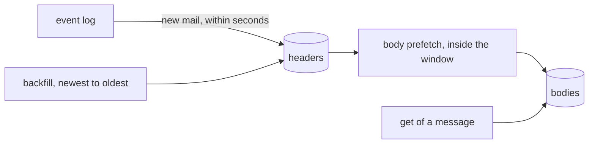

# The local cache

The daemon keeps `cache.db`, a local copy of every synced folder. It holds headers for all of each folder, and bodies for the body window plus recently read mail, indexed with SQLite's full-text search. A search or a read is answered from the cache when the cache can answer completely and is fresh, and from the mail server otherwise. Every answer says which.

The cache needs no configuration. The `[cache]` keys tune it (see [Configuration](../reference/configuration.md)), and [Operating the cache](../operations/cache.md) covers its states, body retention, the download budget, rebuilds and evictions.

`cache.db` lives beside `state.db` in `--state-dir`, or in `[cache] dir`, with mode `0600`, as are its `-wal` and `-shm` files. It is not encrypted (see [Security model](./security-model.md)). It can be deleted while the daemon is stopped, together with `cache.db-wal` and `cache.db-shm`, and the daemon builds it again on its next start.

The cache follows the watcher's event log, so it covers the folders an account syncs (see [Watching for mail](../guide/watching.md)). An account with `sync.enabled = false` has no cache.

## What is cached

For every synced folder, or All Mail on Google, the cache keeps each message's headers: From, To, Cc, Bcc, subject, dates, Message-ID, In-Reply-To, References, flags, Gmail labels, size and the attachment list. For the body window and recent reads, it also keeps the body as `get` reads it: the original header and the text parts, without attachment bodies. Attachments and raw messages are never cached, so `attachment` and `get --raw` always stream from the server.

Gmail's Trash and Spam are not in All Mail. So on Google `in:trash`, `in:spam`, `in:junk` and `in:anywhere`, and `label:` with those names, go to the server. Off Google a default sync leaves out Trash and Junk the same way, so `in:trash` there goes to the server too.

On Google the cache reads `in:` and `label:` as Gmail does. `inbox`, `sent`, `drafts`, `starred` and `important` mean the system labels, and `in:archive` means mail without the Inbox label. Any other label matches with case folded and every space and slash read as a hyphen, so `label:work-clients` finds `Work/Clients`.

### How the cache fills



When the cache starts on a folder, the headers of new mail arrive through the event log within seconds. A backfill walks the older mail from newest to oldest, `backfill_batch` headers at a time with `backfill_pause` between batches, the watched folders first.

Once a folder's backfill is done, a body prefetch fetches the bodies of its mail inside the window, newest first, 25 at a time. After that, new mail that arrives inside the window wakes the prefetch at once, so its body follows its headers within moments, budget allowing. Until it does, the folder's window is not complete, so searches with text go to the server.

A body that fails to fetch is tried at most 3 times, 8 hours apart, then counted as a final failure, and its headers stay searchable. Filling the cache never marks mail read, because every fetch uses `BODY.PEEK`.

## Which answers come from the cache

Each account is decided on its own, for each page, so one search can mix the cache and the servers. With `--source auto`, the default, the cache answers an account when every folder the search covers is synced, fresh and backfilled, and the cache can answer the whole query. Otherwise the account's mail server answers.

Rules match only against the cache, never against the mail servers. A scheduled or manual run on an account whose cache cannot answer the rule completely acts on nothing (see [Rules](../guide/rules.md#the-query)).

### Fresh folders

A folder is fresh when all of these hold:

- It is watched (state `watching`), or polled with its last poll successful within twice `sync.poll`.
- It has been synced since the daemon started.
- The account's cache has caught up with its mail events. It trails them by no more than `fresh_lag`, and none were lost.

So after a restart, a search over a folder goes to the server until the watcher's first pass over that folder in this run. That pass usually follows within seconds of the daemon connecting, however recently the last run synced the folder.

### Text and the body window

Every operator except text is answered from the headers. Text, meaning words and phrases, needs bodies. So the cache answers text only when the query's top level has `newer_than:` or `after:` inside the body window and every folder's window is complete. The bound counts in days, so with the default window of 90 days `newer_than:89d` can use the cache and `newer_than:90d` cannot. A query with text and no such bound, such as `invoice` alone or `invoice OR receipt`, goes to the server.

A query with a term the cache cannot evaluate at all, such as `label:\Seen` off Google, goes to the server whatever `--source` says, and the server answers or refuses it as before. This check comes before every other, so `label:\Seen OR invoice` off Google goes to the server even with `--source cache`, and is refused there.

### Operators only the cache answers

On accounts other than Google, `has:`, `filename:` and `label:` are answered only by the cache. Under `--source auto`, and always under `--source server`, a query the cache cannot answer completely there is refused with `INVALID_ARGUMENT` and a hint that names the cause. `item:` is answered only by the cache on every account, and an account whose cache cannot answer completely refuses it with `CACHE_NOT_READY` (exit 7). [Reading and searching](../guide/reading-and-searching.md) has the details of both.

### Forcing a source

`--source cache`, or `source: "cache"` over MCP, answers from the cache even when a check fails. A query the cache can only partly evaluate then gives no rows for the whole account, which is marked incomplete. That is a query with text under `OR` or `-` and no date bound around it, such as `invoice OR receipt` (`text_outside_window`), or on Google one that names Trash, Spam, Junk or `anywhere` (`folder_not_synced`).

`--source server` skips the cache.

```sh
chainmail search --source cache 'from:acme newer_than:30d'
```

## The source of an answer

A search response's `source` is `cache`, `server`, or `mixed` when some accounts were answered by the cache and others by their servers. Each entry of `account_counts` has these fields:

| Field | Meaning |
|---|---|
| `source` | What answered this account. |
| `synced_at` | With the cache, the oldest last sync of the folders searched. |
| `complete` | Whether the answer is complete. |
| `incomplete_reason` | Why it is not, from the table below. |

In `get` and `thread`, each message carries its own `source`, and the response's `source` sums them up the same way. A thread's `source` also counts where its list of members came from, so a thread whose members were found on the server is `server` or `mixed` even when every message came from the cache.

`account_counts` lists each account that answered the page, with or without matches, and each account whose answer is incomplete. An account whose search failed is in `partial` instead. On a later page, an account the cursor has finished is left out.

Under `--source cache`, an account whose check failed has `complete` false and one of these reasons. Only `unreadable_messages` also appears without `--source cache`.

| Reason | Meaning |
|---|---|
| `backfilling` | A folder's backfill is not done, so older mail is missing. |
| `stale` | A folder is neither `watching` nor `polling` with a successful poll within twice `sync.poll`, as when it is reconnecting or in error. Or the cache has not caught up with the account's mail events: it trails them by more than `fresh_lag`, or events were lost. |
| `text_outside_window` | The query has text without a lower date bound inside the body window, the window is `0d`, or a folder's window is not complete yet. Text under `OR` or `-` with no date bound gives the account no rows. Other text is matched against what the cache holds. |
| `folder_not_synced` | The search covers a folder the account does not sync, such as Trash. Off Google that folder gives no rows and the others answer. On Google, a query naming Trash, Spam, Junk or `anywhere` gives the account no rows. |
| `cache_disabled` | The account has no cache: `cache.enabled` is false, the account does not sync, or `cache.db` cannot be used because it did not open or its disk is full. The account gives no rows, not an error. |
| `unreadable_messages` | A folder searched holds messages the cache could not read. The cache answers anyway, also under `--source auto`, and the answer lacks them. The reasons above win over this one. |

In table output a footer names the source of each account in `account_counts`, and why a forced answer is incomplete:

```text
source: gm cache (incomplete: backfilling), host cache (incomplete: cache_disabled)
```

## Reading through the cache

A message's body never changes for a given UID, so a cached body is always valid. `get` renders it with `body_limit`, `--full` and quote trimming exactly as it renders one from the server. Flags and labels come from the cache when the folder is fresh, and from one quick fetch from the server otherwise.

A message the cache does not hold is read from the server, and its body is kept when the cache tracks its folder. Every read sets the body's last-read time, which body retention uses. `thread` comes from the cache when the cache holds the message and every folder a default search covers is fresh and backfilled.

On accounts other than Google, a read the cache cannot answer goes to the server. Only when the server answers `STALE_REF`, because the folder was renumbered or the message moved, is the message looked up by its Message-ID. The read is then retried on the new ref when that Message-ID names exactly one other message in the cache. The message in the response carries the new ref, while in `get` the item's own `ref` stays the one you passed. Zero or several matches give `STALE_REF` as before.

This recovery covers `get` and `thread` only. Writes with a stale ref still fail with `STALE_REF`. Google keeps its own recovery by Gmail's message ID (see [Refs and cursors](./refs-and-cursors.md)).

## How the cache matches text

The cache matches words and phrases as whole tokens over the subject, the display names, the addresses and the body text, ignoring case and accents. There is no stemming, no synonyms and no partial words, so `invoice` does not match `invoices`, where Gmail's search might. The mail server of an account other than Google matches substrings instead. Header operators, such as `from:`, match substrings on both paths.

Dates differ on one point. A search answered from the cache compares `newer_than:`, `older_than:`, `after:` and `before:` by arrival day on every account. Off Google the mail server does the same, while on Google Gmail's own search reads `newer_than:` its own way.
