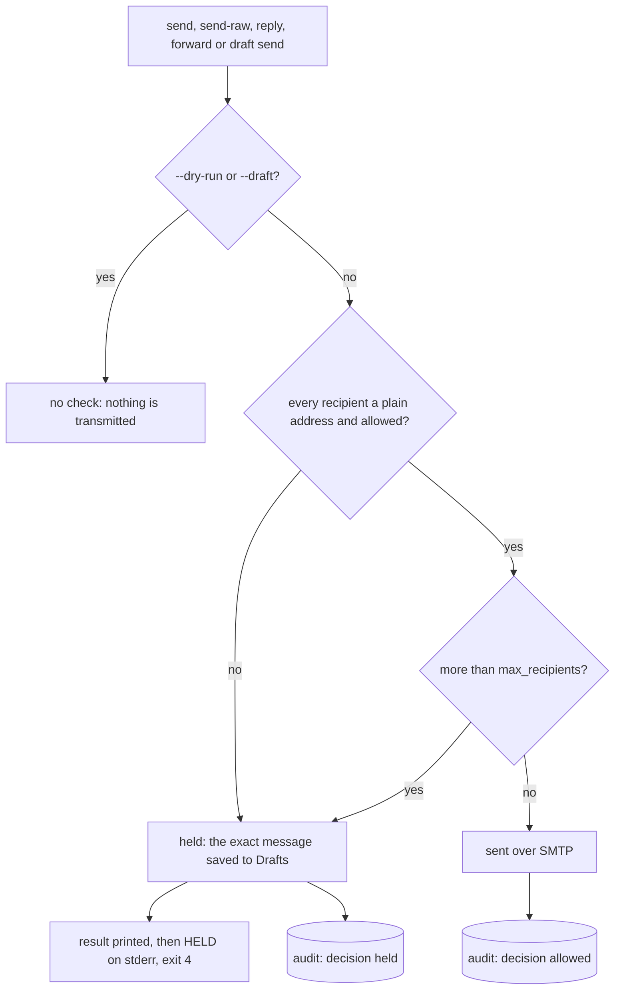

# The send policy

The daemon checks every send against a policy before anything is transmitted, and refuses the destructive actions unless the config turns them on. The policy lives in the daemon's config file, `/etc/chainmail/config.toml` in production, as a global `[policy]` table and an optional `[accounts.<name>.policy]` table per account:

```toml
[policy]
send_allow = ["*@example.org", "someone@example.com"]
max_recipients = 10
allow_expunge = false
allow_folder_delete = false

[accounts.personal.policy]
send_allow = ["friend@example.net"]
```

| Key | Table | Default | Meaning |
|---|---|---|---|
| `send_allow` | `[policy]` and `[accounts.<name>.policy]` | empty | Recipients a send may reach without a hold. The account table's list is added to the global one for that account only. |
| `max_recipients` | `[policy]` | `10` | The most recipients one send may have, from 1 to 500. A send with more is held. |
| `allow_expunge` | `[policy]` | `false` | Whether `expunge` is allowed. |
| `allow_folder_delete` | `[policy]` | `false` | Whether `folder delete` is allowed. |

Like every other key, these are checked at startup, and the daemon refuses to start on an invalid entry or an unknown key. It reads the config only at startup, so a change to the policy takes a restart. [Configuration](../reference/configuration.md) lists every key, and [The policy in operation](../operations/policy.md) covers changing it on a running host.

## How a send is checked



## The allowlist

An entry in `send_allow` has one of two forms:

- A bare address, such as `someone@example.com`, with no display name, no angle brackets and exactly one `@`. It matches only that address.
- `*@domain`, such as `*@example.org`. It matches any address whose part after its last `@` is exactly that domain. Subdomains do not match, so `*@example.org` does not allow `bob@mail.example.org`.

Anything else, such as `*@*`, `*.example.com`, `@example.com` or `bob@*`, is a config error that names the table and the entry. Matching ignores case.

For an account, the allowed recipients are the global `send_allow`, that account's own `send_allow`, and the `address` of every configured account, so mail between your own accounts is never held. With no entries at all, only your own addresses are allowed and every other send is held.

## Held sends

The policy checks `send`, `send-raw`, `reply`, `reply --all`, `forward` and `draft send`. It looks at the message's envelope recipients: To, Cc and Bcc together, without repeats, or for `send-raw` the addresses the message would be submitted to. `--dry-run` and `--draft` transmit nothing, so they are not checked. A send is held when any of these is true:

- A recipient is not allowed.
- A recipient is not a plain `local@domain` address, whatever the allowlist says. A quoted local part such as `"ann smith"@example.com`, an address literal such as `ann@[192.0.2.1]`, whitespace or control characters all count as unsafe, because SMTP could read part of the decoded address as its own syntax. The SMTP sender refuses these recipients too.
- The message has more than `max_recipients` recipients.

A held send is never transmitted. No `MAIL FROM` or `RCPT TO` is sent for it. The daemon dials SMTP while it builds the message, so the connection and login may already have happened, and the hold closes that connection unused.

Instead the daemon saves the exact message it built to the account's Drafts folder, marked `\Draft` and `\Seen`. When the envelope has recipients that are not in the message's To or Cc, such as Bcc recipients or the extra envelope recipients of `send-raw`, the draft gets a `Bcc` header listing them, so nobody is lost when the draft is sent from a mail client. A held `draft send` saves nothing new. The draft stays in Drafts as it was, and the result names it.

A hold still happens while the SMTP server is unreachable, since the message never needed it. If saving the draft fails, for example because IMAP is down, the command fails with that error. The message was then neither sent nor saved, and running the same command again tries again.

### What a hold looks like

The command prints the result on stdout as usual, then the `HELD` error on stderr, and exits 4. With JSON output the result is:

```json
{"result":{"held":{"draft":{"ref":"cm1:work:Drafts:1793457333:12","message_id":"01M69669KM.MJJH0XAXCV@example.org","hint":""},"blocked":["stranger@example.net"],"too_many_recipients":false,"hint":"held by policy: saved to Drafts for James to review and send"}}}
```

When stderr is not a terminal, it holds:

```json
{"error":{"reason":"HELD","message":"held by policy: saved to Drafts","hint":"held by policy: saved to Drafts for James to review and send"}}
```

On a terminal the command prints `held by policy, not sent: saved to Drafts` and the draft's ref, then the blocked recipients and whether there were too many.

- `draft.ref` is the saved draft's ref. On a server that does not say where it stored the draft, `ref` is empty and `draft.hint` says to search Drafts for `message_id`.
- `blocked` lists the recipients that are not allowed, as given.
- `too_many_recipients` is true when there were more than `max_recipients`.

Running the same command again with the same idempotency key replays the held result and saves no second draft. Over MCP, a held send comes back as a result with status `held`, not as an error (see [Working with mail](../agents/working-with-mail.md)).

### What a hold means for an agent

Nothing was sent. An agent should relay the hint to the person and stop there. The person sends, edits or deletes the draft from their own mail client. An agent must not try to get the message out another way, such as from another account or with fewer recipients per send. The MCP server's instructions tell every agent this at startup.

To let a recipient through, add it to `send_allow` and restart the daemon.

## Destructive defaults

`allow_expunge` and `allow_folder_delete` are both `false` unless the config says otherwise.

- With `allow_expunge` off, `expunge` is refused with `POLICY_DENIED` (exit 3), the message `expunge is disabled by policy` and a hint naming the setting, before any IMAP work. `draft delete`, `draft update` and `draft send` then move the old draft to the account's Trash instead of deleting it for good. That stops an agent from moving any message into Drafts, or labelling a Gmail message `\Draft`, and then destroying it with `draft delete`.
- With `allow_folder_delete` off, `folder delete` is refused the same way, with `folder delete is disabled by policy`.
- With `allow_folder_delete` on, an agent can `folder delete --force` a folder that holds mail. On accounts other than Google that deletes the mail with it, whether `allow_expunge` is on or not. Keep both settings `false` unless you mean to let agents destroy mail.
- `trash`, `move`, `copy`, `archive` and the flag and label commands are not gated. Mail in Trash can be recovered until the server empties it.

## Audit

Every policy decision is audited, and audit rows never hold recipient addresses.

| Case | Decision | Result | Also recorded |
|---|---|---|---|
| A send the policy passed | `allowed` | `ok` | the account and the Message-ID |
| A hold | `held` | `ok`, reason `HELD` | the draft's ref, its Message-ID, `blocked:<n>` with the number of blocked recipients, and `too_many` when that applied |
| A repeat of a held send | `duplicate` | | |
| A refused `expunge` or `folder delete` | `denied` | `error`, reason `POLICY_DENIED` | |

[Security model](./security-model.md#every-change-is-audited) describes the audit log as a whole.
