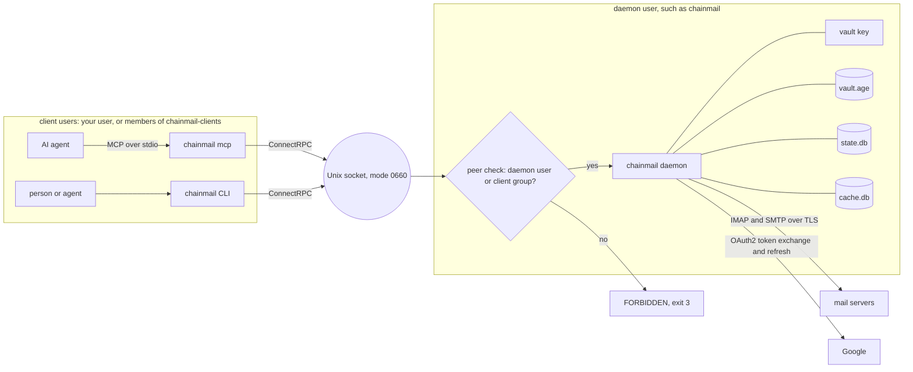

# Security model

chainmail keeps mail credentials away from AI agents. A daemon holds every password and token and makes every connection to the mail servers. Agents and people reach it only through the `chainmail` CLI or `chainmail mcp`, which are thin clients on a Unix socket and hold no secrets. The daemon checks each caller at the socket, checks each send against a policy, and records nearly every call in an audit log.

Everything inside the daemon user's box is readable only by that user. Everything a client sees comes back through the socket, after the policy.

## The daemon owns the credentials

Passwords, OAuth client secrets and refresh tokens live in the daemon's vault and nowhere else. The CLI and `chainmail mcp` hold no secrets and no mail logic.

In production the daemon runs as its own system user, such as `chainmail`. Its state is in `--state-dir`, `/var/lib/chainmail` by default, with mode `0700`, which your user cannot read. That directory also holds `cache.db`, which keeps copies of message headers and recent bodies. `cache.db` is not encrypted, so file modes and the daemon's user protect it. The daemon keeps `cache.db` and its `-wal` and `-shm` files at mode `0600` whatever the umask, and sets a wider mode back to `0600` when it starts. `[cache] dir` can move the cache. The daemon creates that directory with mode `0700`, and leaves the mode of one that already exists as it is.

The NixOS module sets up the user, the client group and the state directory. On other Linux hosts and on macOS you create them yourself, then run `chainmail daemon` as that user with `--config`, `--state-dir` and `--vault-key-file` as needed. macOS has no `/run`, so there the config must set `daemon.socket` to a path in a directory the daemon owns, and clients need `--socket`, `CHAINMAIL_SOCKET` or `socket` in `cli.toml`. [Deploy](../operations/deploy.mdx) gives the steps for each.

A `--dev` daemon runs as your own user and is for development only. Anything running as you can read a dev vault's key.

## Secrets go in and never come out

`chainmail secret set` and `chainmail auth login` write secrets. No API call returns one. `chainmail admin status` lists secret names only. `secret set` accepts only the secret names the config uses (see [Accounts and providers](../getting-started/accounts.md#the-vault)).

## The vault is encrypted at rest

`vault.age` is an [age](https://age-encryption.org) file. Under systemd, as the NixOS module sets it up, its key arrives through `LoadCredentialEncrypted=`, sealed to the host's TPM2, at `$CREDENTIALS_DIRECTORY/vault-key`. Elsewhere, and in development, the key is a file passed with `--vault-key-file`.

The daemon refuses a key file that others can access. The file must meet one of two rules:

- It is owned by the daemon's user, with no group or other permission bits, such as mode `0600` or `0400`.
- It is owned by `root:root`, with no other bits and at most group read.

The second form exists because systemd delivers a `LoadCredential` file as `0440 root:root` and grants the service user read access through an ACL.

## The socket has a group and a peer check

The daemon creates its socket with mode `0660`. Without `--dev`, it sets the socket's group to `daemon.client_group`, `chainmail-clients` by default, and refuses to start when that group does not exist.

On every connection the daemon reads the peer's credentials, with `SO_PEERCRED` on Linux and `LOCAL_PEERCRED` on macOS. It allows only its own user and members of the client group. It looks up membership per request, so adding a user to the group takes effect without a daemon restart. The user's processes still need a new login, or `sg chainmail-clients`, to carry the group. A dev daemon allows only your own user. A refused peer gets `FORBIDDEN` (exit 3).

Release builds are pure Go (`CGO_ENABLED=0`). So on Linux the daemon reads users, groups and memberships from `/etc/passwd` and `/etc/group`, not through NSS. A user or membership that exists only in NSS, such as one from LDAP or SSSD, is refused.

## Sends off the allowlist are held, not sent

A send to any recipient that is not on the policy's allowlist is never transmitted. The daemon saves the exact message to the account's Drafts folder, and you send, edit or delete it from your own mail client. A recipient that is not a plain `local@domain` address, such as one with a quoted local part, is always held, whatever the allowlist says. `expunge` and `folder delete` are refused unless the config enables them. [The send policy](./policy.md) describes the rules.

Any client that passes the peer check can still send as any configured account to anyone on the allowlist, and can move, archive, flag and trash mail. Give the socket only to users and agents you trust that far. Every send and every change is audited, so you can see afterwards what was done.

## Message and item text is untrusted

Everything taken from a message, such as subjects, addresses and bodies, comes back marked as untrusted data, as described in [Untrusted content](./untrusted-content.md). Work item text gets the same treatment. Titles, descriptions, criterion text, evidence and link notes come back wrapped as `{"untrusted": "..."}` from the API, the CLI's JSON and MCP, whoever wrote them. Agents often copy them from mail, and an instruction injected into a message must not come back as trusted text. No error message, hint, log line or audit row holds item text.

Item calls pass no policy gate, so any client allowed on the socket can create, change and delete items. Deletes are soft, and the audit log records every call, so a bad change can be found and undone (see [Work items](../guide/items.md)).

## Rules act inside the policy

Any client allowed on the socket can create, change and delete rules, as it can items. A rule's actions run in the daemon as its own user with client kind `rule`, through the same code as a client's call. So a forward goes through the allowlist and `max_recipients`, and a forward off the allowlist is held as a draft. `expunge` and folder deletion are not actions.

The cap per run and auto-disable bound what a bad rule can do before someone notices, and trashed mail stays recoverable while `expunge` stays refused. Rule descriptions and queries come back wrapped as untrusted, since they are often copied from mail. No error message, hint, log line or row of a rule call holds a rule's description, query, folder or label name, forward address or note. The row of an action a rule takes is the row the same call writes for a client, so a `move` or `copy` names its folder. See [Rules](../guide/rules.md).

## Every change is audited

The `audit` table in `state.db` records, for each call, the time, the caller's UID, the client kind, the account, the action, the targets, the decision, the result and the error reason. The client kind is `cli`, `mcp`, `live-test`, `daemon` for work the daemon starts itself, such as a background probe, or `rule` for an action a rule takes. `chainmail audit` reads the table (see [The audit log](../guide/audit-log.md)).

Every call is recorded except `admin status`, `audit`, `watch status`, `cache status` and a watch's acknowledgements, the `Ack` call. The table is append-only, because triggers refuse updates and deletes. If the audit write fails, the call fails too, so chainmail never reports success for something it could not record.

The client kind is self-reported in the `Chainmail-Client` header, so any local caller can claim any kind. The caller's UID comes from the socket and is the authoritative identity. A socket client that claims `daemon` or `rule` is recorded as `(invalid)`, so those kinds mark only the daemon's own work.

### Actions

The audited reads are `accounts.list`, `account.test`, `secret.set`, `auth.login.begin`, `auth.login.finish`, `folders.list`, `search`, `get`, `get.raw`, `thread`, `attachment`, `watch.subscribe`, `watch.read`, `watch.groups.list`, `item.get`, `item.list`, `rule.get`, `rule.list`, `rule.dry_run`, `rule.runs` and `rule.status`.

The audited writes are `send`, `send_raw`, `reply`, `forward`, `upload`, `draft.create`, `draft.update`, `draft.send`, `draft.delete`, `move`, `copy`, `archive`, `trash`, `expunge`, `flags`, `labels`, `folders.create`, `folders.rename`, `folders.delete`, `limits.probe`, `watch.groups.delete`, `cache.rebuild`, `cache.evict`, `item.create`, `item.update`, `item.delete`, `item.restore`, `item.criteria`, `item.tick`, `item.block`, `item.link`, `item.unlink`, `rule.create`, `rule.update`, `rule.delete`, `rule.restore` and `rule.run`.

### What a row holds

Rows never contain secret values or message content. A read's row holds counts and refs only, never subjects, addresses or the search query.

- A send's row names the account and the Message-ID, never the recipients, subject or body. A reply or forward row also names the original's ref, and a draft row the draft's ref.
- A batch that spans accounts records one row per account.
- The decision of a send is `allowed` when the policy passed it, `held` for a hold, `duplicate` for a repeated send and `dry_run` for a dry run. A refused `expunge` or `folder delete` records `denied`.
- A `search`, `get` or `thread` row names what answered it: `source=cache`, `source=server` or, when accounts or messages differed, `source=mixed`. A `thread` row also counts where its list of members came from.
- A `watch.subscribe` or `watch.read` row names where the read starts (`group=<name>`, `since=<id>` or `live`), the number of accounts in the filter, the kinds, and whether `in` was set, never the `in` value or any event content. A `watch.read` row also counts the events returned, a `watch.groups.list` row counts the groups, and a `watch.groups.delete` row names the group. A row with an item filter names it as `item=<id>`.
- A `cache.rebuild` row names the folder (`folder=<name>`, or `folder=(all)` for every folder of the account) and how many folders it dropped (`rebuilt=<n>`). A `cache.evict` row names the bodies it removed and the bytes they held (`bodies=<n>`, `freed=<bytes>`).
- An item row names the item as `item=<id>`. Where they apply, it also names the type (`type=<type>`), the changed field names (`fields=<names>`), `cascade=1`, the number of items a delete or restore touched (`ids=<n>`), the number of criteria (`criteria=<n>`), the criterion (`criterion=<id>`) and the blocker (`blocked_by=<id>`).
- A link or unlink row also names the account and the thread (`account=<name>`, `thread=<key>`), and has the link's account as its account.
- An `item.list` row names its filters, such as `state=<state>` or `under=<id>`, and the number of rows returned (`rows=<n>`).
- A retried `item.create` with the same idempotency key records the decision `duplicate`.
- A `search` row that used `item:` records `item_op=1`, never the item ID.
- Item rows never hold titles, descriptions, notes, criterion text or evidence.
- A rule row names the rule as `rule=<id>`, or `rule=unsaved` for a dry run of an unsaved rule. Where they apply, it also names the number of actions (`actions=<n>`), the changed field names (`fields=<names>`), the new revision (`revision=<n>`), the trigger (`trigger=<trigger>`), the outcome filter (`outcome=<outcome>`), the cap of a run (`max=<n>`), `history=1`, `enabled=<bool>`, `deleted=1`, and counts such as `accounts=<n>`, `matched=<n>`, `runs=<n>`, `rows=<n>` and `runners=<n>`.
- An action a rule took has client kind `rule` and the daemon's UID, and its targets add `rule=<id>` and `run=<id>`.
- Rule rows never hold a rule's description, query, label names, forward addresses or note.

An account or secret name that is not a valid name, or a client kind that is not a short lowercase name, is recorded as `(invalid)`, and the call fails with `INVALID_ARGUMENT`.

## Root is out of scope

chainmail stops accidents and prompt injection that run through chainmail. It does not stop an agent that can become root. If your user has passwordless sudo or is in the `docker` group, an agent with an unrestricted shell can read the vault through root. Closing that gap means running agents without sudo or docker, which is outside chainmail.
