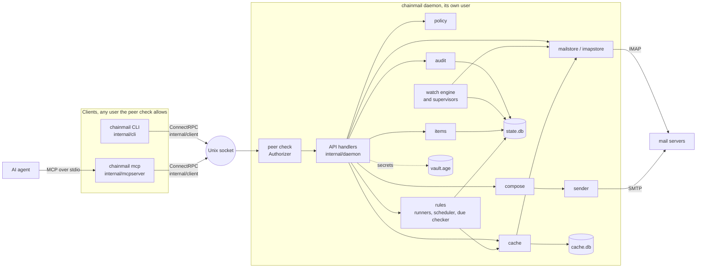
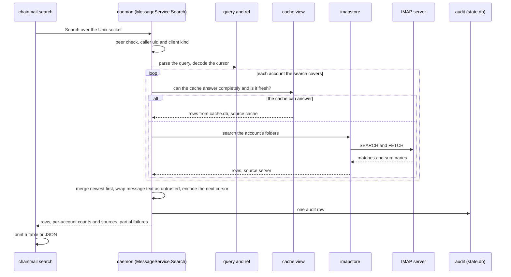
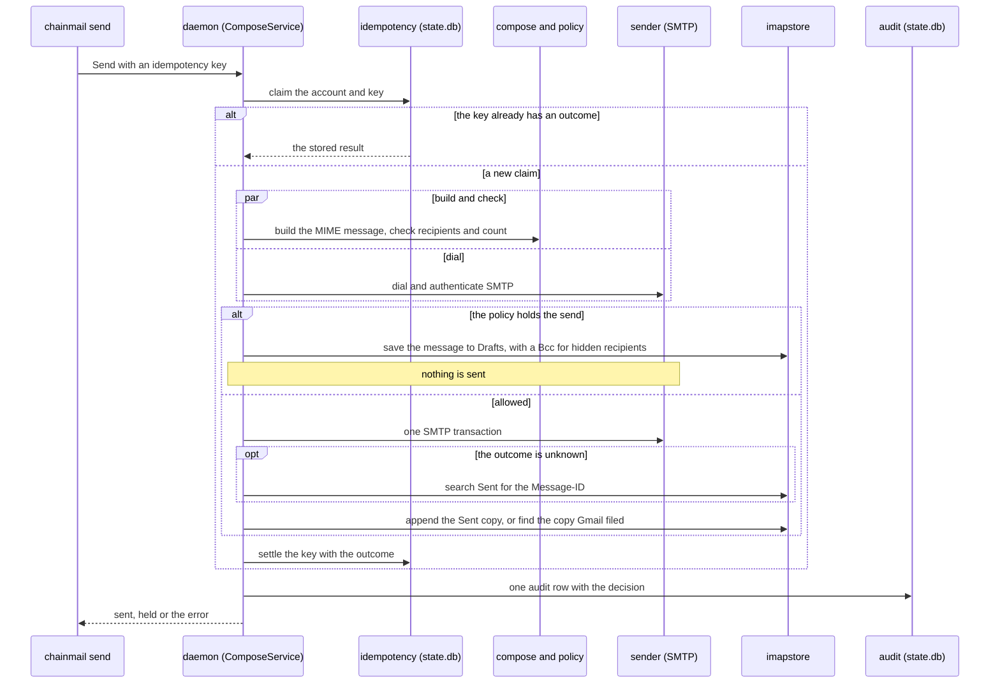
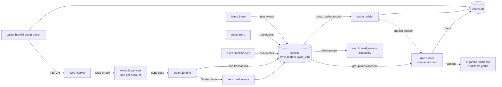

# Architecture

chainmail is one Go binary, `chainmail`, built from `cmd/chainmail`. It runs as three kinds of process. The daemon owns every credential and every mail connection. The CLI and the MCP server are thin clients that call the daemon over a Unix socket. This page describes how those parts fit together, as the code on `main` has them.

## The processes

| Process | Started by | What it does |
|---|---|---|
| `chainmail daemon` | systemd, launchd or a terminal | Opens the vault, `state.db` and `cache.db`, listens on the Unix socket, checks each peer, runs the API handlers, watches and syncs mail, keeps the cache, and runs rules. |
| `chainmail <command>` | a person or a script | Makes the calls for one command, prints the answer as a table or JSON, and exits with a code from `internal/api`. Every call carries client kind `cli`. |
| `chainmail mcp` | an agent's MCP client | Serves chainmail's tools over MCP on stdin and stdout, for as long as the agent runs. It turns each tool call into daemon calls with client kind `mcp`, moves attachment files, and wraps message text as untrusted. |

The daemon is the only process that holds secrets or talks to a mail server. The clients hold no secrets and no mail logic. The [security model](../concepts/security-model.md) explains why the boundary sits there.

## Packages

Everything but the entry point and the generated code lives under `internal/`, so no other module can import it. The generated API code in `gen/` is importable, which the [API page](./api.md) uses.

| Package | What it owns |
|---|---|
| `cmd/chainmail` | The entry point. It runs `cli.Execute` with a context that SIGINT and SIGTERM cancel, and exits with its code. |
| `gen/chainmail/v1` | Go types generated from `proto/` by `buf generate`. Never edit them by hand. |
| `gen/chainmail/v1/chainmailv1connect` | The ConnectRPC clients and handlers generated from the same files. |
| `internal/api` | The contract shared by the daemon and its clients: error reasons, CLI exit codes and the `Chainmail-Client` request header. Its values never change or get reused. |
| `internal/audit` | The audit log: what chainmail did, who asked, and how it turned out. It writes and reads the `audit` table. |
| `internal/auth` | Turns account config and vault secrets into login credentials, tracks which accounts need a human, and runs the OAuth2 login flow. |
| `internal/cache` | `cache.db`: headers of every synced folder, bodies for a window plus recent reads, and an FTS5 index over both. It answers searches and reads when it can, and can be deleted at any time. |
| `internal/cli` | The command line: every cobra command, the output formats, `cli.toml`, completion and the hidden `man` command. |
| `internal/client` | Connects to the daemon over its Unix socket, with one ConnectRPC client per service and the client kind header on every call. |
| `internal/compose` | Builds outgoing MIME messages from a typed spec. It does no I/O. |
| `internal/config` | Loads and validates the daemon's TOML config. |
| `internal/daemon` | The daemon: the socket, the peer check, every API handler, and the wiring of the other packages. |
| `internal/db` | Opens chainmail's SQLite databases and applies the `state.db` migrations. |
| `internal/idempotency` | Records send-type requests by account and key, so a repeated request returns the first outcome instead of sending again. Rows are kept for seven days. |
| `internal/items` | Work items in `state.db`, from objectives down to tasks, with acceptance criteria, blockers, soft delete, a global revision counter and links to mail threads. Every write appends item events to the event log in the same transaction. |
| `internal/limits` | Probes how many IMAP connections an account accepts and stores the result, from which the connection pool is sized. |
| `internal/live` | Smoke tests against real accounts through a running daemon. They build only with the `live` tag. |
| `internal/mailaddr` | Decides which addresses can be written into an SMTP envelope as they are, so the policy and the sender share one grammar. |
| `internal/mailaddr/allow` | Validates and matches allowlist entries, a bare address or `*@domain`, for both `internal/config` and `internal/policy`. |
| `internal/mailstore` | The provider-neutral view of a mail account: the `Store` interface the daemon reads and changes mail through, and the types it returns. Nothing here imports go-imap. |
| `internal/mailstore/imapstore` | The IMAP implementation of `mailstore.Store`. It is the only production package that imports go-imap. |
| `internal/mailstore/fake` | An in-memory `mailstore.Store` for the daemon's component tests. |
| `internal/mailstore/storetest` | The conformance suite every `mailstore.Store` runs: the fake, imapstore against Dovecot and imapstore against the fake Gmail server. |
| `internal/mcpserver` | The MCP server behind `chainmail mcp`. It shapes requests, moves attachment files and wraps output, and holds no secrets and no mail logic. |
| `internal/policy` | Decides which recipients a send may reach, how many, and whether destructive actions are allowed. It is pure, with no I/O. |
| `internal/provider` | Connection presets for the supported mail providers. |
| `internal/query` | Parses the Gmail-style search language into a typed tree and checks it. It knows nothing about IMAP. |
| `internal/ref` | Encodes and decodes message refs and search cursors, which are opaque to agents. |
| `internal/render` | Turns MIME messages into text an agent can read: picks the text part, decodes charsets, converts HTML, trims quotes and signatures, truncates, and cleans message-derived strings. |
| `internal/rules` | Rules in `state.db`: definitions with revisions and soft delete, validation, schedules, run history and the act-once table, plus the due checker that writes item due events. It knows nothing about IMAP. |
| `internal/sender` | Submits mail over SMTP. |
| `internal/upload` | Holds uploaded attachment bytes in `uploads/` under the state directory until a send uses them. Uploads expire, and the index lives in memory. |
| `internal/vault` | Keeps the secrets in one age-encrypted file, `vault.age`. No API returns a secret to a client. |
| `internal/version` | The build version, set with `-ldflags` at build time. |
| `internal/watch` | Sync state and the durable event log in `state.db`: folder checkpoints, known UIDs, the events sync passes append, named groups, and the supervisors that watch each account. |
| `internal/testutil/ctxtest` | Contexts for tests that must end at a moment the test picks. |
| `internal/testutil/daemontest` | Runs an in-process daemon for tests. |
| `internal/testutil/dovecot` | Runs a Dovecot IMAP server in a Docker container for the integration tests. |
| `internal/testutil/fakegmail` | An in-memory IMAP server that speaks enough of Gmail's dialect for imapstore's tests. |
| `internal/testutil/imaptest` | An in-memory IMAP server for tests. |
| `internal/testutil/oauthtest` | A fake OAuth2 token endpoint. |
| `internal/testutil/saslx` | SASL server pieces that go-sasl lacks, for the test servers. |
| `internal/testutil/smtptest` | An SMTP submission server for tests that captures mail and can inject faults. |
| `internal/testutil/tlstest` | Throwaway TLS certificates. |

## Inside the daemon

`daemon.New` wires the packages together and registers one ConnectRPC handler per service: `AccountService`, `AdminService`, `MessageService`, `ComposeService`, `OrganizeService`, `WatchService`, `CacheService`, `ItemsService` and `RulesService`. The [API page](./api.md) lists their RPCs. The HTTP server speaks HTTP/1.1 and unencrypted HTTP/2 on the socket, and every request passes the peer check before it reaches a handler.

`Server.Serve` starts things in this order:

1. It creates the two standing Admin items if they are missing.
2. It recovers sends an earlier daemon left in progress, marking their outcome unknown so a repeat never sends them again.
3. It opens `cache.db`.
4. It starts one watch supervisor per synced account, and the cache workers of each account with the cache on. After the cache workers it starts one rule runner per account with a cache worker.
5. It starts the background loops: the idempotency pruner, the upload sweeper, the event log trimmer, the item and rule run tables' trimmer, the due checker, the rule scheduler and, with a cache, the evictor and the cache housekeeping. They run even when no account is watched.
6. It accepts connections.

On shutdown it stops taking requests, cancels the ones in flight, waits for every handler to return, stops the supervisors and cache workers, and logs out of the mail servers. It then stops the background loops, the rule scheduler among them, and closes `cache.db`. Only then does the CLI close `state.db`.

Each account's `mailstore.Store` is built once, on its first use, with a connection pool sized from the probed connection limit. Watchers hold connections of their own outside the pool.

Most handlers write one audit row through `Server.record` after the action runs, with the caller's uid from the peer check and the client kind from the `Chainmail-Client` header. A failed audit write fails the request, so chainmail never reports success for something it could not record. A few status reads write no row: `GetStatus`, `GetCacheStatus`, `GetWatchStatus`, `ReadAudit` and `Ack`.

Rule actions call the same internal functions as the organize, compose and items handlers, as the daemon's own uid with client kind `rule`, and write their rows through `Server.record` too.

## A search

`chainmail search is:unread` goes through the daemon like this. The MCP `search` tool takes the same path with client kind `mcp`.

The cache answers an account only when it can evaluate the whole query, every folder in the search's scope is fresh, and it holds what the query needs. Otherwise that account goes to its server. Each account's answer records its source, and a page built from both says `mixed`. [The local cache](../concepts/cache.md) describes the rules a user sees.

## A send

`chainmail send` and the MCP `send_email` tool call `ComposeService.Send`. Replies, forwards, `send-raw` and draft sends take the same path from the idempotency claim on.

The build decides before the dial does. So a held send still reaches Drafts while the SMTP server is down, and a build that fails or is held cancels the dial. Once the SMTP transaction starts, it runs to the end even if the client goes away. [The send policy](../concepts/policy.md) explains held sends from the user's side.

## Watching, the event log and the cache

The watch engine, the event log and the cache form one pipeline, all in the daemon.

- A `watch.Supervisor` runs per account. It keeps one IDLE loop on its own connection for each watched folder, and one poller for the synced folders that are not watched. While the account needs a human, every loop stops and the account is parked.
- Each sync pass goes through the `watch.Engine`. The engine compares what the server reports with the folder's checkpoint and known UIDs, and appends `new`, `flags`, `expunged` and `status` events in the same transaction that advances the checkpoint. It keeps no state of its own between passes.
- The engine's `OnNew` hook turns new messages on threads linked to live items into `item_mail` events, inside the same transaction. Item writes append `item` events through `items.Store`.
- The event log has named groups with Redis Streams semantics: each group has an acknowledged position, and a reader continues from it after a restart. Clients read through their own groups with `chainmail watch`, the `read_events` tool, or `WatchService`.
- The cache of each account reads the same log through an internal group named `cache.` followed by the account name. Clients can never use such a name. The builder applies events to `cache.db` and acknowledges them only after they are applied, so a failure loses nothing. The backfill fetches the headers of mail that was in a folder before the cache tracked it, and the prefetcher fetches bodies inside the window. The internal `unreadable` event kind, which the API never shows, tells the cache about new mail a pass could not read.
- The rule runner of each account reads the log through its own internal group, `rules.` followed by the account name, which clients cannot use either. It waits until the cache builder has applied a batch, matches the enabled `on_new` rules against `cache.db`, acts, and only then acknowledges. A transient failure leaves the batch unacknowledged, and the act-once table in `state.db` keeps the replay from acting twice.
- The rule scheduler sleeps until the next scheduled rule is due and hands it to each covered account's runner. An account with no runner gets a `cache_not_ready` run with the reason `cache_disabled`, and the rule moves on to its next time. The scheduler sleeps at most 5 minutes at a time and reads the wall clock after each sleep, as the due checker does. The due checker scans open items with due dates when the daemon starts and each day at `[rules] due_time`. It waits at most 5 minutes at a time and reads the wall clock after each wait, so a machine that wakes from sleep after `due_time` scans within about 5 minutes. `items.Store` calls it inside the transaction of each item write that can change a due stage. Rule changes append `rule` events through `rules.Store`.

[Watching for mail](../guide/watching.md) covers the user's view of events and groups.

## The state database

`state.db` sits in the state directory next to `vault.age`. `internal/db` opens it with WAL journaling, foreign keys on, a 5 second busy timeout, and a pool of one connection, which serializes the daemon's writers. A caller must not run a second query while it still holds rows open from an earlier one, because the second query waits for the only connection.

Migrations are embedded SQL files in `internal/db/migrations/state/`, named `NNNN_description.sql` and numbered from `0001` with no gaps. The database's `PRAGMA user_version` is the number of the last migration applied. On open, `internal/db` checks the whole set, then applies each missing migration in its own transaction. A database with a higher version than the binary knows is refused, so an older binary never runs against a newer schema.

| Migration | Tables |
|---|---|
| `0001_audit.sql` | `audit`, append-only: triggers abort any `UPDATE` or `DELETE`. |
| `0002_compose.sql` | `idempotency` (send-type requests by account and key, with their state and result) and `account_limits` (each account's probed IMAP connection cap). |
| `0003_watch.sql` | `sync_folders` (each synced folder's checkpoint, mode and state), `sync_uids` (the UIDs and flag hashes a folder is known to hold), `events` (the event log) and `event_groups` (each group's acknowledged position). |
| `0004_unreadable_events.sql` | Rebuilds `events` to allow the internal `unreadable` kind, keeping every event ID and the sequence. |
| `0005_items.sql` | `items`, `item_revision`, `item_criteria`, `item_blockers`, `item_links`, `item_mail_seen` and `item_requests`, then rebuilds `events` again to allow the `item` and `item_mail` kinds. |
| `0006_rules.sql` | `rules`, `rule_revisions`, `rule_runs`, `rule_applied` and `item_due_sent`, an index on the items' due dates, the removal of any client group named like a rules group, then a rebuild of `events` to allow the `rule`, `item_due_soon`, `item_due` and `item_overdue` kinds. |

To change the schema, add the next numbered file. Never edit a migration that has shipped. SQLite cannot change a `CHECK` constraint in place, so `0004`, `0005` and `0006` rebuild the `events` table and copy its rows across.

## The cache database

`cache.db` lives in `[cache] dir` when that is set, and otherwise in the state directory. `internal/cache` is the only code that issues SQL against it. Its schema is one file, `internal/cache/schema.sql`, and the cache has no migrations. `cache.SchemaVersion` is the file's `PRAGMA user_version`, and a file with any other version, a corrupt file, or a file next to a corruption marker is deleted and built again from the mail servers.

| Table | Holds |
|---|---|
| `messages` | One row per cached message per folder: envelope fields, flags, labels, attachments and normalized text for matching. |
| `bodies` | Raw bodies, with their size, fetch time and last read time for eviction. |
| `body_failures` | Bodies that failed to fetch, with the attempt count. |
| `messages_fts` | The FTS5 index over subject, names, addresses and body. |
| `folders` | Each folder's backfill progress and window state. |
| `ref_recovery` | Old refs of removed rows with their Message-ID, so a ref can be found again after a folder is renumbered. |
| `budget` | Bytes downloaded per account per UTC day. |
| `unreadable` | Messages whose server answer could not be parsed. |

`cache.db` and its `-wal` and `-shm` files are mode `0600` whatever the umask, since they hold mail. [Cache operations](../operations/cache.md) covers rebuilds, eviction and corruption in production.
