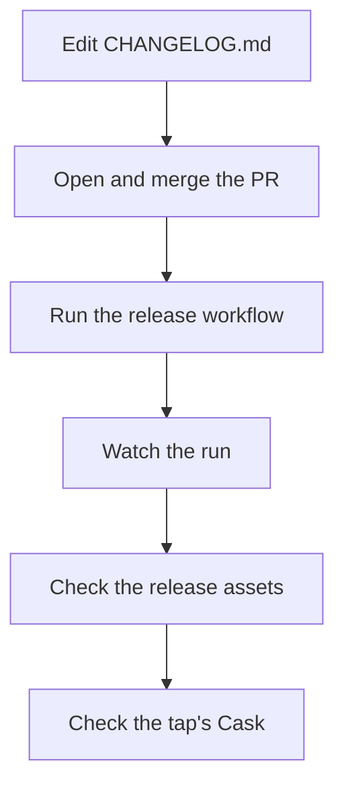

# Releasing

A release is a tag, a GitHub release with the binaries, and a Cask in the [yaklabco/homebrew-tap](https://github.com/yaklabco/homebrew-tap) tap, so that `brew install yaklabco/tap/chainmail` installs it. The `release` workflow does all three with `go tool stave release`. Releases are cut from `main`.

In the commands below, `'<version>'` is the new version without the `v`, such as `0.2.0`, and its tag is `'v<version>'`. Replace the text between the quotes and keep the quotes. Every block runs unchanged in bash and in fish.



## One-time setup

The workflow pushes the Cask to the tap with a token in the repository secret `HOMEBREW_TAP_TOKEN`. Make a fine-grained GitHub token with read and write access to the contents of `yaklabco/homebrew-tap`, then store it. The command prompts for the value:

```sh
gh secret set HOMEBREW_TAP_TOKEN --repo yaklabco/chainmail
```

`gh secret list --repo yaklabco/chainmail` shows `HOMEBREW_TAP_TOKEN` once it is set. The workflow stops early with a message naming the secret when it is empty. Set it again when the token expires.

## Edit the changelog

The release target tags the next version that the commit messages since the last tag call for, as `.svu.yml` configures it. A `feat` commit raises the minor number. A breaking change also raises the minor number while chainmail is before 1.0. Any other commit, `fix` included, raises the patch number. The target takes the release notes from that version's section of `CHANGELOG.md`, so the new heading must name that version.

On a branch from an up-to-date `main`:

```sh
git switch main
git pull --ff-only
git switch -c 'release-<version>'
```

In `CHANGELOG.md`:

1. Add a heading `## [<version>] - <date>` under `## [Unreleased]`, with today's date as `YYYY-MM-DD`.
2. Move every entry from under `## [Unreleased]` to under the new heading, and leave `## [Unreleased]` empty.
3. At the bottom, point `[Unreleased]` at `https://github.com/yaklabco/chainmail/compare/v<version>...HEAD`, and add a line `[<version>]: https://github.com/yaklabco/chainmail/compare/v<previous>...v<version>`, where `<previous>` is the last release.

Check the file and commit it. `check` validates `CHANGELOG.md` along with the lint, tests and build:

```sh
nix develop -c go tool stave check
git add CHANGELOG.md
git commit -m 'docs: release <version>'
git push -u origin 'release-<version>'
gh pr create --repo yaklabco/chainmail --fill
```

Merge the pull request once CI passes. `go tool stave snapshot` runs the same preparation as a release on your checkout without tagging or publishing anything. Run it on `main` after the merge to see the version it picks, the notes it wrote to `.buildcache/release-notes.md` and the archives it built in `dist/`:

```sh
git switch main
git pull --ff-only
nix develop -c go tool stave snapshot
```

## Run the release workflow

The workflow takes no inputs and runs only from `main`. It runs `go tool stave check`, then `go tool stave release`. The release target refuses to tag in any of these cases:

- `GITHUB_TOKEN` or `HOMEBREW_TAP_TOKEN` is empty.
- The tag already exists, locally or on `origin`.
- The working tree has changes or untracked files.
- `HEAD` is not the tip of `main` on `origin`.
- `CHANGELOG.md` has no section for the version.
- `goreleaser check` fails.

```sh
gh workflow run release --repo yaklabco/chainmail --ref main
```

Or from the web: open [the release workflow](https://github.com/yaklabco/chainmail/actions/workflows/release.yml), choose **Run workflow**, keep the branch at `main`, and choose **Run workflow** again.

## Watch the run

Find the run's ID, then follow it until it ends. `--exit-status` makes the command fail when the run fails:

```sh
gh run list --repo yaklabco/chainmail --workflow release --limit 1
gh run watch '<run-id>' --repo yaklabco/chainmail --exit-status
```

`gh run watch --repo yaklabco/chainmail` without an ID asks which run to follow. To read a failed run's log:

```sh
gh run view '<run-id>' --repo yaklabco/chainmail --log-failed
```

## Check the release

The release has five assets: an archive for each of `darwin_amd64`, `darwin_arm64`, `linux_amd64` and `linux_arm64`, named `chainmail_<version>_<os>_<arch>.tar.gz`, and `checksums.txt`. Each archive holds the binary, `LICENSE`, `README.md` and the man page.

```sh
gh release view 'v<version>' --repo yaklabco/chainmail --json assets --jq '.assets[].name'
gh release download 'v<version>' --repo yaklabco/chainmail --pattern checksums.txt --output -
```

The release notes on the release page are the changelog section for the version.

## Check the tap

The workflow commits `Casks/chainmail.rb` to the tap. Read it and check that its `version` is the new version and that each `sha256` matches the archive's line in `checksums.txt`:

```sh
gh api -H 'Accept: application/vnd.github.raw' repos/yaklabco/homebrew-tap/contents/Casks/chainmail.rb
```

Then install or upgrade on a Mac and check the binary and the man page:

```sh
brew update
brew upgrade yaklabco/tap/chainmail
chainmail version
man chainmail
```

Use `brew install yaklabco/tap/chainmail` instead of `brew upgrade` on a machine that does not have it yet.

## A release that fails halfway

The release target pushes the tag before it runs goreleaser. If goreleaser fails after that, most often because a token has expired or lacks access to the tap, the tag is on `origin` with no complete release behind it. A second run then refuses because the tag exists. Look first for what the failed run left behind:

```sh
git fetch --tags origin
gh release view 'v<version>' --repo yaklabco/chainmail
```

Delete a partial release if the second command finds one. Then delete the tag on `origin` and in your checkout:

```sh
gh release delete 'v<version>' --repo yaklabco/chainmail --yes
git push origin --delete 'v<version>'
git tag -d 'v<version>'
```

If the run got as far as the tap, its commit to `Casks/chainmail.rb` names checksums of archives that are gone. Leave it, because the rerun replaces it. Fix the cause through a pull request to `main`, then [run the workflow again](#run-the-release-workflow). A fix needs no changelog entry unless it changes what ships. A fix merged as a `feat` commit raises the version, so move the changelog heading to the new version in the same pull request.
