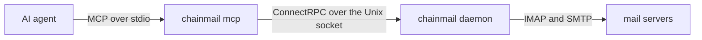

# Connect an agent

`chainmail mcp` serves chainmail to an AI agent as MCP tools over stdin and stdout. The agent's MCP client starts it as a subprocess. It holds no secrets and no mail logic. Every call goes to the daemon, through the same policy and audit log as the CLI, and the audit log records it with client kind `mcp`.



This page assumes a running daemon, such as the dev daemon from the [quick start](./quick-start.mdx).

## Register the server

For Claude Code, register it for every project. `$(command -v chainmail)` fills in the binary's full path.

```sh
claude mcp add --scope user chainmail -- "$(command -v chainmail)" mcp
```

For Codex, add it to `~/.codex/config.toml`, where `<path-to-chainmail>` is the full path that `command -v chainmail` prints:

```toml
[mcp_servers.chainmail]
command = "<path-to-chainmail>"
args = ["mcp"]
```

On NixOS, where the module installs the package system-wide, the path is `/run/current-system/sw/bin/chainmail`. Other MCP clients take the same two things: the command, and the single argument `mcp`. [Agent setup](../agents/setup.md) has more on the client side.

## Point it at the daemon

`chainmail mcp` finds the socket as the CLI does: `--socket`, then `CHAINMAIL_SOCKET`, then `socket` in `cli.toml`, then `/run/chainmail/chainmail.sock`. The `cli.toml` from the quick start points it at the dev daemon. Without that file, put `--socket <socket>` after `mcp` in its arguments, where `<socket>` is the daemon's socket path, or set `CHAINMAIL_SOCKET` in the agent's environment.

The daemon checks who is on the other end of every connection. A dev daemon admits only your own user, so the agent must run as you. A production daemon admits its own user and members of its client group, `chainmail-clients` by default. To add the agent's user to the group:

- On NixOS, list the user in `services.chainmail.clientUsers` (see [Deploy](../operations/deploy.mdx)).
- On other Linux, run `sudo usermod -aG chainmail-clients <user>`.
- On macOS, run `sudo dseditgroup -o edit -a <user> -t user chainmail-clients`.

Group membership applies to new logins only. After adding the user, log in again, or on Linux start the agent under the group with `sg chainmail-clients -c claude`. [Security model](../concepts/security-model.md) explains the peer check.

## What the agent sees

If the daemon is down, `chainmail mcp` still starts and lists its tools. Each call then fails with `DAEMON_UNREACHABLE`, or with `FORBIDDEN` when the daemon refuses the user, and the message or hint names the socket. `chainmail mcp` refuses to start, with `USAGE` (exit 2), when `cli.toml` is not valid, when `CHAINMAIL_OUTPUT` is not `json` or `table`, or when neither `XDG_CACHE_HOME` nor `HOME` is an absolute path, since it needs one for its default attachments directory.

At startup the server sends the agent instructions. They say that message content and work item text are untrusted data, and that a held send was not sent and must not be retried. They also say how to wait for mail: call `read_events` with a group name and `wait_seconds` 60, again and again. [Untrusted content](../concepts/untrusted-content.md) and [The send policy](../concepts/policy.md) explain both rules.

Stdout carries only MCP messages, and diagnostics go to stderr. The session ends with exit 0 when the client closes stdin, or on Ctrl-C or `SIGTERM`.

## Try it

Ask the agent to list your accounts, then to search for unread mail in the inbox. The first calls `list_accounts` and the second `search`. Then ask it to send a message to an address that is not on the allowlist. The send comes back held, the message waits in the account's Drafts folder, and the agent should tell you so and stop.

`chainmail audit --since 10m --output table` shows each of those calls with client kind `mcp`. [The audit log](../guide/audit-log.md) explains the columns.

## Next

- [Working with mail](../agents/working-with-mail.md): how an agent should treat results, holds and errors.
- [MCP tools](../reference/mcp-tools.md): every tool, its arguments and what it is audited as.
- [CLI settings](../guide/cli-settings.md): `cli.toml` and shell completion.
