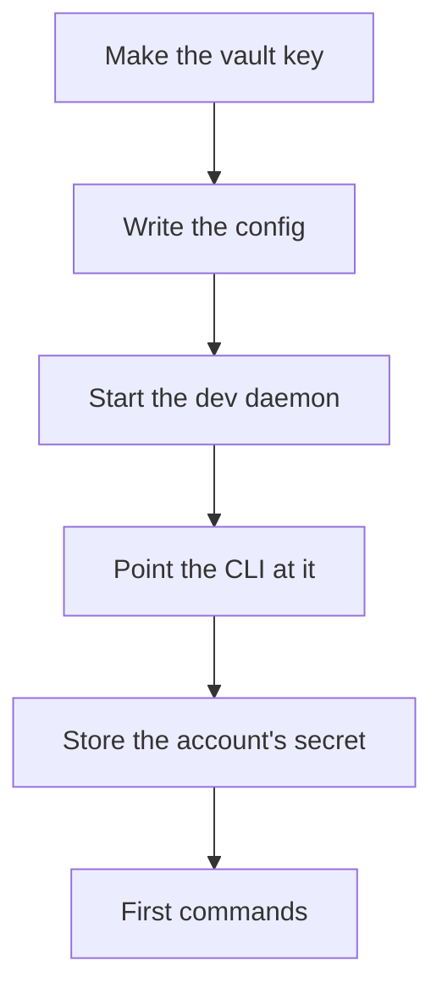

import Tabs from '@theme/Tabs';
import TabItem from '@theme/TabItem';

# Quick start

This guide runs a development daemon as your own user, adds an account to it and tries the first commands. It assumes `chainmail` is on your `PATH` (see [Install](./install.md)). [Connect an agent](./connect-an-agent.md) follows it, and [Deploy](../operations/deploy.mdx) covers a production daemon.

Blocks fenced as `sh` run unchanged in bash and in fish. Where a step keeps shell state, such as a variable for later commands, the guide gives a bash tab and a fish tab. Text in angle brackets, such as `<account>`, is a value you fill in, and each one is explained next to its block.



## Run a dev daemon

The daemon owns every password, token and mail connection. The CLI and `chainmail mcp` are thin clients that talk to it over a Unix socket. A dev daemon, started with `--dev`, runs as your own user and lets in only your own user. Anything running as you can read its vault key, so use it for development only. [Security model](../concepts/security-model.md) explains what a production daemon adds.

### The vault key

Make a config directory, a state directory and the vault key. `age-keygen -o` writes the key with mode `0600`. The daemon refuses a key file that other users can read, and one that its group can read unless `root` owns it.

```sh
mkdir -p ~/.config/chainmail-dev ~/.local/state/chainmail-dev
age-keygen -o ~/.config/chainmail-dev/vault-key
```

Keep this file. It is the only key to the vault, which holds every secret you store.

### The config file

The daemon reads one TOML file, which holds no secrets. Unknown keys and keys with capital letters are errors, and the daemon reports every invalid value at once. It reads the file only at startup, so restart it after an edit.

A minimal config has one account. Save it as `~/.config/chainmail-dev/config.toml`:

```toml
[accounts.site]
provider = "hostinger"
address = "me@example.com"
```

`site` is the account's name, which commands use to refer to it. `provider` names a preset that supplies the servers and the auth methods. [Accounts and providers](./accounts.md) has a table for each preset, and [Configuration](../reference/configuration.md) lists every key.

### Start the daemon

Start it in a terminal of its own. The `--socket` path is the Unix socket clients connect to. Giving it explicitly works the same on Linux and on macOS.

```sh
chainmail daemon --dev \
    --config ~/.config/chainmail-dev/config.toml \
    --state-dir ~/.local/state/chainmail-dev \
    --vault-key-file ~/.config/chainmail-dev/vault-key \
    --socket ~/.local/state/chainmail-dev/chainmail.sock
```

The daemon logs JSON lines to stderr and logs `daemon listening` once it accepts clients. It keeps `vault.age`, `state.db` and `cache.db` in the state directory. It replaces a stale socket left by a crashed daemon, and refuses to start if another daemon is listening on the path. `--dev` refuses the production state directory, `/var/lib/chainmail`, including through a symlink. A dev daemon ignores `socket` and `client_group` in the config, which apply to a production daemon only.

Without `--socket`, a dev daemon uses `CHAINMAIL_SOCKET`, then `$XDG_RUNTIME_DIR/chainmail-dev.sock`. Where `XDG_RUNTIME_DIR` is not set, as on macOS, it needs one of the first two, and otherwise exits with `--dev needs --socket, CHAINMAIL_SOCKET or XDG_RUNTIME_DIR`.

### Point the CLI at the socket

Clients pick their socket from `--socket`, then `CHAINMAIL_SOCKET`, then `socket` in `cli.toml`, then `/run/chainmail/chainmail.sock`. They never look at `XDG_RUNTIME_DIR`. The simplest way to reach a dev daemon from every shell and every agent is `cli.toml`. The file is `$XDG_CONFIG_HOME/chainmail/cli.toml` when `XDG_CONFIG_HOME` is an absolute path, and `~/.config/chainmail/cli.toml` otherwise, on macOS too. These blocks pick that directory and write the file, replacing any `cli.toml` you already have:

<Tabs groupId="shell">
<TabItem value="bash" label="bash">

```bash
case "$XDG_CONFIG_HOME" in /*) cfg="$XDG_CONFIG_HOME/chainmail" ;; *) cfg="$HOME/.config/chainmail" ;; esac
mkdir -p "$cfg"
printf 'socket = "%s"\n' "$HOME/.local/state/chainmail-dev/chainmail.sock" > "$cfg/cli.toml"
chainmail admin status --output table
```

</TabItem>
<TabItem value="fish" label="fish">

```fish
if string match -q '/*' -- "$XDG_CONFIG_HOME"
    set cfg "$XDG_CONFIG_HOME/chainmail"
else
    set cfg "$HOME/.config/chainmail"
end
mkdir -p "$cfg"
printf 'socket = "%s"\n' "$HOME/.local/state/chainmail-dev/chainmail.sock" > "$cfg/cli.toml"
chainmail admin status --output table
```

</TabItem>
</Tabs>

`admin status` prints the daemon's version, `dev mode  true`, the names of the stored secrets, and each folder's sync state and each account's cache state. The file takes a literal path. Variables such as `$HOME` are not expanded in it, so the `printf` writes the expanded path. The daemon never reads `cli.toml`. [CLI settings](../guide/cli-settings.md) describes the file's other key, `output`.

To use an environment variable instead, set `CHAINMAIL_SOCKET` in each shell that runs the CLI. A dev daemon started where it is set uses it too, so you can then leave out `--socket`.

<Tabs groupId="shell">
<TabItem value="bash" label="bash">

```bash
export CHAINMAIL_SOCKET="$HOME/.local/state/chainmail-dev/chainmail.sock"
```

</TabItem>
<TabItem value="fish" label="fish">

```fish
set -gx CHAINMAIL_SOCKET "$HOME/.local/state/chainmail-dev/chainmail.sock"
```

</TabItem>
</Tabs>

The daemon also reads its other flags from the environment: `CHAINMAIL_CONFIG`, `CHAINMAIL_STATE_DIR`, `CHAINMAIL_VAULT_KEY_FILE` and `CHAINMAIL_DEV`. A flag on the command line wins over its variable, so an explicit `--dev` or `--dev=false` wins over `CHAINMAIL_DEV`, which takes a boolean such as `true` or `1`. This starts the same dev daemon as above:

<Tabs groupId="shell">
<TabItem value="bash" label="bash">

```bash
export CHAINMAIL_CONFIG="$HOME/.config/chainmail-dev/config.toml"
export CHAINMAIL_STATE_DIR="$HOME/.local/state/chainmail-dev"
export CHAINMAIL_VAULT_KEY_FILE="$HOME/.config/chainmail-dev/vault-key"
export CHAINMAIL_SOCKET="$HOME/.local/state/chainmail-dev/chainmail.sock"
export CHAINMAIL_DEV=true
chainmail daemon
```

</TabItem>
<TabItem value="fish" label="fish">

```fish
set -gx CHAINMAIL_CONFIG "$HOME/.config/chainmail-dev/config.toml"
set -gx CHAINMAIL_STATE_DIR "$HOME/.local/state/chainmail-dev"
set -gx CHAINMAIL_VAULT_KEY_FILE "$HOME/.config/chainmail-dev/vault-key"
set -gx CHAINMAIL_SOCKET "$HOME/.local/state/chainmail-dev/chainmail.sock"
set -gx CHAINMAIL_DEV true
chainmail daemon
```

</TabItem>
</Tabs>

### Stop the daemon

Press Ctrl-C in its terminal. From another terminal, send that one daemon `SIGTERM`, which stops it just as cleanly. The first command below prints the PID of the `chainmail daemon` whose command line ends with this guide's `--socket` path, so it finds a daemon started with the first command above and no other. A second daemon refuses to start on a socket path that one is listening on, so it should print one PID. `<pid>` is that number. If it prints none or more than one, use Ctrl-C instead.

```sh
pgrep -f -- 'chainmail daemon .*--socket '"$HOME"'/\.local/state/chainmail-dev/chainmail\.sock$'
kill '<pid>'
```

Everything the daemon knows stays in the state directory. The next start picks up where it stopped, and mail that arrived meanwhile produces its events in order.

## Add the account's secret

The `hostinger` preset logs in with a password, which goes in the vault as `accounts/site`, after the account's name. `secret set` prompts for it without echo when stdin is a terminal, and reads it from stdin otherwise. It never shows the value, and no command can read a secret back.

```sh
chainmail secret set accounts/site
```

After storing a password, `secret set` measures the account's connection limit, which sizes its pool of IMAP connections. [Accounts and providers](./accounts.md) covers the other presets, Google's OAuth2 login with `auth login`, and reading a secret from `pass`.

Then check the account:

```sh
chainmail accounts list --output table
chainmail accounts test site --output table
```

`accounts list` shows each account's auth state, and when an account needs you, the command to run. `accounts test` logs in to the account's IMAP server, then its SMTP server, and reports each check. It exits 5 when a server rejected the credentials. chainmail never retries rejected credentials, because providers lock out accounts that keep failing. It marks the account as needing a human until you set a new secret or log in again (see [When a server rejects the credentials](./accounts.md#when-a-server-rejects-the-credentials)).

From a checkout, the live smoke test exercises every configured account through this dev daemon. [Testing](../developers/testing.md) describes it and its safety rules.

## First commands

On a terminal, commands print tables or text. Piped, they print one line of JSON, so an agent gets JSON without asking for it. `--output json` or `--output table` chooses either.

List accounts and folders. `<account>` is an account name from your config.

```sh
chainmail accounts list
chainmail folders --account '<account>'
```

### Search and read

Search every account, newest first. The query language is Gmail's, and [Reading and searching](../guide/reading-and-searching.md) lists every operator. Quote the whole query when it holds a phrase or a quoted value, and put `--` before it when a term starts with `-`.

```sh
chainmail search is:unread in:inbox
chainmail search invoice from:acme newer_than:30d
chainmail search 'subject:"q3 report" OR has:attachment' --account '<account>'
chainmail search -- invoice -from:acme
chainmail search is:unread --count
```

On accounts other than Google, `has:`, `filename:` and `label:` are answered only by the cache, so the third search fails there with `INVALID_ARGUMENT` until the cache can answer it (see [The local cache](../concepts/cache.md)).

Every row has a `ref`, the last column of the table. Pass it back exactly as you got it. Here `<ref>` is one such ref.

```sh
chainmail get '<ref>'
chainmail thread '<ref>'
```

Reading never marks mail read. `get` takes up to 50 refs, and `thread` reads the whole thread, oldest first. [Refs and cursors](../concepts/refs-and-cursors.md) explains refs and paging.

### Send, dry run first

`--dry-run` builds the message and writes it as MIME to stdout. It sends nothing and connects to no server. It refuses to write to a terminal unless `--output json` is given, so redirect it to a file:

```sh
chainmail send --account '<account>' --to ann@example.com --subject "Hello" --body "Testing *chainmail*." --dry-run > hello.eml
```

The body is Markdown, sent as a plain-text part and an HTML part. Drop `--dry-run` to send it. [Sending](../guide/sending.md) covers replies, forwards, drafts and attachments.

### A held send

The daemon checks every send against the policy's allowlist. A send to anyone not on it is held, not sent. With the minimal config, nothing but your own addresses is allowed, so this send is held:

```sh
chainmail send --account '<account>' --to someone@example.net --subject "Hello" --body "Testing the hold."
```

It prints `held by policy, not sent: saved to Drafts`, then the draft's ref, lists the blocked recipients, and exits 4 with the reason `HELD`. No `MAIL FROM` or `RCPT TO` went to the mail server. The daemon saved the exact message to the account's Drafts folder, and you send, edit or delete it from your own mail client. An agent that gets a hold must stop and tell you, not try another way to get the message out. Running the same command again replays the hold and saves no second draft. To allow a recipient, add it to `send_allow` in `[policy]` and restart the daemon (see [The send policy](../concepts/policy.md)).

### Watch for mail

`watch` streams mail events, one per line. A group remembers where it stopped, so a restarted watcher misses nothing. A new group starts at the newest event.

```sh
chainmail watch --group quickstart --kind new --in inbox
chainmail watch status --output table
```

`watch` runs until you stop it with Ctrl-C, and reconnects by itself when the daemon restarts. `watch status` shows each synced folder's mode, state and last sync. See [Watching for mail](../guide/watching.md).

### Cache status

The daemon keeps a local cache of every synced folder and answers searches and reads from it once it is complete and fresh. After the first start each account shows `backfilling`, then `prefetching`, then `ready`.

```sh
chainmail cache status --output table
```

[The local cache](../concepts/cache.md) explains when the cache answers, and [Operating the cache](../operations/cache.md) lists every state.

### Items

chainmail keeps work items, from objectives down to tasks, and links mail threads to them. These commands create a task in the inbox, link a thread to it and find the thread's mail again. `item:` searches are answered only by the cache, so they fail with `CACHE_NOT_READY` (exit 7) until `cache status` shows the account `ready`.

<Tabs groupId="shell">
<TabItem value="bash" label="bash">

```bash
ref=$(chainmail search 'from:acme newer_than:7d' --limit 1 --output json | jq -r '.rows[0].ref')
id=$(chainmail item create task 'Answer Acme' --area work --output json | jq -r .item.id)
chainmail item link "$id" "$ref" --anchor --note 'the thread to answer'
chainmail item show "$id"
chainmail search "item:$id"
```

</TabItem>
<TabItem value="fish" label="fish">

```fish
set ref (chainmail search 'from:acme newer_than:7d' --limit 1 --output json | jq -r '.rows[0].ref')
set id (chainmail item create task 'Answer Acme' --area work --output json | jq -r .item.id)
chainmail item link $id $ref --anchor --note 'the thread to answer'
chainmail item show $id
chainmail search item:$id
```

</TabItem>
</Tabs>

`chainmail item list --inbox` lists the tasks nobody has sorted yet. See [Work items](../guide/items.md).

## Next

- [Accounts and providers](./accounts.md): Google Workspace, Gmail, iCloud, Hostinger and other servers.
- [Connect an agent](./connect-an-agent.md): give an AI agent chainmail's tools over MCP.
- [Deploy](../operations/deploy.mdx): run the daemon as its own user, and move the dev daemon's state there.
