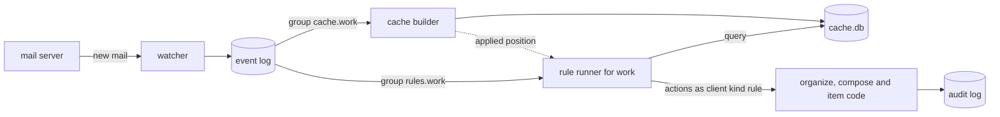

# Rules

A rule is a search query and a list of actions. The daemon keeps rules in `state.db` and matches them against the local cache. A rule can act on mail as it arrives, on a schedule, or when you run it by hand.

Rules are data, not config, so `config.toml` holds none. You create and change them with `chainmail rule` or the MCP rule tools. Any client allowed on the socket may do so, as for work items. Deleting `cache.db` loses no rule and no record of what a rule did.

Every action runs through the same code as the matching command, as the daemon's own user with client kind `rule`. So a forward goes through the send policy, and the audit log records each action with the rule and the run that took it.



## A first rule

This rule labels Stripe receipts on the Google account `work`, files each one under a task and archives it. Save it as `receipts.toml`:

```toml
name = "stripe-receipts"
description = "Label Stripe receipts, file them under the expenses task and archive them"
accounts = ["work"]
query = "from:stripe.com subject:receipt"
on_new = true
priority = 50

[[actions]]
kind = "label"
label = "Receipts"

[[actions]]
kind = "link_item"
item_id = "it_01jcb7m2k9r8q3v4w5x6y7z8a9"
anchor = true

[[actions]]
kind = "archive"
```

Dry-run it against the newest mail, then create it and look at it:

```sh
chainmail rule dry-run -f receipts.toml --trigger new
chainmail rule create -f receipts.toml
chainmail rule show stripe-receipts
```

The same rule with flags:

```sh
chainmail rule create --name stripe-receipts --description 'Label Stripe receipts, file them under the expenses task and archive them' --account work --query 'from:stripe.com subject:receipt' --on-new --priority 50 --action label=Receipts --action 'link_item=it_01jcb7m2k9r8q3v4w5x6y7z8a9,anchor' --action archive
```

From then on, each new receipt is labelled, linked and archived within seconds of the cache taking it. `chainmail audit --client rule` shows each action.

## Fields

A rule file uses the field names below as its keys, all but `id`, and so do the MCP rule tools. `rule show --toml` prints a rule in the same shape.

| Field | Values |
|---|---|
| `id` | `ru_` followed by 26 lowercase letters and digits, given when the rule is made. It never changes. |
| `name` | 1 to 63 lowercase letters, digits and hyphens, starting with a letter or digit. It is unique among live rules and can be changed. |
| `description` | Up to 1000 characters. |
| `accounts` | The accounts the rule covers. Empty means every account. An unknown account is refused. |
| `query` | A query in [the query language](./reading-and-searching.md#the-query-language), checked when the rule is saved. |
| `on_new` | `true` to run on mail as it arrives. |
| `schedule` | Empty, `every:<duration>` or `at:<HH:MM>`. See [Schedules](#schedules). |
| `priority` | `-1000000` to `1000000`, default `100`. Lower runs first, and rules of equal priority run in ID order. |
| `stop` | `true` to keep later rules from acting on a message this rule matched. |
| `actions` | 1 to 16 actions, run in order. See [Actions](#actions). |
| `max_per_run` | `1` to `5000`, default `500`. The most messages a scheduled or manual run acts on per account. |
| `enabled` | `true` or `false`, default `true`. |

A rule read back also holds its `revision`, its `disabled_reason` when it turned itself off, its creation and update times with who made each change, and its next and last scheduled runs.

A name holds no underscore, so it can never look like an ID. Every command and tool that names a rule takes its ID or its name. A deleted rule is found by its ID only.

A rule with neither `on_new` nor a schedule runs only when you run it by hand.

A rule file is TOML with these keys at the top and one `[[actions]]` table per action, in order. An action table names its action in `kind` and adds the arguments the action takes: `label`, `folder`, `item_id` and `anchor`, or `to` and `note`.

## The query

A rule matches what a search matches, with the same operators. It is matched against the cache only, never against the mail servers.

- Without `in:`, a rule covers what a search without `in:` covers: All Mail on Google, and every folder but Trash and Spam elsewhere.
- Without `in:`, a rule also never matches drafts or sent mail. Off Google it leaves out the Drafts and Sent folders, and on Google the messages with the `\Draft` or `\Sent` label. Name `in:sent` or `in:drafts` to match them. This keeps a rule from acting on the mail it forwards.
- `account:` terms narrow the accounts the rule covers.
- `item:<id>` and `item:none` work as in a search.
- A rule sees the cache as it was when it matched. A label or flag that an earlier rule set in the same batch is not visible to a later rule.

Words in a query match message bodies, so a rule with words needs the bodies in the cache. On new mail, the runner waits up to 5 minutes for a matched message's body. A message whose body does not arrive in time, or failed to download for good, fails that rule with the reason `body_not_cached`. So does every message of an account whose `prefetch_bodies` window is `0d`. A query of operators only, such as `from:stripe.com subject:receipt`, never waits.

## Actions

| Action | `--action` | What it does |
|---|---|---|
| `label` | `label=<label>` | Adds a Gmail label. |
| `unlabel` | `unlabel=<label>` | Removes a Gmail label. |
| `copy` | `copy=<folder>` | Copies the message to a folder. |
| `flag`, `unflag` | `flag`, `unflag` | Sets or clears `\Flagged`. |
| `read`, `unread` | `read`, `unread` | Sets or clears `\Seen`. |
| `link_item` | `link_item=<item-id>`, `link_item=<item-id>,anchor` | Links the message's thread to a work item, with the message as the link's anchor when `anchor` is given. |
| `forward` | `forward=<address>[,<address>...]` | Forwards the message through the send policy. `--note` adds a note above it. |
| `move` | `move=<folder>` | Moves the message to a folder. |
| `archive` | `archive` | Archives the message, as `chainmail archive` does. |
| `trash` | `trash` | Moves the message to Trash. |

Saving a rule checks its actions:

- A rule has 1 to 16 actions.
- It holds at most one of `move`, `archive` and `trash`, and that one comes last. Such a rule also keeps later rules from acting on each message it moved, whatever `stop` says, because the message's old ref no longer points at it.
- It holds at most one `forward` and at most one `copy`.
- `label` and `unlabel` need every account the rule covers to be a Google account. Name only Google accounts in `accounts`, or use `copy` or `move` instead. An account that stops being a Google account later fails the action when it runs.
- A forward names 1 to `policy.max_recipients` plain addresses. Its note is up to 2000 characters.
- A `link_item` item must exist and must not be deleted.
- Folder and label names are 1 to 255 bytes with no control characters. Whether a folder exists is checked when the action runs, on each account, since accounts differ.

A rule that breaks a check is refused with `INVALID_ARGUMENT` and a hint. Neither the message nor the hint quotes the rule's text.

`expunge`, folder changes and new messages are not actions. A forward to anyone off the allowlist is held as a draft, as any send is (see [The send policy](../concepts/policy.md)).

## Triggers

### New mail

The daemon runs one rule runner for each synced account whose cache is on.

1. The runner reads the event log through its own group, `rules.<account>`, up to 200 events at a time, and keeps the `new` events.
2. It waits until the account's cache has taken those events, so the cache holds the new messages.
3. It matches each enabled `on_new` rule that covers the account, in priority order, against the new messages only.
4. It acts on each match, records the run and acknowledges the events.

A batch with no `new` events is acknowledged at once. A new message the cache could not read is not matched, and it is not a failure. A new-mail run that matched nothing writes no run row, so a busy inbox does not fill the run history.

A runner's group starts at the newest event the first time the daemon runs it. So the first rule you create touches no mail that is already there. Run the rule by hand to act on older mail.

An account whose cache is off has no runner. Its rules never run there, and `rule status` shows it as `cache_disabled`. Rules never fall back to matching on the mail server. When the cache turns itself off while the daemon runs, as it does when its disk is full, the runner leaves new mail unread until the cache is back on.

### Schedules

| Schedule | Runs |
|---|---|
| `every:<duration>` | `<duration>` after the last run finished. The duration is 15 minutes to 30 days, as whole days such as `7d` or as a Go duration such as `6h`. |
| `at:<HH:MM>` | Once a day at that wall-clock time in `[rules] timezone`. |

`--every` and `--at` set the schedule on the command line, and `rule edit --no-schedule` takes it off:

```sh
chainmail rule create --name inbox-cleanup --query 'in:inbox is:read older_than:30d' --every 1d --action archive
chainmail rule create --name morning-flags --account work --query 'is:unread from:ceo@example.org' --at 07:00 --action flag
```

On a daylight saving change, an `at:` time that does not exist runs at the first instant after the gap. A time that happens twice runs once, at the first. After the daemon was down, a rule whose time passed runs once when it starts, and missed runs are not repeated. The scheduler starts with the watchers, so a daemon that watches no account runs no scheduled rule.

A scheduled run matches the rule against the whole cache of each account it covers, oldest first. It acts on at most `max_per_run` messages per account, not counting those it already acted on. The cache must be able to answer the query completely. When it cannot, the run is recorded with outcome `cache_not_ready` and acts on nothing, and the rule tries again 5 minutes later. An account with no runner gets a `cache_not_ready` run with the reason `cache_disabled`, and the rule waits for its next scheduled time. `[rules]` is in the [configuration reference](../reference/configuration.md#rules).

### Running by hand

`rule run <rule>` runs a rule now, as a scheduled run does. It runs on each account the rule covers, or on the one `--account` names. `--max` caps the messages it acts on per account, from 1 to 5000, and without it the cap is the rule's `max_per_run`. The command waits for the account's runner and for the run, up to 10 minutes, and prints one run per account. A disabled rule runs too, since you asked for it. A deleted rule does not.

```sh
chainmail rule dry-run inbox-cleanup --trigger manual
chainmail rule run inbox-cleanup --max 100
chainmail rule run inbox-cleanup --max 100 --account site
```

A runner does one thing at a time: a new-mail batch, a scheduled run or a run by hand. So two triggers never act on one account at once.

## Dry runs

`rule dry-run` matches a rule without acting and without writing anything. It takes a saved rule by ID or name, or an unsaved one with `-f <file>`. A deleted rule can be dry-run by its ID, to see what it would do before you restore it.

- `--trigger new` matches the newest 200 cached messages of each account.
- `--trigger schedule` and `--trigger manual`, the default, match the whole cache.
- `--account` limits it to one account.

For each account it reports how many messages matched and how many of those the rule already acted on (`skipped`). It also gives the first 50 matches as search rows, and the actions each would get. An account whose cache cannot answer the rule completely gets a `reason` and no matches.

```sh
chainmail rule dry-run stripe-receipts --trigger new --output table
```

Dry-run a rule before you create it, and again before you run it by hand. The MCP rule tools tell agents the same. A dry run is audited as `rule.dry_run`.

## Act once, caps and failures

### Act once

A rule acts on a message at most once per account, whatever triggered it. Once a rule has acted on a message, the daemon records the message in `state.db`. The record is keyed by the message's Gmail message ID on Google, and by its folder, UIDVALIDITY and UID elsewhere. Every trigger skips a message already recorded and counts it as `skipped`. The records are kept for good, and deleting `cache.db` keeps them.

A `move`, `archive`, `trash` or `copy` can report where the message landed. The daemon then copies every rule's records to the new place. So a rule that filed a message into another synced folder does not act on it there again, and neither does any other rule that already handled it.

### Caps

A scheduled or manual run stops at its cap with outcome `capped`. The next run goes on, oldest first, since the messages already done are skipped.

### Failures

| Failure | Such as | What happens |
|---|---|---|
| Transient | `SERVER_UNAVAILABLE`, `TIMEOUT`, `AUTH_REQUIRED`, `CACHE_NOT_READY` | The run stops with outcome `interrupted`. A new-mail batch is not acknowledged, and the runner tries it again after a backoff. Messages already recorded are skipped, so the retry acts on none of them twice. A message whose actions only partly ran starts again at its first action, which at worst repeats a label or a flag. |
| Permanent | `NOT_FOUND` for a folder or an item, `INVALID_ARGUMENT`, `body_not_cached` | The message counts as `failed` and is not recorded. New-mail matching does not try it again. A later scheduled run or a run by hand matches it again. |
| Held | a forward the policy held as a draft | The message counts as `held` and is recorded as done. |

### Forwards and copies across a crash

A forward sends mail, and a copy makes a new message on most servers each time, so neither is safe to repeat. Before the first of them runs on a message, the daemon records the message as pending. A forward also carries an idempotency key made from the rule, the account and the message.

A run after a crash that finds a pending message handles it this way:

- A forward is called again with the same key. The daemon returns the first attempt's outcome, sent or held, and sends nothing new. An attempt that crashed during the send is recorded as done with the note `outcome_unknown`, and is never tried again. A pending forward older than 6 days is recorded the same way without a call, since the daemon keeps idempotency keys for 7 days.
- A copy is skipped and recorded as done with the note `replayed`.

So a crash can lose a forward or a copy, but never repeats one.

### Auto-disable

A rule turns itself off when a run fails on every message it did not skip, with the reason `all_failed`. It also turns itself off after 5 runs with failures and no clean run between them, with the reason `repeated_failures`. `rule show` shows the reason, and a `rule` event reports the change. `rule enable` turns the rule back on and clears the reason and the count.

```sh
chainmail rule list --disabled --output table
chainmail rule runs stripe-receipts --outcome failed
chainmail rule enable stripe-receipts
```

The cap and auto-disable bound what a bad rule can do before someone notices. Trashed mail stays recoverable, since `expunge` is not an action.

## Runs

Each scheduled run and run by hand writes one run row per account, and so does each new-mail batch that matched something. A row holds the trigger, the start and finish times, and the counts `matched`, `applied`, `held`, `skipped` and `failed`. It also holds the outcome, and the reason and hint of the first failure. It never holds server text or message content. Runs are kept for 30 days.

| Outcome | Meaning |
|---|---|
| `ok` | The run finished. |
| `capped` | The run stopped at its cap. The next run goes on where it stopped. |
| `failed` | The run finished, and at least one message failed for good, such as on a folder that does not exist. |
| `cache_not_ready` | The cache could not answer the rule completely on the account, so the run acted on nothing. `reason` says why, such as `stale` or `cache_disabled`. |
| `interrupted` | The run stopped on a transient failure, or the daemon stopped during it. A new-mail batch is tried again. |

`rule runs` lists runs newest first, for one rule or for all. `--account`, `--trigger` and `--outcome` keep the runs of one account, trigger or outcome, and `--limit` and `--before-id` page through them. `rule show` lists a rule's last 10 runs and its counts over the runs kept.

## Status

`rule status` shows each account's runner, the next scheduled run and the next due check. For a runner it shows the state, the event it acknowledged, how many events lie past it, and the reason it waits.

```sh
chainmail rule status --output table
```

| State | Meaning |
|---|---|
| `starting` | The runner has not opened its group yet. |
| `running` | The runner is working on a batch or a run. |
| `waiting_for_cache` | The runner waits for the cache to take a batch's messages, or for their bodies. |
| `backing_off` | The runner waits to try again after a transient failure. |
| `idle` | The runner has nothing to do. |
| `cache_disabled` | The account's cache is off or the account is not synced, so the account has no runner and its rules do not run. |

A lag that grows while a runner shows `waiting_for_cache` means the account's cache is behind. Check `chainmail cache status` (see [The cache in operation](../operations/cache.md)).

## Revisions, delete and restore

Every change to a rule raises the rule's own revision, which starts at 1. The daemon records the whole rule in its history with the kind of change: `created`, `updated`, `deleted`, `restored`, `disabled` or `enabled`. `rule show --history` lists up to 50 revisions, newest first.

`rule edit --expected-revision <n>` and `update_rule` over MCP refuse the change when the rule changed after that revision, with `INVALID_ARGUMENT` and the hint to read the rule again.

`rule delete` is a soft delete. A deleted rule never runs, and `rule list` leaves it out unless you pass `--deleted`. It keeps its runs and its record of the messages it acted on. Its name is free for a new rule. `rule restore <id>` brings it back. It takes the rule's ID only, which `rule list --deleted` shows, and fails with `INVALID_ARGUMENT` when a live rule took its name.

## Rule events

`rule` events report changes to rules. A watcher gets them only when it asks for them, so existing watchers and groups see nothing new.

```sh
chainmail watch --group rule-changes --kind rule
```

The event's `rule` field holds `rule_id`, `name`, `change`, `revision`, `actor` and, when the rule turned itself off, `reason`. The event has no account or folder. It never holds the rule's description, query or actions. Runs write no events. [Watching for mail](./watching.md#events) lists every kind.

## The audit log

Rule calls are audited under the caller's own client kind, as `rule.create`, `rule.update`, `rule.delete`, `rule.restore`, `rule.get`, `rule.list`, `rule.dry_run`, `rule.run`, `rule.runs` and `rule.status`. Enabling and disabling a rule are `rule.update`. Their targets name the rule as `rule=<id>`, with counts and field names such as `actions=3`, `fields=priority,stop` or `revision=4`.

Every action a rule takes is audited under its own action, such as `labels`, `move`, `forward` or `item.link`. The row has client kind `rule` and the daemon's user, and its targets add `rule=<id>` and `run=<id>`. A socket client that claims the client kind `rule` is recorded as `(invalid)`, so `audit --client rule` lists only what rules did.

```sh
chainmail audit --client rule --since 24h --output table
```

No error message, hint, log line or `rule.*` row holds a rule's description, query, folder or label name, forward address or note. An action's row is the row the same call from a client writes, so a `move` or `copy` names its folder as `folder=<name>`, and no row holds a label name, an address or a note. See [The audit log](./audit-log.md).

## Untrusted text

Descriptions and queries come back wrapped as `{"untrusted": "..."}`, as item text does, since both are often copied from mail. Over MCP a forward's note is wrapped too. Rule names are plain, since a name holds only lowercase letters, digits and hyphens. Dry-run matches are search rows, with the usual wrapping. See [untrusted content](../concepts/untrusted-content.md).

## The rule commands

`<rule>` is a rule's ID or name.

| Command | Does | Prints with JSON output |
|---|---|---|
| `rule list` | Lists live rules in priority order. `--account` keeps the rules that cover an account, by name or by covering every account. `--enabled` keeps only enabled rules, `--disabled` only disabled rules and `--deleted` only deleted rules. | `{"rules":[...]}` |
| `rule show <rule>` | Shows a rule with its next run, its last 10 runs and its counts. `--history` adds up to 50 revisions. `--toml` prints the rule as a rule file instead. | `{"rule":{...},"runs":[...],"counts":{...},"revisions":[...]}` |
| `rule create` | Creates a rule from flags or from `-f <file>`. Flags: `--name`, `--description`, `--account` (repeatable), `--query`, `--on-new`, `--every <duration>` or `--at <HH:MM>`, `--priority`, `--stop`, `--max-per-run`, `--action` (repeatable), `--note` for a forward, and `--disabled` to create it turned off. | `{"rule":{...}}` |
| `rule edit <rule>` | Changes the fields its flags name, or the keys `-f <file>` holds. It takes the same field flags as `rule create`, plus `--all-accounts`, `--no-schedule` and `--expected-revision <n>`. | `{"rule":{...}}` |
| `rule enable <rule>`, `rule disable <rule>` | Turns a rule on or off. Enabling clears an auto-disable's reason and its failure count. | `{"rule":{...}}` |
| `rule delete <rule>`, `rule restore <id>` | Soft-deletes or restores a rule. A restore takes the rule's ID. | `{"rule":{...}}` |
| `rule dry-run <rule>`, `rule dry-run -f <file>` | Matches without acting. `--trigger` takes `new`, `schedule` or `manual`, the default. `--account` limits it to one account. | `{"accounts":[...]}` |
| `rule run <rule>` | Runs a rule now. `--max` caps the messages it acts on per account, and `--account` limits it to one account. | `{"runs":[...]}` |
| `rule runs [<rule>]` | Lists runs newest first. `--account`, `--trigger` and `--outcome` filter them. `--limit` sets the page size, 1 to 500 and 50 by default, and `--before-id` takes `next_before_id`. | `{"runs":[...],"next_before_id":...}` |
| `rule status` | Shows each account's runner, the next scheduled run and the next due check. | `{"runners":[...],"next_scheduled_at":...,"next_due_check_at":...}` |

Every `revision`, run ID and run count in this output is a JSON string, as for other 64-bit fields. On a terminal the commands print tables, which clean descriptions and queries of terminal control characters.

Every flag is in the [rule command reference](../reference/commands/chainmail-rule.md).

## Over MCP

Over MCP the same calls are the eight rule tools in the [MCP tool reference](../reference/mcp-tools.md#rules). `rule runs` and `rule status` have no tool, and `get_rule` returns a rule's last 10 runs. `run_rule` and `dry_run_rule` wait up to 10 minutes. [Working with mail](../agents/working-with-mail.md#rules) has the agent's side.
