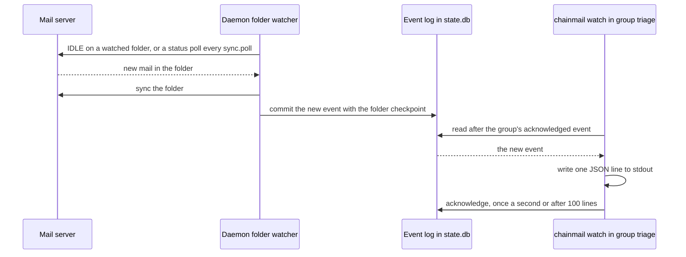

# Watching for mail

The daemon watches each account's mail and writes what changes to an event log in `state.db`. `chainmail watch` streams that log, and the MCP tool `read_events` reads it a page at a time. A watcher that names a group resumes where it left off, so a watcher restart, a daemon restart or a deploy loses no mail.



## What is watched

The daemon runs one supervisor for each account with `sync.enabled` on, from start to shutdown.

- On the Google presets it watches All Mail, the folder with the `\All` attribute, on one connection. All Mail holds every message whatever its labels, so that one connection sees every label, and a Google account polls nothing.
- Other accounts watch each folder in `watch` with IDLE, each on a connection of its own, and poll the rest of `sync.folders` every `sync.poll`.
- Without `sync.folders`, an account other than Google syncs every folder a default search covers: every selectable folder except Trash, Junk and a virtual All folder.

The daemon lists the folders when the account connects and again every `watch.expunge_sweep`. A folder that appears is synced as soon as a listing finds it, starting with a silent first sync. One that disappears stops being synced and leaves `watch status`. So `chainmail watch` also reports `new`, `flags` and `expunged` events from folders such as Sent and Archive. Filter with `--in inbox` to see only the inbox.

### Polls and IDLE

A poll asks the server for the folder's status on a pooled connection, and syncs only when it changed. On a server without CONDSTORE it syncs every time, since the status cannot show a flag change there. A poll that finds nothing changed still records its time as the folder's last sync. `watch status` shows that time, and the cache uses it to judge a polled folder fresh.

A server without IDLE gets its watched folders synced every `watch.idle_fallback_poll` on their own connections instead.

An IDLE ends after 25 minutes at most, and the folder is synced before the next one starts. On the Google presets it ends after `watch.google_check` (5 seconds by default) instead. Gmail tells an IDLE about new mail late, often around 30 seconds after the mail arrives and sometimes later, while a fresh sync sees it at once. A check that finds nothing changed costs ending and restarting the IDLE, one SELECT and a checkpoint write.

The `sync` and `[watch]` keys are in the [configuration reference](../reference/configuration.md).

### The first sync and new mail

The first sync of a folder records where it stands and the messages it holds, and publishes a `status` event with state `baselined`. It reports nothing for the mail already there.

After that, each new message produces a `new` event within seconds on a watched folder, and within `sync.poll` on a polled one. A sync commits its events together with the folder's checkpoint, so a crash neither loses nor repeats one.

When the daemon starts, every folder catches up from its checkpoint, at most 500 messages per commit. Mail that arrived while the daemon was down produces its events in order.

## Events

Every event has `id`, `at`, `kind`, `account` and `folder`. The rest depends on the kind:

| Kind | Fields | Meaning |
|---|---|---|
| `new` | `ref`, `message` | A message arrived. `message` is the message's search row, as `search` prints it, with the snippet when the server gave a preview. `thread_count` is always 0. |
| `flags` | `ref`, `flags`, `labels` | A message's flags or Gmail labels changed. Both hold the current values, not a diff. `flags` holds keywords too, as the server names them. |
| `expunged` | `ref` | A message left the folder. It can be a message no `new` event reported, because the daemon could not read it when it arrived. On Gmail the `ref` of such a message has no Gmail message ID (no `:g` part), since the daemon never read one, so it can differ from a ref a search gave for the same message. |
| `status` | `state`, `detail` | A folder's sync state changed. An empty `folder` means the whole account. See [sync status](#sync-status). |
| `gap` | `reason`, `next_id` | Events are missing. `trimmed` means the log no longer holds them, and `uidvalidity` means the server renumbered the folder. |
| `item` | `item` | An item changed. Watchers get it only when they ask for it (see [item events](./items.md#item-events)). |
| `item_mail` | `ref`, `message`, `item_id`, `from_self` | New mail arrived on a thread linked to an item. Watchers get it only when they ask for it. |

### JSON lines

`chainmail watch --output json` prints one line per event, with every field, empty ones included, as other commands do. Like other 64-bit fields, `id`, `next_id`, a message's `size` and an `item` event's `revision` are JSON strings. These lines are what it prints for each mail kind:

```json
{"id":"1","at":"2026-11-02T10:00:01Z","kind":"new","account":"host","folder":"INBOX","ref":"cm1:host:INBOX:1:1","message":{"ref":"cm1:host:INBOX:1:1","account":"host","folder":"INBOX","date":"2026-11-02T10:00:00Z","internal_date":"2026-11-02T10:00:00Z","from":[{"name":{"untrusted":"Sam"},"email":{"untrusted":"sam@example.org"}}],"to":[],"subject":{"untrusted":"Hello"},"flags":[],"size":"300","has_attachment":false,"thread_id":"","labels":[],"snippet":null,"thread_count":0},"flags":[],"labels":[],"state":"","detail":"","reason":"","next_id":"0","item":null,"item_id":"","from_self":false}
{"id":"2","at":"2026-11-02T10:00:02Z","kind":"flags","account":"host","folder":"INBOX","ref":"cm1:host:INBOX:1:1","message":null,"flags":["\\Seen"],"labels":["Work"],"state":"","detail":"","reason":"","next_id":"0","item":null,"item_id":"","from_self":false}
{"id":"3","at":"2026-11-02T10:00:03Z","kind":"status","account":"host","folder":"INBOX","ref":"","message":null,"flags":[],"labels":[],"state":"watching","detail":"","reason":"","next_id":"0","item":null,"item_id":"","from_self":false}
{"id":"4","at":"2026-11-02T10:00:04Z","kind":"expunged","account":"host","folder":"INBOX","ref":"cm1:host:INBOX:1:2","message":null,"flags":[],"labels":[],"state":"","detail":"","reason":"","next_id":"0","item":null,"item_id":"","from_self":false}
{"id":"0","at":"2026-11-02T10:00:05Z","kind":"gap","account":"","folder":"","ref":"","message":null,"flags":[],"labels":[],"state":"","detail":"","reason":"trimmed","next_id":"9","item":null,"item_id":"","from_self":false}
```

Subjects, names, addresses and snippets come from the message and are untrusted, wrapped as `{"untrusted": "..."}` as in search rows. Folder names, flags and labels come from the server.

On a terminal each event is one line instead: the time, the kind, the account and the folder, then what happened. That is a new message's subject, a changed message's ref with its flags and labels, an expunged message's ref, a status's state and detail, a gap's reason and next ID, an item change's item ID, type, op, fields and revision, or an `item_mail` event's item ID and subject, with `(from self)` for the account's own mail. Every value is cleaned of terminal control characters.

### Gaps

A `uidvalidity` gap comes with the folder's new `baselined` status, and its `next_id` is 0. The refs the folder's earlier events named are stale, so search the folder again.

A `trimmed` gap is made at read time and is never stored. So its `id` is 0 and it has no account or folder. Its `next_id` is where reading goes on.

## Expunges

Most servers tell a watching client about new mail and flag changes at once. Gmail does it late, which `google_check` covers. chainmail finds expunged mail differently, by comparing the folder's UIDs with the ones it knows. That comparison is the sweep.

- On a server with CONDSTORE the sweep runs on each connect, every `expunge_sweep`, and after the server reports an expunge during IDLE, as soon as 5 minutes have passed since the last sweep.
- A sync on a watched folder also counts its messages. A count lower than the last sync's plus the new mail since is taken as a reported expunge, which covers Gmail's late EXPUNGE on the Google presets.
- On a server without CONDSTORE every sync fetches the whole UID set, so each sync finds expunges.

So an `expunged` event can trail the change by up to 5 minutes on a watched folder whose server reports it. On the Google presets the sync that notices it comes within `google_check`, so the event trails by up to 5 minutes, or by `google_check` when that is longer. Otherwise, as on a polled folder, it trails by up to `expunge_sweep`. Each bound is give or take a sync.

On Gmail, archiving takes the `\Inbox` label away, which arrives as a `flags` event without `\Inbox`. Trashing a message, or marking it as spam, takes it out of All Mail, which arrives as an `expunged` event. Mail sent from the account arrives as a `new` event with the `\Sent` label.

## Reading the stream

```text
chainmail watch [--group NAME | --since ID] [--account NAME]... [--kind KIND[,KIND]...] [--in FOLDER] [--item ID] [--once] [--heartbeat]
chainmail watch status
chainmail watch groups
chainmail watch groups delete <name>
```

### Where a read starts

- `--group <name>` resumes after the group's acknowledged event. A group is created the first time it is used, at the newest event, so a new group sees only what comes after. Group names match `^[a-z0-9][a-z0-9._-]{0,63}$` and may not start with `cache.`, which names the groups the daemon's cache reads the log through.
- `--since <id>` resumes after that event ID, or after a heartbeat's position.
- Neither starts with the events that arrive from now on.

`--group` and `--since` together are a usage error.

```sh
chainmail watch --group triage --kind new
chainmail watch --since 0 --account work --in inbox --once
```

### Filters

Filters apply in the daemon.

- `--account`, repeatable, keeps the named accounts' events. An unknown account fails with `NOT_FOUND`.
- `--kind` takes `new`, `flags`, `expunged`, `status`, `gap`, `item` and `item_mail`, comma separated or repeated. Without `--kind`, a watch gets every kind except `item` and `item_mail`.
- `status` and `gap` events pass a `--kind` list that names neither of them. So a `--kind new` watcher still hears about gaps and auth problems.
- `--in` keeps events whose folder or Gmail labels match, ignoring case. `inbox` also matches Gmail's `\Inbox` label and `sent` matches `\Sent`. `status` and `gap` events always pass `--in`.
- `--item <id>` keeps the `item` and `item_mail` events of that item and every live item below it, and drops `new`, `flags` and `expunged` events (see [item events](./items.md#item-events)).

### Trimming

A start older than the oldest event kept, after a trim, first gets a `trimmed` gap, then goes on from the oldest event. A start past the newest event, as when `state.db` was reset under a watcher, gets one `trimmed` gap and goes on from the newest event. A group acknowledged past it is reset there.

The daemon trims the log when it starts and every hour after. It removes events older than `watch.retention` or beyond `watch.max_events`, oldest first, whatever any group has acknowledged. A group that falls further behind than that gets a gap.

A group not used for longer than `watch.retention` is removed with the events. The cache's own `cache.` groups are the exception and never expire.

`chainmail watch groups` lists the groups, leaving out the cache's, with the event each has acknowledged, how many events lie past it, its creation time and its last use. `chainmail watch groups delete <name>` removes one, so its next use starts at the newest event. Deleting a group that does not exist succeeds with `deleted` false.

```sh
chainmail watch groups
chainmail watch groups delete triage
```

## Delivery

`chainmail watch --group` acknowledges an event once its line is written to stdout, in batches: once a second, or at once after 100 lines. Heartbeats move the acknowledgement too, so a group also moves past the events its filters dropped. The last batch goes out before each reconnect and when the watch exits.

Delivery is at least once. A watch that crashes, or whose acknowledgement fails, delivers the events it printed since its last acknowledgement again on its next run. That is usually a second's worth, so a consumer should tolerate an `id` it has already seen.

The acknowledgement says the line was written, not that the consumer finished with it. A consumer that must not lose an event it had read but not yet handled should record the last `id` it handled and restart from it with `--since`.

`read_events` with a group acknowledges the events it returns, and the events its filters dropped, before it answers. If the acknowledgement fails, the call fails and the next read returns the same events. If the client goes away after the acknowledgement and before the answer reaches it, those events are lost. Under a disconnect, a group read over MCP is at most once.

Use one group per consumer. Two consumers that share a group share its position, and each skips what the other acknowledged.

## Long-running watchers

`chainmail watch` runs until it is stopped.

- When the daemon goes away, as in a deploy, or the stream ends, it reconnects by itself. It waits 1 second, then twice as long each time, up to 30 seconds.
- It resumes from its group, or from the last event or heartbeat it saw.
- The daemon sends a heartbeat as soon as the stream has sent every event already in the log, then every 30 seconds while nothing happens. A stream silent for 75 seconds is reconnected.
- `--heartbeat` prints heartbeats, as `{"heartbeat":{"at":...,"position":...}}` lines.

The watch stops with an error only when the daemon refuses the request, or when it cannot write its output. A refusal is such as an invalid group name, an unknown account or a refused socket peer. Not being able to write is such as when the program reading it exits. An account that needs a login does not stop it: the watch goes on, and an `auth_required` status event says what to run. Ctrl-C or `SIGTERM` ends it with exit 0 after its last acknowledgement.

`--once` exits at the first heartbeat, once every event already in the log is printed. That suits cron:

```sh
chainmail watch --group digest --once >> ~/mail-events.jsonl
```

A script that handles new inbox mail can read the stream through a pipe. Its stdout is not a terminal, so it gets JSON lines:

```sh
chainmail watch --group triage --kind new --in inbox | ~/bin/triage
```

As a systemd user service, so that it comes back if the script fails:

```ini
[Unit]
Description=Triage new mail

[Service]
ExecStart=/bin/sh -c 'chainmail watch --group triage --kind new --in inbox | %h/bin/triage'
Restart=always
RestartSec=10

[Install]
WantedBy=default.target
```

The service's user must be in the `chainmail-clients` group, as for the CLI. On macOS, a launchd agent in `~/Library/LaunchAgents` with `KeepAlive` set does the same. [Watching in operation](../operations/watching.md) covers running watchers on a server and what to do when one falls behind.

## Agents

An agent reads the same log with the MCP tool `read_events`, calling it again and again with a group and `wait_seconds` 60. [Waiting for mail](../agents/working-with-mail.md#waiting-for-mail) has its inputs and results.

## Sync status

`chainmail watch status`, and the `sync` section of `chainmail admin status`, show each synced folder's mode, state, whether it has CONDSTORE, its last sync and sweep, and its last error. Both print the same table. Neither is audited. `chainmail watch status` lists every synced folder, so an account without `sync.folders` shows each folder of its default search.

```sh
chainmail watch status --output table
```

With JSON output it prints `{"folders":[{"account":...,"folder":...,"mode":...,"state":...,"condstore":...,"last_sync_at":...,"last_sweep_at":...,"last_error":...}]}`.

The mode is `idle` for a folder watched with IDLE and `poll` for a polled one, including a watched folder on a server without IDLE. The state is one of these, and each change of state is also published as a `status` event:

| State | Meaning |
|---|---|
| `baselined` | The folder's first sync recorded where it stands. |
| `watching` | The folder is watched with IDLE and its last sync worked. |
| `polling` | The folder is polled and its last sync worked. |
| `reconnecting` | The connection or the poll failed. The daemon tries again after 1 second, then twice as long each time up to 5 minutes, give or take a fifth. A polled folder waits at most `sync.poll`. The last error is `SERVER_UNAVAILABLE`, or `MALFORMED_RESPONSE` when the server sent something chainmail cannot read. A watch connection that ends because new mail arrived in such a form is dialled again at once instead, since the daemon read that mail on another connection, and the folder does not show this state. |
| `auth_required` | The server rejected the account's credentials, or it has no secret. Every loop of the account stops and every folder shows this state, with the last error `AUTH_REQUIRED`. One `status` event with an empty folder stands for the whole account, and its `detail` is the command to run, such as `run: chainmail auth login work`. Watching starts again within 15 seconds of `secret set` or `auth login` clearing the state. |
| `error` | The folder does not exist. The last error is `FOLDER_NOT_FOUND`, and the folder is tried again every `sync.poll`. The account's other folders keep running. |

The event schema also names a `catching_up` state. It is reserved and not published yet, since a folder catches up inside one sync, which reports its events as it commits them.

When the daemon shuts down, each watcher ends its IDLE and logs out, within 5 seconds.

Every flag is in the [watch command reference](../reference/commands/chainmail-watch.md).
