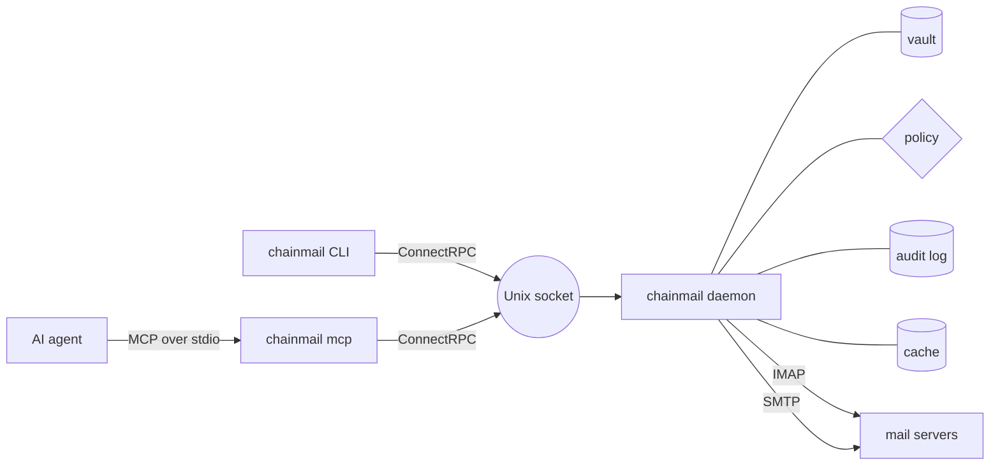

# chainmail

chainmail is email for AI agents. It is one Go binary that lets agents read, send and organize mail over IMAP and SMTP without ever holding a password or token. A long-running daemon owns every credential and every connection to the mail servers. It checks every send against a policy and records nearly every call in an audit log. Agents talk to it through the `chainmail` CLI or through `chainmail mcp`, an MCP server. Both are thin clients on a Unix socket.

chainmail is for people who want an AI agent to work with their mail without handing it their accounts. A send to anyone off the allowlist is held as a draft for you to review, so an agent cannot mail a stranger on its own. chainmail runs on any Linux and on macOS. In production the daemon runs as its own system user, so the agent's user cannot read the vault.

## Where to go next

- [Install](./getting-started/install.md) chainmail with Homebrew, a release archive, Nix or from source.
- [Quick start](./getting-started/quick-start.mdx): run a dev daemon, add an account and search your mail.
- [User guide](./guide/reading-and-searching.md): reading, searching, sending, organizing, items, rules and watching.
- [Agents (MCP)](./agents/setup.md): connect an AI agent and learn how it should treat what it reads.
- [Operations](./operations/deploy.mdx): deploy the daemon, keep it healthy, back it up and upgrade it.
- [Reference](./reference/configuration.md): the configuration file, [every command](./reference/commands/chainmail.md), the [MCP tools](./reference/mcp-tools.md) and the [exit codes](./reference/exit-codes.md).
- [Developer guide](./developers/architecture.md): how chainmail is built, tested and released.
