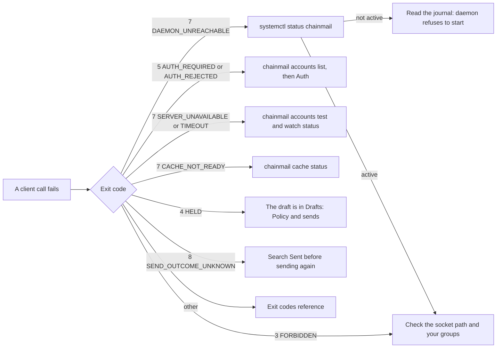

The Operations pages are for whoever keeps a production chainmail daemon running. They cover the daemon that the flake's NixOS module runs as `chainmail.service`, and a daemon you run yourself under plain systemd or launchd (see [Deploy](deploy.mdx)). Each entry gives the symptom or goal, the commands to run, what good output looks like, and what to do next.

For a first install, see the [quick start](../getting-started/quick-start.mdx). Maintainers publishing a new version start at [Releasing](../developers/releasing.md).

## Conventions

### Layout

The commands assume the layout the NixOS module creates. On another host, substitute your own paths and names.

| What | Where |
|---|---|
| Unit | `chainmail.service`, description `chainmail policy daemon` |
| Daemon user and group | `chainmail:chainmail` |
| Client group | `chainmail-clients`, members may use the socket |
| Config | `/etc/chainmail/config.toml`, mode `0444`, rendered from `services.chainmail.settings` |
| State directory | `/var/lib/chainmail`, mode `0700`: `vault.age`, `state.db`, `cache.db` and `uploads/` |
| Socket | `/run/chainmail/chainmail.sock`, mode `0660`, group `chainmail-clients`, in a `0755` directory |
| Vault key | `$CREDENTIALS_DIRECTORY/vault-key`, from `LoadCredentialEncrypted=vault-key:<vaultKeyCredential>` |

The unit runs `chainmail daemon --config /etc/chainmail/config.toml` with `Restart=on-failure`, `RestartSec=5s` and `UMask=0077`. It restarts whenever the rendered config changes. On a host without the module, copy the `serviceConfig` in [`nix/module.nix`](https://github.com/yaklabco/chainmail/blob/main/nix/module.nix) into your own unit, and pass `--state-dir` and `--vault-key-file` when you do not use the defaults. [Deploy](deploy.mdx#a-systemd-unit) has such a unit.

### Shells and placeholders

Every block marked `sh` runs unchanged in bash and in fish 3.4 or later. Where a command needs shell state, the page shows it in bash and fish tabs. Pick your shell once and every page follows.

Values you fill in are written as quoted placeholders, such as `'<account>'`. Replace the text between the quotes. The quotes can stay. These are the placeholders the Operations pages use:

| Placeholder | Meaning |
|---|---|
| `'<account>'` | An account name from the config, as `chainmail accounts list` shows it |
| `'<client>'` | An `[oauth_clients.<name>]` name from the config |
| `'<folder>'` | A folder name as `chainmail folders` shows it |
| `'<ref>'` | A message ref, such as `cm1:work:Drafts:1793457333:12` |
| `'<group>'` | A watch group name |
| `'<item-id>'` | An item ID, such as `it_admin_work` |
| `'<host>'` | The NixOS configuration name in your host flake, such as `mailhost` |
| `'<backup-dir>'` | A directory only root can read, on the volume you back up |
| `'<label>'` | The label of your own launchd job, on macOS |
| `'<chainmail-checkout>'` | A clone of the chainmail repository |

### sudo and the socket

Use `sudo` only for the service and its files: `systemctl` changes, `journalctl` when your user cannot read the system journal, and anything under `/var/lib/chainmail`. Run the `chainmail` CLI as yourself, never with `sudo`. The daemon allows only its own user and members of `chainmail-clients`, so root gets `FORBIDDEN` unless root is in that group.

The CLI finds the socket from `--socket`, then the `CHAINMAIL_SOCKET` variable, then `socket` in `cli.toml`, then `/run/chainmail/chainmail.sock`. The commands on these pages rely on the default. A `CHAINMAIL_SOCKET`, or a `socket` line in `cli.toml`, left over from development points them at a dev daemon instead (see the last step of [moving a dev daemon's state](backup-restore.mdx#move-a-dev-daemons-state-to-production)). Add `--socket /run/chainmail/chainmail.sock` when in doubt. `chainmail admin status` shows `dev mode  false` for the production daemon.

### Logs

The daemon writes one JSON object per line to stderr, which systemd sends to the journal. Each line has `time`, `level` (`INFO`, `WARN` or `ERROR`) and `msg`, plus fields such as `account`, `folder` and `reason`. Log lines name accounts, folders and reason codes, never message content.

A failure that stops the daemon is printed as one line of JSON in the CLI's error form, such as `{"error":{"reason":"INTERNAL","message":"..."}}`, and the process exits non-zero.

## Triage

Start from the exit code of the call that failed. The [exit codes reference](../reference/exit-codes.md) lists every code and reason.



Where each branch leads:

- The daemon is not active: [The daemon refuses to start](start-stop.md#the-daemon-refuses-to-start).
- The socket or your groups: [The socket](#the-socket) below.
- `AUTH_REQUIRED` or `AUTH_REJECTED`: [Auth](auth.md).
- `SERVER_UNAVAILABLE` or `TIMEOUT`: [Accounts](#accounts) and [Watching](#watching) below, then [A folder stuck in reconnecting](watching.md#a-folder-stuck-in-reconnecting).
- `CACHE_NOT_READY`: [Item searches refused with CACHE_NOT_READY](items.md#item-searches-refused-with-cache_not_ready).
- `HELD`: [A held send](policy.md#a-held-send).
- `SEND_OUTCOME_UNKNOWN`: [Send outcome unknown](policy.md#send-outcome-unknown-exit-8).

## Is the daemon running

```sh
systemctl status chainmail --no-pager
```

Good output shows `Active: active (running)`, a `Main PID` and the command line `.../bin/chainmail daemon --config /etc/chainmail/config.toml`. The last journal lines under it are JSON from the daemon.

If it shows `activating (auto-restart)` or `failed`, the daemon exits at start. Go to [The daemon refuses to start](start-stop.md#the-daemon-refuses-to-start).

On macOS, with a launchd job you made:

```sh
sudo launchctl print system/'<label>'
```

Look for `state = running`. The daemon's log goes wherever the job's `StandardErrorPath` points.

## Read the daemon's log

```sh
sudo journalctl -u chainmail -o cat -n 100 --no-pager
sudo journalctl -u chainmail -o cat --since '1 hour ago' --no-pager | grep -v '"level":"INFO"'
sudo journalctl -u chainmail -o cat -b --no-pager | grep '"msg":"daemon listening"'
```

`-o cat` prints only the JSON, without journald's prefix. The second command shows warnings and errors only. The third shows each start since boot.

A healthy start logs these lines, in this order, within a second or two of `Starting chainmail policy daemon...`:

```
{"time":"...","level":"INFO","msg":"watching accounts","accounts":["work","site"]}
{"time":"...","level":"INFO","msg":"caching accounts","accounts":["work","site"]}
{"time":"...","level":"INFO","msg":"daemon listening","addr":"/run/chainmail/chainmail.sock","dev":false}
```

`cache backfill started` lines for each folder follow on a fresh cache. With the cache off for every account, there is no `caching accounts` line, and `the cache is disabled for every account` comes before `watching accounts`.

Lines worth acting on:

| Message | Level | Meaning | See |
|---|---|---|---|
| `sends left in progress by an earlier daemon now have an unknown outcome` | WARN | The last daemon died during a send. `count` says how many. | [Send outcome unknown](policy.md#send-outcome-unknown-exit-8) |
| `send outcome unknown` | WARN | A send lost its connection after handing the message over. Has `account` and `message_id`. | [Send outcome unknown](policy.md#send-outcome-unknown-exit-8) |
| `watching is parked until the account is authenticated` | WARN | An account needs a login or a secret. | [Auth](auth.md) |
| `watch connection failed` | WARN | A watched folder's connection failed. `reason` says why. It reconnects by itself. | [A folder stuck in reconnecting](watching.md#a-folder-stuck-in-reconnecting) |
| `a watched folder does not exist` | WARN | A folder in `watch` is missing on the server. | [A folder in error](watching.md#a-folder-in-error) |
| `server refused a watch connection for its connection limit` | WARN | The account is out of IMAP connections. | [Connection limits](connection-limits.md) |
| `server refused a connection; recorded the connection limit` | INFO | The pool shrank by one after a refusal. | [Connection limits](connection-limits.md) |
| `recreating cache.db` | WARN | `reason` is `version`, `corrupt` or `unknown_tables`. The cache rebuilds. | [Corruption](cache.md#corruption) |
| `cache.db could not be opened; searches and reads use the mail servers` | ERROR | The cache is off until a restart opens it. | [Corruption](cache.md#corruption) |
| `the disk holding cache.db is full; searches and reads use the mail servers until a write succeeds, retried hourly` | WARN | Disk full. | [A full disk](cache.md#a-full-disk) |
| `cache.db is over max_size with message headers alone; raise [cache] max_size` | WARN | `over_cap`. | [Over cap](cache.md#over-cap) |
| `audit write failed` | ERROR | Calls fail, because chainmail never reports a call it could not audit. Usually a full disk. | [A full disk](cache.md#a-full-disk) |
| `trimming the event log failed` | ERROR | The event log is not being trimmed. Usually a full disk. | [Event log retention](watching.md#event-log-retention) |

## The socket

```sh
ls -ld /run/chainmail /run/chainmail/chainmail.sock
id -nG
getent group chainmail-clients
```

Good output:

```
drwxr-xr-x 2 chainmail chainmail          60 Nov  6 08:00 /run/chainmail
srw-rw---- 1 chainmail chainmail-clients   0 Nov  6 08:00 /run/chainmail/chainmail.sock
```

`id -nG` must list `chainmail-clients`, and `getent group chainmail-clients` must name your user. On macOS, use `dseditgroup -o checkmember -m "$USER" chainmail-clients` in place of `getent`.

What the failures look like:

- No socket file: the daemon is down, or its `daemon.socket` is elsewhere. A client prints `DAEMON_UNREACHABLE` (exit 7) with `connect: no such file or directory` and the hint `is the chainmail daemon running? check --socket or CHAINMAIL_SOCKET`.
- `connect: permission denied` with `DAEMON_UNREACHABLE`: your session is not in `chainmail-clients`. Group membership applies to new logins only. Log in again, or on Linux run one command under the group with `sg chainmail-clients -c 'chainmail admin status'`. On NixOS, add the user to `services.chainmail.clientUsers` first.
- `FORBIDDEN` (exit 3) with the hint `your user may not use this daemon socket; join its client group`: the socket accepted the connection, but the daemon's peer check refused you. On Linux the daemon reads `/etc/passwd` and `/etc/group` directly, so a user or membership that exists only in LDAP or SSSD is refused. Root is refused too.

The [security model](../concepts/security-model.md) explains the peer check.

## Daemon status

```sh
chainmail admin status --socket /run/chainmail/chainmail.sock --output table
```

Good output starts with the daemon's details, then the sync table and the cache table:

```
version   0.2.0
started   Thu, 05 Nov 2026 08:00 PST
dev mode  false
secrets   accounts/site, oauth_clients/workspace, tokens/work

ACCOUNT  FOLDER            MODE  STATE     CONDSTORE  LAST SYNC         LAST SWEEP        ERROR
site     INBOX             idle  watching  true       2026-11-06 11:40  2026-11-06 11:02  -
work     [Gmail]/All Mail  idle  watching  true       2026-11-06 11:41  2026-11-06 11:05  -

ACCOUNT  CACHE  STATE  BUDGET TODAY         ERROR
site     on     ready  2.5 MiB of 1.0 GiB   -
work     on     ready  60.6 KiB of 1.0 GiB  -
```

Check that `version` is the release you deployed, `dev mode` is `false`, and every secret the config needs is listed: `accounts/<account>` for each password account, `oauth_clients/<client>` for each OAuth client and `tokens/<account>` for each OAuth2 account. A release build reports its version, such as `0.2.0`. A build from the flake reports the first 7 characters of its commit, or `dirty`. The JSON form has `version`, `started_at`, `dev_mode`, `secret_names`, `sync` and `cache`. `admin status` is not audited.

## Accounts

```sh
chainmail accounts list --output table
chainmail accounts test '<account>' --output table
```

Good `accounts list` output has `ok` in the `STATE` column for every account. `auth required` there means a human must act, and `DETAIL` says what to run (see [Auth](auth.md)). In JSON the fields are `auth_state` (`AUTH_STATE_OK` or `AUTH_STATE_REQUIRED`) and `auth_detail`. `capabilities` holds the effective `allow_expunge` and `allow_folder_delete` for each account.

To list only the accounts that need a human:

```sh
chainmail accounts list --output json | jq -r '.accounts[] | select(.auth_state == "AUTH_STATE_REQUIRED") | .name + ": " + .auth_detail'
```

`accounts test` logs in to IMAP, then SMTP. Good output:

```
CHECK  OK    REASON  LATENCY  ERROR
imap   true          182ms
smtp   true          240ms
```

A failed check still prints the table, then exits 5 when a server rejected the credentials, otherwise with the first failed check's code. `REASON` is `AUTH_REJECTED`, `SERVER_UNAVAILABLE` or `TIMEOUT`. When the IMAP login is rejected, SMTP is not tried. When the account lacks a secret or already needs a human, no check runs and the command fails with `AUTH_REQUIRED` (exit 5). `accounts test` is audited as `account.test`.

## Watching

```sh
chainmail watch status --output table
```

Every folder should be `watching` (mode `idle`) or `polling` (mode `poll`) with `ERROR` shown as `-` and a recent `LAST SYNC`. A polled folder's last sync is at most `sync.poll` old, `5m` by default. The other states are `baselined` (a first sync just ran), `reconnecting`, `auth_required` and `error`. See [Watching and events](watching.md). `watch status` is not audited.

## Cache

```sh
chainmail cache status --output table
```

Good output after the first backfill shows every account `ready`, and a `size` line well under the cap:

```
size  474.5 MiB of 2.0 GiB

ACCOUNT  CACHE  STATE  BUDGET TODAY         ERROR
site     on     ready  2.5 MiB of 1.0 GiB   -
```

A third table lists each folder with `HEADERS`, `BACKFILL`, `BODIES`, `WINDOW`, `FAILED`, `UNREADABLE` and `ATTACH UNKNOWN`. The other states are covered in [The cache in operation](cache.md). `cache status` is not audited.

## The audit log

`chainmail audit` lists audit rows, newest first. It is not itself audited.

```sh
chainmail audit --since 1h --output table
chainmail audit --since 24h --action send --output table
chainmail audit --since 168h --account '<account>' --action expunge --output table
chainmail audit --since 24h --limit 1000 --output json
```

| Flag | Default | Meaning |
|---|---|---|
| `--since` | `24h` | How far back, as a Go duration such as `90m` or `168h`. Days are not accepted. |
| `--account` | all | Only this account's rows. An unknown account fails with `INVALID_ARGUMENT`. |
| `--action` | all | One action, such as `send`, `draft.send`, `expunge`, `folders.delete`, `cache.rebuild` or `item.delete`. [The audit log](../guide/audit-log.md) lists every action. |
| `--limit` | `100` | Rows per page, up to 1000. |
| `--before-id` | none | Older rows only. Pass the previous page's `next_before_id`. |

The table's columns are `AT`, `ACTION`, `ACCOUNT`, `DECISION`, `RESULT`, `REASON` and `TARGETS`. The JSON entries also have `id`, `caller_uid` and `client`. `client` is `cli`, `mcp`, `live-test` or `daemon`, as the caller claims it, and `caller_uid` is the authoritative identity from the socket. `next_before_id` is `"0"` on the last page.

Useful decisions: `allowed` (the policy passed a send), `held`, `denied` (a refused `expunge` or `folder delete`), `duplicate` (a replayed send or item create) and `dry_run`. Rows never hold recipients, subjects, bodies, item text or secrets.

To page back:

```sh
chainmail audit --since 168h --before-id '<next_before_id>' --output table
```
